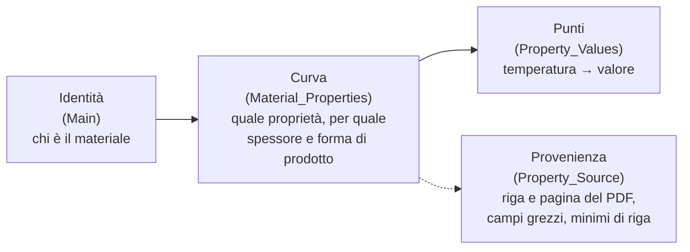
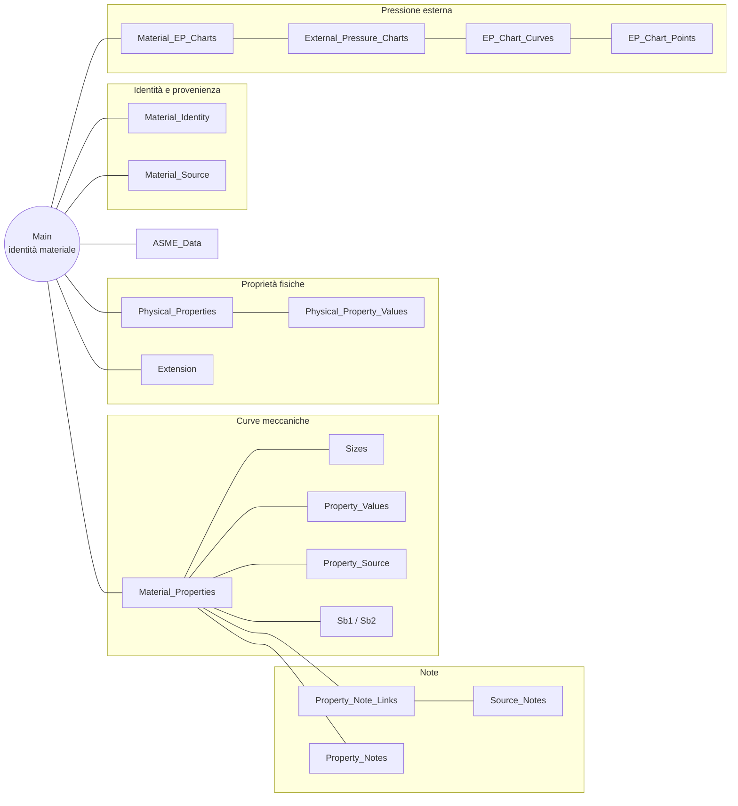
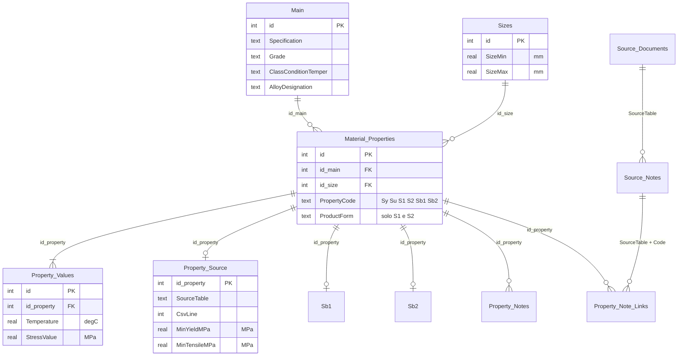
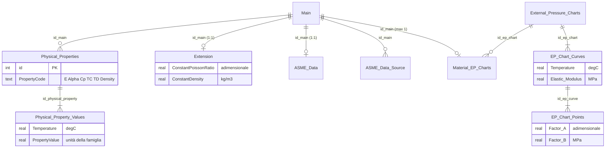
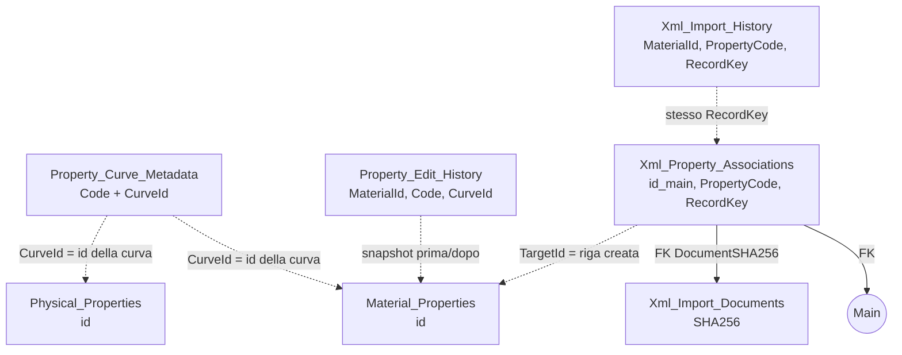
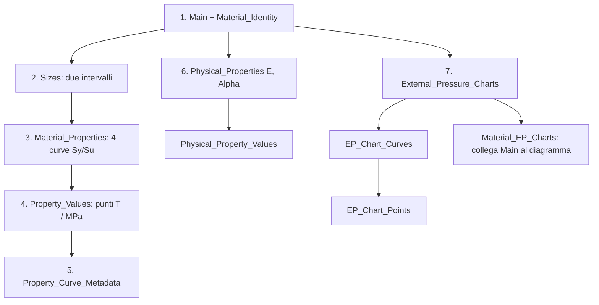
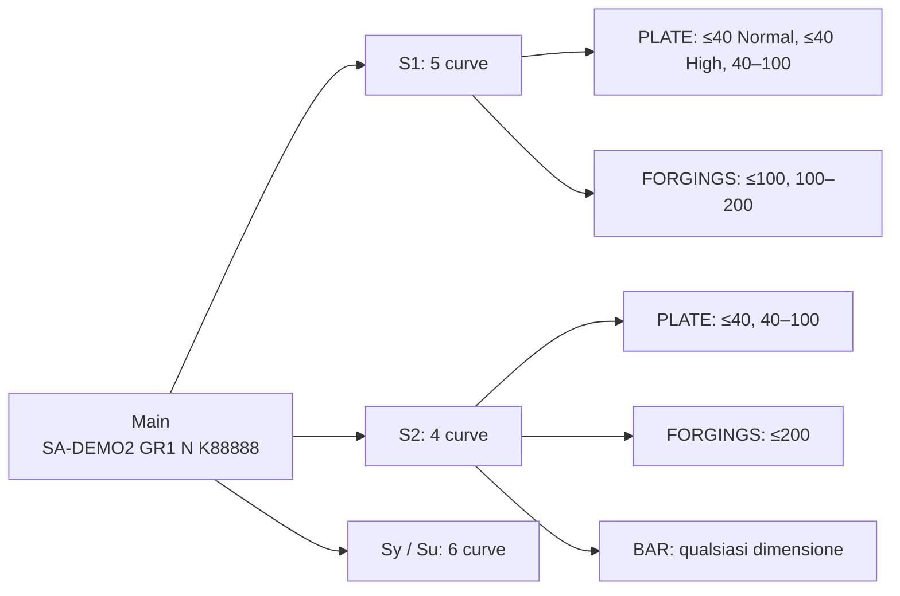
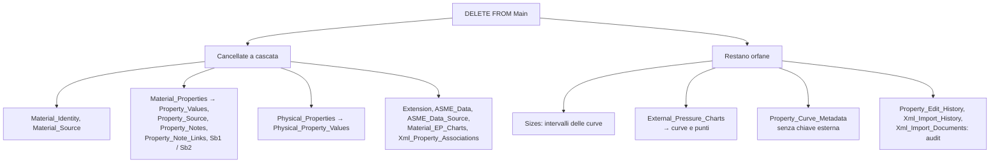

# Struttura del database ASME

**Percorso 1: dati.** Per operare sui dati vedere [app desktop](desktop-app.md).

**Indice.** [Prologo: filosofia e confronto](#prologo-la-filosofia-di-questa-organizzazione) · [1. File](#1-quale-file-contiene-cosa) · [2. Catalogo delle tabelle](#2-catalogo-delle-tabelle) · [3. Identità](#3-identità-del-materiale) · [4. Relazioni](#4-relazioni-fra-le-tabelle) · [5. Famiglie e unità](#5-famiglie-e-unità-native) · [6. Fonte e modifiche locali](#6-fonte-ufficiale-e-modifiche-locali) · [7. Legacy](#7-cosa-resta-legacy) · [8. Verifica](#8-verifica-e-aggiornamento) · [9. Esempi di lettura](#9-esempi-pratici) · [10. Creare materiali e scheda prodotto](#10-esempi-creare-un-materiale-s1s2-bolting-e-scheda-prodotto) · [11. Cancellare un materiale](#11-esempio-cancellare-un-materiale) · [12. Modificare un dato](#12-esempi-modificare-un-dato) · [13. Robustezza](#13-rendere-larchitettura-più-robusta) · [14. Sintesi del controllo](#14-sintesi-del-controllo-di-robustezza)

## Prologo: la filosofia di questa organizzazione

### Il problema di partenza

Le tabelle ASME Section II-D (e le analoghe norme EN) sono **pagine pensate per essere
lette da una persona**: una riga per ogni combinazione di specifica, grado, condizione,
forma di prodotto e spessore, e una colonna per ogni temperatura (`≤40 °C`, `≤65 °C`,
`≤100 °C`, …). Ogni tabella (1A, 1B, 5A, 5B, 3, 4, Sy, Su, E, Alpha, …) ha il proprio
elenco di colonne, le proprie note e i propri casi particolari (`NP`, `…`, valori
tra parentesi, note di riga). Un software di calcolo però non cerca «la riga 7 di pagina 8»:
vuole **il valore di una proprietà di un materiale a una data temperatura, per un dato
spessore**.

Le soluzioni possibili sono due:

1. **Clone piatto**: una tabella del database per ogni tabella del PDF, con le stesse
   colonne (una colonna per temperatura) e una riga per riga stampata.
2. **Modello normalizzato** (questo): si separa *che cosa è il materiale*, *quali curve
   ha* e *quali punti compongono ogni curva*, conservando però per ogni curva la riga
   originale da cui deriva.

### Idea di fondo: tre livelli



- **Identità**: quattro soli campi (Specification, Grade, ClassConditionTemper, UNS).
  Forma di prodotto, spessore e variante non creano materiali nuovi.
- **Curva**: una proprietà (Sy, Su, S1, E, Alpha, …) valida per un intervallo di
  spessore e, per S1/S2, una forma di prodotto. È l'unità che si legge, si modifica e si
  cancella.
- **Punto**: una coppia temperatura/valore. Ogni curva ha *le sue* temperature.
- **Provenienza**: ogni curva ricorda da quale riga di quale tabella proviene, con i campi
  originali in JSON. Il PDF non va perso: resta la fonte di verità.

I principi guida sono quattro: **l'identità non dipende dal formato di stampa**, **ogni
dato ha le sue unità e le sue temperature**, **la fonte ufficiale è immutabile** e **le
modifiche locali stanno accanto, non sopra**.

### Confronto con un clone piatto delle tabelle PDF

Esempio: la tensione ammissibile S1 di SA-516 Gr. 70. Nel PDF è *una riga* con decine
di colonne di temperatura (da `≤40 °C` a `≤900 °C`); qui è una curva da 18 punti (§9.2). Nel database nativo
l'importazione di 10 tabelle sorgente (10.709 righe) produce 2.532 materiali, 9.390 curve
e 149.029 punti.

| Aspetto | Clone piatto del PDF | Modello normalizzato |
|---|---|---|
| **Temperature diverse per Sy, Su, E, Alpha, …** | Ogni tabella ha le sue colonne; per confrontare o combinare due proprietà servono mappature manuali colonna per colonna | Ogni curva ha i suoi punti: Sy a 40, 65, 100 °C e E a 20, 100, 200 °C convivono senza forzare una griglia comune |
| **Spessori diversi fra Sy e Su** (come in EN, dove snervamento e rottura dipendono da intervalli di spessore propri) | Il confronto Sy/Su richiede di allineare righe con intervalli diversi; facile accoppiare la riga sbagliata | Ogni curva ha il proprio intervallo (`Sizes`), con estremi inclusi/esclusi: Sy può avere tre intervalli e Su due |
| **Più varianti per lo stesso materiale** (forma di prodotto, spessore, livello di tensione) | O si duplicano le righe di identità oppure si usa una chiave a più campi che ogni query deve ripetere | Un solo `Main`, tante curve (§9.4) |
| **Valori mancanti o non permessi** (`NP`, `…`, vuoto) | Il carattere finisce in una colonna numerica o diventa 0 | Il punto semplicemente non esiste; `NP` e limiti qualificati restano nella provenienza e nei limiti di curva |
| **Unità e temperature** | Nomi di colonna come `≤100 °C, MPa`, unità implicite nel titolo | Un'unità fissa per famiglia (§5), temperatura numerica in °C |
| **Interpolazione e ricerca** | Bisogna interpretare i nomi delle colonne | Una query su coppie numeriche ordinate; nessuna estrapolazione |
| **Nuove proprietà** (c, k, a, densità, Nu) | Una nuova tabella con una nuova struttura per ciascuna | Si aggiunge un `PropertyCode`, senza cambiare lo schema |
| **Aggiornamento di edizione** | Si sostituisce il blocco, ma l'identità dei materiali non è stabile fra edizioni | La chiave naturale a 4 campi permette di confrontare edizioni e di preservare le modifiche locali |
| **Modifiche dell'utente** | Si sovrascrive il dato ufficiale | Il dato ufficiale resta; note utente, limiti e storico stanno in tabelle separate |
| **Fedeltà visiva al PDF** | Massima: una riga = una riga stampata | Indiretta: va ricostruita da `Property_Source`, `Property_Values` e dalle viste `S1`/`S2` |
| **Semplicità della query** | Una `SELECT` su una sola tabella | Più join (materiale → curva → punti → dimensione) |
| **Semplicità dell'importazione** | Quasi un `CSV → tabella` | Importatore con regole su identità, deduplicazione, righe escluse e provenienza |

### Vantaggi in sintesi

- **Correttezza**: il lookup non può mescolare per errore spessori, forme di prodotto o
  temperature di proprietà diverse.
- **Tracciabilità**: da ogni valore si risale a tabella, pagina e riga del documento.
- **Estendibilità**: nuove famiglie, curve utente e dati da XML entrano senza modificare le
  tabelle esistenti.
- **Separazione fra fonte e modifica**: il riferimento resta intatto; ogni intervento è
  nella copia di lavoro e annotato nello storico.
- **Interoperabilità**: strutture semplici (curva + punti) facili da esporre a C#, Python
  e C++ e da serializzare in JSON/XML.
- **Controlli di qualità**: viste come `VW_Missing_Strength` rendono visibili i buchi.

### Svantaggi e costi

- **Più complessità**: per leggere un valore servono più tabelle; le viste `S1`/`S2`
  e il codice di lookup nascondono i join ma non li eliminano.
- **Distanza dal PDF**: confrontare «a occhio» una riga stampata con il database richiede
  uno strumento (editor o query), non un colpo d'occhio.
- **Integrità da difendere**: alcune regole non sono imposte dallo schema, ad esempio la
  non sovrapposizione degli intervalli di spessore, la coerenza fra `Sb1`/`Sb2` e
  `Material_Properties`, la sincronia `Main`/`Material_Identity` (§10–§12).
- **Dati orfani**: `Sizes`, diagrammi EP e metadati non hanno un proprietario unico; una
  cancellazione ingenua li lascia indietro (§11).
- **Righe di `Sizes` condivise**: risparmiano spazio ma una modifica sul posto cambia più
  curve (§12.6).
- **Tabelle previste ma vuote**: lo schema comprende stress-strain, creep, ciclico e
  Larson–Miller; l'esistenza di una tabella non vuol dire che i dati ci siano.
- **Costo di importazione e di manutenzione**: aggiornare l'edizione ASME richiede il
  DatabaseUpdater e verifiche, non una semplice sostituzione di tabelle.
- **Peso**: più righe piccole (149.029 punti) invece di poche righe larghe; sul volume
  attuale non è un problema, ma lo spazio e il numero di scritture per curva crescono.

Come ridurre questi svantaggi, con prove su una copia del riferimento, vedere la §13.

### Altre scelte di progetto

- **Identità a 4 campi**: un UNS comune non fonde specifiche o condizioni diverse; il
  prezzo è che lo stesso acciaio commerciale può comparire in più righe di `Main`.
- **Minimi scalari separati dalle curve** (`SMYS`/`SMUS`): comodi per ricerca, ma `NULL`
  quando la fonte ha più valori; i minimi per riga stanno in `Property_Source`.
- **Nessuna estrapolazione e nessuna scelta implicita**: «prima curva» o «valore a 0»
  sono vietati; se i dati non bastano il risultato è «non trovato».
- **Unità SI fisse** (MPa, °C, mm, …): niente conversioni a runtime, ma le fonti in altre
  unità devono essere convertite prima dell'importazione.
- **Normativa per curva, non per materiale**: i limiti per Section appartengono alla
  riga sorgente; `ASME_Data` ne conserva solo la sintesi non ambigua.
- **Pressione esterna come diagramma condiviso**: evita duplicati ma obbliga a
  copiare il diagramma prima di cambiarne uno condiviso (§12.8).
- **Schema nativo ≠ documento `Material`**: il modello JSON/XML serve allo scambio e ai
  materiali personalizzati; non è un backup del database (§7).

In breve: il clone piatto è più semplice da costruire e da confrontare col PDF, il modello
normalizzato è più semplice e sicuro da **usare, estendere e verificare** nel calcolo.
Questo documento descrive il secondo e come tornare, quando serve, alla vista del primo (la riga stampata affiancata alla curva: §13.8).

## 1. Quale file contiene cosa

| File/dataset | Ruolo |
|---|---|
| [materials_2025.db](../database/data/materials_2025.db) | Riferimento attivo, con schema nativo normalizzato: dati meccanici da `database/sources` e proprietà fisiche dagli XML (senza revisione manuale richiesta) |
| `%LOCALAPPDATA%\MaterialLibrary\ASME2025\materials_2025.working.db` | Copia locale predefinita modificabile dall'app e dall'editor Excel |
| [XML fisici](../database/data/physical-properties-xml/) | Dati candidati con fonte e chiavi di associazione; non automaticamente presenti in SQLite |
| [XML pressione esterna](../database/data/external-pressure-xml/) | Dataset di tipi diversi, non tutti importabili come proprietà materiale |
| Libreria JSON/XML | Documenti del modello `Material`, per scambio e materiali personalizzati; non un backup completo del database nativo |
| [ASME_Materials_2023.db](../database/data/archive/2023/ASME_Materials_2023.db) | Archivio legacy, aperto solo esplicitamente |

Il progetto copia e impacchetta il riferimento e gli XML sotto `data/`. L'archivio 2023
non è distribuito come fallback.

**Stato del riferimento attuale** (`materials_2025.db`, rigenerato dai CSV di `database/sources` e dagli XML di `database/data`):
2.532 righe `Main`, 9.390 curve meccaniche e 149.029 punti, più le proprietà fisiche importate dagli XML
**senza revisione manuale e con un solo candidato per materiale e famiglia**: E (1.850 materiali), Alpha (1.746),
AlphaInstantaneous (1.746), k (1.750), a (1.701), 213.999 punti e le costanti di densità
(1.087) e di Poisson (1.087) in `Extension`; la provenienza di ognuna delle 10.967 associazioni è in
`Xml_Property_Associations` (con i 13 documenti XML in `Xml_Import_Documents`). **Non** sono importati i record che richiedono revisione
(Code Case e simili: 2.400 proposte) né i diagrammi di pressione esterna, che negli XML distribuiti sono estrazioni grezze. Calore specifico `c`: nessun dato.
Un'associazione importata non equivale a un'applicabilità approvata: controllare note, limiti e composizione (vedere
[importazione XML](xml-physical-import.md)). Per una copia modificata, verificare sempre il suo contenuto effettivo.

<!-- catalog:begin (generato da tools/Generate-DatabaseCatalog.ps1; non modificare a mano) -->

## 2. Catalogo delle tabelle

Questo capitolo descrive **tutte** le tabelle e le viste del database: scopo, colonne, tipi,
vincoli (chiavi primarie ed esterne, `UNIQUE`, `CHECK`, indici, trigger) e chi le scrive. I
capitoli seguenti spiegano come usarle insieme; qui si consulta una tabella alla volta.

> Questo capitolo è **generato** dallo schema reale con `tools/Generate-DatabaseCatalog.ps1`:
> non modificarlo a mano (le modifiche andrebbero perse alla prossima rigenerazione).

### 2.1 Come leggere il catalogo

- **Origine.** Le tabelle del *riferimento* esistono in `materials_2025.db`. Le tabelle
  delle *copie di lavoro* nascono solo quando si apre una copia con l'app (editor)
  e sono segnate come tali. Il rafforzamento (§13.3) aggiunge indici, trigger e viste alle sole copie di lavoro.
- **Colonne.** `PK` = chiave primaria (`n/m` per le chiavi composte); `FK → Tabella.colonna` = chiave
  esterna; `CASCADE` = la cancellazione della riga padre cancella le figlie; `senza azione` = la
  chiave esterna blocca la cancellazione della riga referenziata.
- **Tipi.** Dichiarati come nello schema SQLite (`INTEGER`, `REAL`, `TEXT`, `BOOLEAN`); SQLite
  non li impone rigidamente, quindi i vincoli sotto sono quelli che contano.
- **Unità fisse.** Temperature in °C, tensioni in MPa, dimensioni in mm, altre unità indicate nella
  colonna *Note* (§5).
- **Foreign keys.** Per il funzionamento a cascata ogni connessione deve eseguire `PRAGMA foreign_keys = ON`.
- **Conteggi** riferiti al riferimento 2025.

### 2.2 Panoramica

| Tabella | Gruppo | Origine | Righe nel riferimento |
|---|---|---|---|
| `Main` | Identità e provenienza dell'identità | riferimento | 2.532 |
| `Material_Identity` | Identità e provenienza dell'identità | riferimento | 2.532 |
| `Material_Source` | Identità e provenienza dell'identità | riferimento | 10.709 |
| `Sizes` | Curve meccaniche | riferimento | 331 |
| `Material_Properties` | Curve meccaniche | riferimento | 9.390 |
| `Property_Values` | Curve meccaniche | riferimento | 149.029 |
| `Property_Source` | Curve meccaniche | riferimento | 9.390 |
| `Sb1` | Curve meccaniche | riferimento | 241 |
| `Sb2` | Curve meccaniche | riferimento | 74 |
| `Source_Notes` | Note | riferimento | 414 |
| `Property_Note_Links` | Note | riferimento | 8.643 |
| `Property_Notes` | Note | riferimento | 12.392 |
| `Physical_Properties` | Proprietà fisiche e costanti | riferimento | 8.793 |
| `Physical_Property_Values` | Proprietà fisiche e costanti | riferimento | 213.999 |
| `Extension` | Proprietà fisiche e costanti | riferimento | 1.087 |
| `External_Pressure_Charts` | Pressione esterna | riferimento | 0 |
| `Material_EP_Charts` | Pressione esterna | riferimento | 0 |
| `EP_Chart_Curves` | Pressione esterna | riferimento | 0 |
| `EP_Chart_Points` | Pressione esterna | riferimento | 0 |
| `ASME_Data` | Applicabilità normativa | riferimento | 2.336 |
| `ASME_Data_Source` | Applicabilità normativa | riferimento | 30.507 |
| `Source_Documents` | Audit dell'importazione ASME | riferimento | 10 |
| `Import_Files` | Audit dell'importazione ASME | riferimento | 113 |
| `Import_Omitted_Rows` | Audit dell'importazione ASME | riferimento | 43 |
| `Database_Metadata` | Audit dell'importazione ASME | riferimento | 9 |
| `Stress_Strain_Curves` | Modelli previsti ma non popolati | riferimento | 0 |
| `Stress_Strain_Points` | Modelli previsti ma non popolati | riferimento | 0 |
| `Creep_Rupture_Data` | Modelli previsti ma non popolati | riferimento | 0 |
| `Larson_Miller_Parameters` | Modelli previsti ma non popolati | riferimento | 0 |
| `Larson_Miller_Curve_Points` | Modelli previsti ma non popolati | riferimento | 0 |
| `Stress_Strain_Model_Parameters` | Modelli previsti ma non popolati | riferimento | 0 |
| `Cyclic_Curve_Header` | Modelli previsti ma non popolati | riferimento | 0 |
| `Cyclic_Curve_Values` | Modelli previsti ma non popolati | riferimento | 0 |
| `Omega_Method_Parameters` | Modelli previsti ma non popolati | riferimento | 0 |
| `Xml_Import_Documents` | Provenienza dell'importazione XML | riferimento | 13 |
| `Xml_Property_Associations` | Provenienza dell'importazione XML | riferimento | 10.967 |
| `Xml_Import_History` | Provenienza dell'importazione XML | riferimento | 0 |
| `Property_Curve_Metadata` | Tabelle delle copie di lavoro | copia di lavoro | — |
| `Property_Edit_History` | Tabelle delle copie di lavoro | copia di lavoro | — |
| `Sql_Change_Log` | Tabelle delle copie di lavoro | opzionale | — |

In totale 37 tabelle nel riferimento, 2 tabelle create nelle copie di lavoro (più `Sql_Change_Log` se attivata) e 10 viste.

### 2.3 Identità e provenienza dell'identità

#### `Main`

Un materiale = una riga: l'identità a quattro campi (specifica, grado, classe/condizione/tempra, UNS) più composizione nominale e i minimi scalari. È il perno del database: ogni altra tabella dei dati del materiale vi si collega con `id_main`. Forma di prodotto, spessore e variante della curva **non** creano nuove righe.

- **Righe nel riferimento:** 2.532
- **Chi la scrive:** Importatore ASME (DatabaseUpdater); editor (identità) nelle copie di lavoro.

| Colonna | Tipo | Vincoli | Note |
|---|---|---|---|
| `id` | INTEGER | PK AUTOINCREMENT | Chiave tecnica |
| `Revision` | TEXT(30) | — | Revisione della fonte (spesso NULL) |
| `NominalComposition` | TEXT | — | Composizione nominale, es. `Carbon steel` |
| `Specification` | TEXT(30) | NOT NULL | Specifica, es. `SA-516` |
| `Grade` | TEXT(30) | — | Grado |
| `ClassConditionTemper` | TEXT(30) | — | Classe/condizione/tempra |
| `AlloyDesignation` | TEXT(30) | — | UNS |
| `SMYS` | REAL | — | Snervamento minimo scalare, MPa; NULL se la fonte ha più valori |
| `SMUS` | REAL | — | Rottura minima scalare, MPa; NULL se ambigua |
| `ElongationAtRuptureLong` | REAL | — | Allungamento longitudinale, % |
| `ElongationAtRuptureTransv` | REAL | — | Allungamento trasversale, % |

**Vincoli e strutture nel riferimento:**

- indice `UX_Main_FourFieldIdentity` (univoco) sui quattro campi di identità: `Specification`, `Grade`, `ClassConditionTemper`, `AlloyDesignation`, con NULL trattato come stringa vuota e confronto senza distinzione fra maiuscole e minuscole

#### `Material_Identity`

Chiave naturale testuale del materiale, array JSON `[Specification, Grade, ClassConditionTemper, UNS]` in maiuscolo, per confrontare identità fra edizioni e garantirne l'unicità. Una riga per `Main`.

- **Righe nel riferimento:** 2.532
- **Chi la scrive:** Importatore ASME; editor (identità).

| Colonna | Tipo | Vincoli | Note |
|---|---|---|---|
| `id_main` | INTEGER | PK; FK → `Main.id` (CASCADE) | Materiale |
| `NaturalKey` | TEXT | NOT NULL | Array JSON `["SA-516","70","","K02700"]`; confrontare dopo l'analisi del JSON (l'escaping varia) |

**Vincoli e strutture nel riferimento:**

- `NaturalKey` univoco

#### `Material_Source`

Righe CSV del documento ASME da cui ha origine ogni identità (anche più righe per un materiale). Conserva la riga grezza e un'impronta per ricostruire e confrontare l'importazione.

- **Righe nel riferimento:** 10.709
- **Chi la scrive:** Importatore ASME.

| Colonna | Tipo | Vincoli | Note |
|---|---|---|---|
| `id_main` | INTEGER | NOT NULL; FK → `Main.id` (CASCADE) | Materiale |
| `SourceTable` | TEXT | NOT NULL | Tabella ASME (1A, 1B, 2A, …) |
| `File` | TEXT | PK 1/2 | File CSV |
| `CsvLine` | INTEGER | PK 2/2 | Riga nel CSV |
| `RawFieldsJson` | TEXT | NOT NULL | Riga CSV originale come JSON |
| `Fingerprint` | TEXT | NOT NULL | Hash della riga |

**Vincoli e strutture nel riferimento:**

- chiave primaria composta `(File, CsvLine)`
- indice `IDX_MaterialSource_Main` su `id_main`

### 2.4 Curve meccaniche

#### `Sizes`

Intervalli di spessore/dimensione (mm) con estremi inclusi o esclusi. Le righe sono **condivise** da più curve (277 su 331 nel riferimento) e non hanno chiave naturale: per cambiare l'intervallo di una curva si crea una riga nuova e si ricollega la curva.

- **Righe nel riferimento:** 331
- **Chi la scrive:** Importatore ASME; editor (una riga nuova per ogni salvataggio di curva).

| Colonna | Tipo | Vincoli | Note |
|---|---|---|---|
| `id` | INTEGER | PK AUTOINCREMENT | Chiave tecnica |
| `SizeMin` | REAL | — | mm; NULL = nessun limite inferiore |
| `SizeMinIncluded` | BOOLEAN | — | 1 = estremo incluso (ignorato se SizeMin è NULL) |
| `SizeMax` | REAL | — | mm; NULL = nessun limite superiore |
| `SizeMaxIncluded` | BOOLEAN | — | 1 = estremo incluso (ignorato se SizeMax è NULL) |

**Aggiunte dal rafforzamento delle copie di lavoro (vedere §13.3):**

- trigger `Guard_Sizes_Immutable`: rifiuta ogni `UPDATE` (copy-on-write).

#### `Material_Properties`

Testata di una **curva meccanica**: materiale, famiglia (`Sy`, `Su`, `S1`, `S2`, `Sb1`, `Sb2`), intervallo di spessore e, solo per S1/S2, forma di prodotto. È l'unità che si legge, si modifica e si cancella.

- **Righe nel riferimento:** 9.390
- **Chi la scrive:** Importatore ASME; editor.

| Colonna | Tipo | Vincoli | Note |
|---|---|---|---|
| `id` | INTEGER | PK AUTOINCREMENT | Chiave tecnica |
| `id_main` | INTEGER | NOT NULL; FK → `Main.id` (CASCADE) | Materiale |
| `id_size` | INTEGER | FK → `Sizes.id` (CASCADE) | Riga di `Sizes` (obbligatoria in pratica: i lettori la uniscono con `Sizes`, una curva con `id_size` NULL non viene letta). Per «qualsiasi dimensione» si usa la riga con `SizeMin` e `SizeMax` entrambi NULL |
| `PropertyCode` | TEXT | NOT NULL | Famiglia: Sy, Su, S1, S2, Sb1, Sb2 |
| `ProductForm` | TEXT | — | Forma di prodotto (PLATE, FORGINGS, …); solo S1/S2 |

**Vincoli e strutture nel riferimento:**

- CHECK `PropertyCode IN ('S1','S2') OR ProductForm IS NULL`
- indice `IDX_MaterialProperties_Main_Code` su `id_main, PropertyCode`

**Aggiunte dal rafforzamento delle copie di lavoro (vedere §13.3):**

- indice `IDX_MaterialProperties_Size` su `id_size`
- trigger `Clean_Metadata_After_Mechanical_Delete`: elimina i metadati `(Code, CurveId)` della curva cancellata.
- trigger `Clean_Sizes_After_Curve_Delete`: elimina l'intervallo se nessuna curva né `Sb1`/`Sb2` lo usa più.
- trigger `Clean_Sizes_After_Curve_Repoint`: come sopra, quando la curva passa a un altro intervallo.
- trigger `Guard_MaterialProperties_Code_Insert`: rifiuta famiglie meccaniche sconosciute.
- trigger `Guard_MaterialProperties_Size_Insert`: rifiuta una curva meccanica senza riga di `Sizes` (`id_size` NULL): per «qualsiasi dimensione» serve la riga con `SizeMin` e `SizeMax` NULL.
- trigger `Sync_Sb_Size_From_Curve`: quando cambia `Material_Properties.id_size` di una curva Sb1/Sb2, allinea `Sb1`/`Sb2`.

#### `Property_Values`

Punti di una curva meccanica: una coppia temperatura (°C) / tensione (MPa) per riga.

- **Righe nel riferimento:** 149.029
- **Chi la scrive:** Importatore ASME; editor (riscrive tutti i punti della curva a ogni salvataggio).

| Colonna | Tipo | Vincoli | Note |
|---|---|---|---|
| `id` | INTEGER | PK AUTOINCREMENT | Chiave tecnica |
| `id_property` | INTEGER | NOT NULL; FK → `Material_Properties.id` (CASCADE) | Curva |
| `Temperature` | REAL | NOT NULL | °C |
| `StressValue` | REAL | NOT NULL | MPa |

**Vincoli e strutture nel riferimento:**

- indice `IDX_PropertyValues_Temp` su `id_property, Temperature`

**Aggiunte dal rafforzamento delle copie di lavoro (vedere §13.3):**

- indice `UX_PropertyValues_Curve_Temp` (univoco) su `id_property, Temperature`: una sola temperatura per curva
- trigger `Guard_PropertyValues_Insert`: rifiuta tensioni negative e temperature fuori −273,15…1200 °C.
- trigger `Guard_PropertyValues_Update`: come sopra, in modifica.
- sostituisce l'indice `IDX_PropertyValues_Temp` (non univoco)

#### `Property_Source`

Provenienza di una curva importata: tabella ASME, file e riga CSV, pagina, riga stampata (`RawFieldsJson`), asse dimensionale e minimi di snervamento/rottura della riga. I limiti applicabili alla curva si leggono qui, non in `ASME_Data`. Le curve create dall'utente non hanno questa riga (tranne Sb1/Sb2, per il trigger).

- **Righe nel riferimento:** 9.390
- **Chi la scrive:** Importatore ASME; editor solo per Sb1/Sb2 nuove (riga con `Fingerprint = 'User'`).

| Colonna | Tipo | Vincoli | Note |
|---|---|---|---|
| `id_property` | INTEGER | PK; FK → `Material_Properties.id` (CASCADE) | Curva |
| `SourceTable` | TEXT | NOT NULL | 1A, 1B, 3, 4, 5A, 5B, Sy, Su |
| `File` | TEXT | NOT NULL | File CSV |
| `CsvLine` | INTEGER | NOT NULL | Riga nel CSV |
| `Page` | TEXT | — | Pagina stampata |
| `SourceLine` | TEXT | — | Riga sulla pagina |
| `SourceRowNumber` | TEXT | — | Numero di riga della tabella |
| `SizeText` | TEXT | — | Testo dello spessore come stampato |
| `SizeAxis` | TEXT | NOT NULL | `thickness-or-unspecified`, `diameter`, `OD`, `DN` |
| `MinYieldMPa` | REAL | — | Snervamento minimo della riga, MPa |
| `MinTensileMPa` | REAL | — | Rottura minima della riga, MPa |
| `RawFieldsJson` | TEXT | NOT NULL | Riga stampata come JSON (colonne `<=T °C, MPa`, identità, note) |
| `Fingerprint` | TEXT | NOT NULL | Hash della riga; `User` per righe create dall'utente |

**Vincoli e strutture nel riferimento:**

- indice `IDX_PropertySource_Table` su `SourceTable`

#### `Sb1`

Marca le curve `Material_Properties` che sono bolting della Table 3 e ne ripete materiale e intervallo (dedicata e distinta da Sb2).

- **Righe nel riferimento:** 241
- **Chi la scrive:** Importatore ASME; editor per nuove curve Sb1.

| Colonna | Tipo | Vincoli | Note |
|---|---|---|---|
| `id_property` | INTEGER | PK; FK → `Material_Properties.id` (CASCADE) | Curva Sb1 (stessa chiave di `Material_Properties`) |
| `id_main` | INTEGER | NOT NULL; FK → `Main.id` (CASCADE) | Materiale |
| `id_size` | INTEGER | NOT NULL; FK → `Sizes.id` (senza azione) | Deve coincidere con `Material_Properties.id_size` |

**Vincoli e strutture nel riferimento:**

- trigger `Validate_Sb1_Insert`: BEFORE INSERT: accetta solo curve `Sb1` con fonte Table 3 e stesso materiale e intervallo della curva.

**Aggiunte dal rafforzamento delle copie di lavoro (vedere §13.3):**

- indice `IDX_Sb1_Main` su `id_main`
- trigger `Guard_Sb1_Update`: rifiuta un `id_size` diverso da quello della curva.

#### `Sb2`

Come `Sb1`, per il bolting della Table 4.

- **Righe nel riferimento:** 74
- **Chi la scrive:** Importatore ASME; editor per nuove curve Sb2.

| Colonna | Tipo | Vincoli | Note |
|---|---|---|---|
| `id_property` | INTEGER | PK; FK → `Material_Properties.id` (CASCADE) | Curva Sb2 (stessa chiave di `Material_Properties`) |
| `id_main` | INTEGER | NOT NULL; FK → `Main.id` (CASCADE) | Materiale |
| `id_size` | INTEGER | NOT NULL; FK → `Sizes.id` (senza azione) | Deve coincidere con `Material_Properties.id_size` |

**Vincoli e strutture nel riferimento:**

- trigger `Validate_Sb2_Insert`: BEFORE INSERT: accetta solo curve `Sb2` con fonte Table 4 e stesso materiale e intervallo della curva.

**Aggiunte dal rafforzamento delle copie di lavoro (vedere §13.3):**

- indice `IDX_Sb2_Main` su `id_main`
- trigger `Guard_Sb2_Update`: rifiuta un `id_size` diverso da quello della curva.

### 2.5 Note

#### `Source_Notes`

Testo ufficiale delle note di ogni tabella sorgente ASME, identificate da `(SourceTable, Code)`. `Kind` distingue le note generali della tabella (`General`) da quelle specifiche di riga (`Specific`).

- **Righe nel riferimento:** 414
- **Chi la scrive:** Importatore ASME. Non si modifica.

| Colonna | Tipo | Vincoli | Note |
|---|---|---|---|
| `SourceTable` | TEXT | PK 1/2 | Tabella ASME |
| `Code` | TEXT | PK 2/2 | Codice nota, es. `(a)` o `G10` |
| `Kind` | TEXT | NOT NULL | `General` o `Specific` |
| `NoteText` | TEXT | NOT NULL | Testo integrale |

**Vincoli e strutture nel riferimento:**

- chiave primaria composta `(SourceTable, Code)`

#### `Property_Note_Links`

Collega ogni curva alle note ufficiali che le si applicano (relazione n:m fra `Material_Properties` e `Source_Notes`). Le note `General` di una tabella si applicano senza collegamento esplicito (vista `VW_Property_Notes_All`).

- **Righe nel riferimento:** 8.643
- **Chi la scrive:** Importatore ASME.

| Colonna | Tipo | Vincoli | Note |
|---|---|---|---|
| `id_property` | INTEGER | PK 1/3; FK → `Material_Properties.id` (CASCADE) | Curva |
| `SourceTable` | TEXT | PK 2/3 | Tabella della nota |
| `Code` | TEXT | PK 3/3 | Codice della nota |

**Vincoli e strutture nel riferimento:**

- chiave primaria composta `(id_property, SourceTable, Code)`
- chiave esterna composta `(SourceTable, Code)` → `Source_Notes(SourceTable, Code)` (senza azione)

#### `Property_Notes`

Copia denormalizzata del testo delle note di ogni curva. `note_type` ha forma `Tabella:Codice` (es. `1A:G10`); `1A:RawCodes` è l'elenco grezzo dei codici stampati nella riga.

- **Righe nel riferimento:** 12.392
- **Chi la scrive:** Importatore ASME. Per annotare una curva si usano i metadati dell'editor, non questa tabella.

| Colonna | Tipo | Vincoli | Note |
|---|---|---|---|
| `id` | INTEGER | PK AUTOINCREMENT | Chiave tecnica |
| `id_property` | INTEGER | NOT NULL; FK → `Material_Properties.id` (CASCADE) | Curva |
| `note` | TEXT | NOT NULL | Testo della nota |
| `note_type` | TEXT | — | `Tabella:Codice` |

**Aggiunte dal rafforzamento delle copie di lavoro (vedere §13.3):**

- indice `IDX_PropertyNotes_Property` su `id_property`

### 2.6 Proprietà fisiche e costanti

#### `Physical_Properties`

Testata di una **curva fisica** di un materiale: `E`, `Alpha`, `AlphaInstantaneous`, `Cp`, `TC`, `TD`, `Density`, `Nu`. Non ha intervalli di spessore.

- **Righe nel riferimento:** 8.793
- **Chi la scrive:** Editor; importazione XML. Nel riferimento: curve E, Alpha, AlphaInstantaneous, k (TC) e a (TD) importate dagli XML senza revisione manuale.

| Colonna | Tipo | Vincoli | Note |
|---|---|---|---|
| `id` | INTEGER | PK AUTOINCREMENT | Chiave tecnica |
| `id_main` | INTEGER | NOT NULL; FK → `Main.id` (CASCADE) | Materiale |
| `PropertyCode` | TEXT | NOT NULL | `E`, `Alpha`, `AlphaInstantaneous`, `Cp`, `TC`, `TD`, `Density`, `Nu` |

**Vincoli e strutture nel riferimento:**

- indice `IDX_PhysicalProperties_Main_Code` su `id_main, PropertyCode`

**Aggiunte dal rafforzamento delle copie di lavoro (vedere §13.3):**

- trigger `Clean_Metadata_After_Physical_Delete`: elimina i metadati della curva fisica cancellata.
- trigger `Guard_PhysicalProperties_Code_Insert`: rifiuta famiglie fisiche sconosciute.

#### `Physical_Property_Values`

Punti di una curva fisica: temperatura (°C) e valore (unità della famiglia, vedi §5).

- **Righe nel riferimento:** 213.999
- **Chi la scrive:** Editor; importazione XML. Popolata nel riferimento.

| Colonna | Tipo | Vincoli | Note |
|---|---|---|---|
| `id` | INTEGER | PK AUTOINCREMENT | Chiave tecnica |
| `id_physical_property` | INTEGER | NOT NULL; FK → `Physical_Properties.id` (CASCADE) | — |
| `Temperature` | REAL | NOT NULL | °C |
| `PropertyValue` | REAL | NOT NULL | MPa (E), 1/°C (Alpha), J/(kg·K) (Cp), W/(m·K) (TC), m²/s (TD), kg/m³ (Density), adimensionale (Nu) |

**Vincoli e strutture nel riferimento:**

- indice `IDX_PhysicalValues_Temp` su `id_physical_property, Temperature`

**Aggiunte dal rafforzamento delle copie di lavoro (vedere §13.3):**

- indice `UX_PhysicalValues_Curve_Temp` (univoco) su `id_physical_property, Temperature`: una sola temperatura per curva
- trigger `Guard_PhysicalValues_Insert`: rifiuta temperature fuori −273,15…1200 °C.
- sostituisce l'indice `IDX_PhysicalValues_Temp` (non univoco)

#### `Extension`

Costanti per materiale: densità e coefficiente di Poisson, validi a ogni temperatura. Una sola riga per materiale; `NULL` = assente, mai un valore ipotizzato.

- **Righe nel riferimento:** 1.087
- **Chi la scrive:** Editor (costanti); importazione XML (costanti). Nel riferimento: densità e Poisson dei materiali associati agli XML senza revisione manuale.

| Colonna | Tipo | Vincoli | Note |
|---|---|---|---|
| `id` | INTEGER | PK AUTOINCREMENT | Chiave tecnica |
| `id_main` | INTEGER | NOT NULL; FK → `Main.id` (CASCADE) | Materiale |
| `ConstantPoissonRatio` | REAL | — | Adimensionale, −1 < Nu < 0,5 |
| `ConstantDensity` | REAL | — | kg/m³, > 0 |

**Vincoli e strutture nel riferimento:**

- indice `IDX_Extension_Main` (univoco) su `id_main`

**Aggiunte dal rafforzamento delle copie di lavoro (vedere §13.3):**

- trigger `Guard_Extension_Insert`: densità > 0 e −1 < Nu < 0,5.
- trigger `Guard_Extension_Update`: come sopra, in modifica.

### 2.7 Pressione esterna

#### `External_Pressure_Charts`

Diagramma di pressione esterna (A/B) identificato dal nome. È **condiviso**: più materiali possono usarlo tramite `Material_EP_Charts`.

- **Righe nel riferimento:** 0
- **Chi la scrive:** Importazione XML (nome `Nome [XML hash]`). Vuota nel riferimento: gli XML EP distribuiti sono estrazioni grezze, non importabili.

| Colonna | Tipo | Vincoli | Note |
|---|---|---|---|
| `id` | INTEGER | PK AUTOINCREMENT | Chiave tecnica |
| `Chart_Name` | TEXT | NOT NULL | Nome (univoco) |

**Vincoli e strutture nel riferimento:**

- `Chart_Name` univoco

#### `Material_EP_Charts`

Associa a ogni materiale al massimo un diagramma di pressione esterna.

- **Righe nel riferimento:** 0
- **Chi la scrive:** Importazione XML. Vuota nel riferimento (stesso motivo).

| Colonna | Tipo | Vincoli | Note |
|---|---|---|---|
| `id` | INTEGER | PK AUTOINCREMENT | Chiave tecnica |
| `id_main` | INTEGER | NOT NULL; FK → `Main.id` (CASCADE) | Materiale |
| `id_ep_chart` | INTEGER | NOT NULL; FK → `External_Pressure_Charts.id` (CASCADE) | — |

**Vincoli e strutture nel riferimento:**

- indice `IDX_MaterialEPChart_Main` (univoco) su `id_main`

**Aggiunte dal rafforzamento delle copie di lavoro (vedere §13.3):**

- indice `IDX_MaterialEPCharts_Chart` su `id_ep_chart`
- trigger `Clean_EPChart_After_Link_Delete`: elimina il diagramma se nessun materiale lo usa più.
- trigger `Clean_EPChart_After_Link_Repoint`: come sopra, quando il materiale passa a un altro diagramma.

#### `EP_Chart_Curves`

Una curva del diagramma per temperatura (°C), con modulo elastico opzionale.

- **Righe nel riferimento:** 0
- **Chi la scrive:** Importazione XML. Vuota nel riferimento (stesso motivo).

| Colonna | Tipo | Vincoli | Note |
|---|---|---|---|
| `id` | INTEGER | PK AUTOINCREMENT | Chiave tecnica |
| `id_ep_chart` | INTEGER | NOT NULL; FK → `External_Pressure_Charts.id` (CASCADE) | — |
| `Temperature` | REAL | NOT NULL | °C |
| `Elastic_Modulus` | REAL | — | MPa; opzionale (non valorizzato dall'importazione XML) |

**Vincoli e strutture nel riferimento:**

- indice `IDX_EPChartCurves_Chart_Temp` su `id_ep_chart, Temperature`

#### `EP_Chart_Points`

Punti (A adimensionale, B in MPa) di una curva del diagramma.

- **Righe nel riferimento:** 0
- **Chi la scrive:** Importazione XML. Vuota nel riferimento (stesso motivo).

| Colonna | Tipo | Vincoli | Note |
|---|---|---|---|
| `id` | INTEGER | PK AUTOINCREMENT | Chiave tecnica |
| `id_ep_curve` | INTEGER | NOT NULL; FK → `EP_Chart_Curves.id` (CASCADE) | — |
| `Factor_A` | REAL | NOT NULL | Adimensionale |
| `Factor_B` | REAL | NOT NULL | MPa |

**Vincoli e strutture nel riferimento:**

- indice `IDX_EPChartPoints_Curve_A` su `id_ep_curve, Factor_A`

### 2.8 Applicabilità normativa

#### `ASME_Data`

Sintesi per materiale dell'applicabilità normativa: P-No., Group No., diagramma EP e temperature massime per Section (I, III, VIII-1, VIII-2, XII). Contiene solo i valori scalari non ambigui; i limiti **per curva** stanno in `Property_Source`.

- **Righe nel riferimento:** 2.336
- **Chi la scrive:** Importatore ASME.

| Colonna | Tipo | Vincoli | Note |
|---|---|---|---|
| `id` | INTEGER | PK AUTOINCREMENT | Chiave tecnica |
| `id_main` | INTEGER | NOT NULL; FK → `Main.id` (CASCADE) | Materiale |
| `P_Number` | TEXT | — | P-No. (testo, es. `1`, `5A`) |
| `Group_Number` | TEXT | — | Group No. |
| `External_Pressure_Chart_No` | TEXT | — | Riferimento al diagramma EP originale (es. `CS-2`) |
| `Time_Dependent_Start_Temp` | REAL | — | °C |
| `Max_Temp_Sect_I` | REAL | — | °C |
| `Max_Temp_Sect_III` | REAL | — | °C |
| `Max_Temp_Sect_VIII_1` | REAL | — | °C |
| `Max_Temp_Sect_VIII_2` | REAL | — | °C |
| `Max_Temp_Sect_XII` | REAL | — | °C |

**Vincoli e strutture nel riferimento:**

- indice `IDX_ASMEData_Main` (univoco) su `id_main`

#### `ASME_Data_Source`

Ogni campo normativo originale (anche se non riducibile a un solo valore) con file e riga di provenienza, valore grezzo e, se numerico, valore numerico.

- **Righe nel riferimento:** 30.507
- **Chi la scrive:** Importatore ASME.

| Colonna | Tipo | Vincoli | Note |
|---|---|---|---|
| `id_main` | INTEGER | NOT NULL; FK → `Main.id` (CASCADE) | Materiale |
| `SourceTable` | TEXT | NOT NULL | Tabella ASME |
| `File` | TEXT | PK 1/3 | File CSV |
| `CsvLine` | INTEGER | PK 2/3 | Riga nel CSV |
| `FieldName` | TEXT | PK 3/3 | Campo normativo (P_Number, Group_Number, External_Pressure_Chart_No, Max_Temp_Sect_*) |
| `RawValue` | TEXT | NOT NULL | Valore come stampato (anche `NP` o con qualifica) |
| `NumericValue` | REAL | — | Valore numerico, se riducibile (°C) |

**Vincoli e strutture nel riferimento:**

- chiave primaria composta `(File, CsvLine, FieldName)`
- chiave esterna composta `(File, CsvLine)` → `Material_Source(File, CsvLine)` (senza azione)
- indice `IDX_ASMEDataSource_Main` su `id_main`

### 2.9 Audit dell'importazione ASME

#### `Source_Documents`

Documento sorgente completo (testo) di ciascuna tabella ASME importata (1A, 1B, 2A, 2B, 3, 4, 5A, 5B, Sy, Su), con SHA-256.

- **Righe nel riferimento:** 10
- **Chi la scrive:** Importatore ASME.

| Colonna | Tipo | Vincoli | Note |
|---|---|---|---|
| `SourceTable` | TEXT | PK | Tabella ASME |
| `SHA256` | TEXT | NOT NULL | Hash del documento |
| `Contents` | TEXT | NOT NULL | Testo del documento |

#### `Import_Files`

Elenco dei file CSV importati con hash e numero di righe: base per verificare l'importazione.

- **Righe nel riferimento:** 113
- **Chi la scrive:** Importatore ASME.

| Colonna | Tipo | Vincoli | Note |
|---|---|---|---|
| `Path` | TEXT | PK | Percorso relativo del CSV |
| `SHA256` | TEXT | NOT NULL | Hash del file |
| `RowCount` | INTEGER | NOT NULL | Righe lette |

#### `Import_Omitted_Rows`

Righe del CSV escluse dall'importazione, con motivo e contenuto grezzo (nel riferimento: righe vuote usate come marcatori di cancellazione).

- **Righe nel riferimento:** 43
- **Chi la scrive:** Importatore ASME.

| Colonna | Tipo | Vincoli | Note |
|---|---|---|---|
| `SourceTable` | TEXT | NOT NULL | Tabella ASME |
| `File` | TEXT | PK 1/2 | File CSV |
| `CsvLine` | INTEGER | PK 2/2 | Riga nel CSV |
| `Reason` | TEXT | NOT NULL | Motivo dell'esclusione |
| `RawFieldsJson` | TEXT | NOT NULL | Riga grezza |

**Vincoli e strutture nel riferimento:**

- chiave primaria composta `(File, CsvLine)`

#### `Database_Metadata`

Metadati dell'importazione: sorgente, hash, edizione, unità, ambito, politica di identità e versione dello schema (`SchemaVersion`).

- **Righe nel riferimento:** 9
- **Chi la scrive:** Importatore ASME.

| Colonna | Tipo | Vincoli | Note |
|---|---|---|---|
| `Key` | TEXT | PK | SourceKind, SourcePath, SourceSHA256, ArchiveSHA256, Edition, Units, Scope, IdentityPolicy, SchemaVersion |
| `Value` | TEXT | NOT NULL | Valore |

### 2.10 Modelli previsti ma non popolati

#### `Stress_Strain_Curves`

Curve sforzo-deformazione per materiale e temperatura (isocrone o altro). Prevista dallo schema ma **non popolata**; nessun codice di accesso al database la usa.

- **Righe nel riferimento:** 0
- **Chi la scrive:** Nessuno.

| Colonna | Tipo | Vincoli | Note |
|---|---|---|---|
| `id` | INTEGER | PK AUTOINCREMENT | Chiave tecnica |
| `id_main` | INTEGER | NOT NULL; FK → `Main.id` (CASCADE) | Materiale |
| `Temperature` | REAL | NOT NULL | °C |
| `Time_Hours` | REAL | — | h; obbligatorio per `Isochronous` |
| `Curve_Type` | TEXT | NOT NULL | Tipo di curva |

**Vincoli e strutture nel riferimento:**

- CHECK `(Curve_Type = 'Isochronous' AND Time_Hours IS NOT NULL) OR (Curve_Type != 'Isochronous')`
- indice `IDX_StressStrain_Main_TempTime` su `id_main, Temperature, Time_Hours, Curve_Type`

#### `Stress_Strain_Points`

Punti (deformazione, tensione) di una curva sforzo-deformazione.

- **Righe nel riferimento:** 0
- **Chi la scrive:** Nessuno.

| Colonna | Tipo | Vincoli | Note |
|---|---|---|---|
| `id` | INTEGER | PK AUTOINCREMENT | Chiave tecnica |
| `id_curve` | INTEGER | NOT NULL; FK → `Stress_Strain_Curves.id` (CASCADE) | — |
| `Strain` | REAL | NOT NULL | Adimensionale |
| `Stress` | REAL | NOT NULL | MPa |

**Vincoli e strutture nel riferimento:**

- indice `IDX_StressStrain_Points_Strain` su `id_curve, Strain`

#### `Creep_Rupture_Data`

Dati di creep/rottura per materiale, temperatura e durata.

- **Righe nel riferimento:** 0
- **Chi la scrive:** Nessuno.

| Colonna | Tipo | Vincoli | Note |
|---|---|---|---|
| `id` | INTEGER | PK AUTOINCREMENT | Chiave tecnica |
| `id_main` | INTEGER | NOT NULL; FK → `Main.id` (CASCADE) | Materiale |
| `PropertyCode` | TEXT | NOT NULL | — |
| `Temperature` | REAL | NOT NULL | °C |
| `Duration_Hours` | REAL | — | h |
| `StressValue` | REAL | NOT NULL | MPa |

**Vincoli e strutture nel riferimento:**

- indice `IDX_CreepRupture_Lookup` su `id_main, PropertyCode, Temperature, Duration_Hours`

#### `Larson_Miller_Parameters`

Costante di Larson–Miller per materiale.

- **Righe nel riferimento:** 0
- **Chi la scrive:** Nessuno.

| Colonna | Tipo | Vincoli | Note |
|---|---|---|---|
| `id` | INTEGER | PK AUTOINCREMENT | Chiave tecnica |
| `id_main` | INTEGER | NOT NULL; FK → `Main.id` (CASCADE) | Materiale |
| `LM_Constant` | REAL | NOT NULL | — |
| `Reference_Source` | TEXT | — | — |

**Vincoli e strutture nel riferimento:**

- indice `IDX_LarsonMiller_Main` (univoco) su `id_main`

#### `Larson_Miller_Curve_Points`

Punti (tensione, parametro LMP) della curva di Larson–Miller.

- **Righe nel riferimento:** 0
- **Chi la scrive:** Nessuno.

| Colonna | Tipo | Vincoli | Note |
|---|---|---|---|
| `id` | INTEGER | PK AUTOINCREMENT | Chiave tecnica |
| `id_lm_param` | INTEGER | NOT NULL; FK → `Larson_Miller_Parameters.id` (CASCADE) | — |
| `StressValue` | REAL | NOT NULL | MPa |
| `LMP_Value` | REAL | NOT NULL | — |

**Vincoli e strutture nel riferimento:**

- indice `IDX_LarsonMiller_Points_LMP` su `id_lm_param, LMP_Value`

#### `Stress_Strain_Model_Parameters`

Parametri del modello sforzo-deformazione (limiti di temperatura, formula m2, ε_p).

- **Righe nel riferimento:** 0
- **Chi la scrive:** Nessuno.

| Colonna | Tipo | Vincoli | Note |
|---|---|---|---|
| `id` | INTEGER | PK AUTOINCREMENT | Chiave tecnica |
| `id_main` | INTEGER | NOT NULL; FK → `Main.id` (CASCADE) | Materiale |
| `Temperature_Limit_C` | REAL | — | °C |
| `Temperature_Limit_F` | REAL | — | °F |
| `m2_Formula` | TEXT | — | — |
| `Epsilon_p` | REAL | — | — |

**Vincoli e strutture nel riferimento:**

- indice `IDX_StressStrainModel_Main` (univoco) su `id_main`

#### `Cyclic_Curve_Header`

Testata della curva ciclica (tipo di componente, riferimento di spessore).

- **Righe nel riferimento:** 0
- **Chi la scrive:** Nessuno.

| Colonna | Tipo | Vincoli | Note |
|---|---|---|---|
| `id` | INTEGER | PK AUTOINCREMENT | Chiave tecnica |
| `id_main` | INTEGER | NOT NULL; FK → `Main.id` (CASCADE) | Materiale |
| `Component_Type` | TEXT | — | — |
| `Thickness_Reference` | TEXT | — | — |

#### `Cyclic_Curve_Values`

Valori n_css e K_css della curva ciclica per temperatura.

- **Righe nel riferimento:** 0
- **Chi la scrive:** Nessuno.

| Colonna | Tipo | Vincoli | Note |
|---|---|---|---|
| `id` | INTEGER | PK AUTOINCREMENT | Chiave tecnica |
| `id_cyclic_header` | INTEGER | NOT NULL; FK → `Cyclic_Curve_Header.id` (CASCADE) | — |
| `Temperature` | REAL | NOT NULL | °C |
| `n_css` | REAL | NOT NULL | — |
| `K_css` | REAL | NOT NULL | — |

**Vincoli e strutture nel riferimento:**

- indice `IDX_CyclicValues_Temp` su `id_cyclic_header, Temperature`

#### `Omega_Method_Parameters`

Coefficienti A0–A4 e B0–B4 del metodo Omega per materiale.

- **Righe nel riferimento:** 0
- **Chi la scrive:** Nessuno.

| Colonna | Tipo | Vincoli | Note |
|---|---|---|---|
| `id` | INTEGER | PK AUTOINCREMENT | Chiave tecnica |
| `id_main` | INTEGER | NOT NULL; FK → `Main.id` (CASCADE) | Materiale |
| `Material_Class` | TEXT | — | — |
| `A0` | REAL | NOT NULL | — |
| `A1` | REAL | NOT NULL | — |
| `A2` | REAL | NOT NULL | — |
| `A3` | REAL | NOT NULL | — |
| `A4` | REAL | NOT NULL | — |
| `B0` | REAL | NOT NULL | — |
| `B1` | REAL | NOT NULL | — |
| `B2` | REAL | NOT NULL | — |
| `B3` | REAL | NOT NULL | — |
| `B4` | REAL | NOT NULL | — |

**Vincoli e strutture nel riferimento:**

- indice `IDX_OmegaMethod_Main` (univoco) su `id_main`

### 2.11 Provenienza dell'importazione XML

#### `Xml_Import_Documents`

Documento XML integrale di ogni sorgente importata, con SHA-256 dei byte originali. Conservato una sola volta, anche se migliaia di associazioni lo condividono.

- **Righe nel riferimento:** 13
- **Chi la scrive:** Importazione XML (dati distribuiti e app).

| Colonna | Tipo | Vincoli | Note |
|---|---|---|---|
| `SHA256` | TEXT | PK | Hash dei byte del file XML |
| `File` | TEXT | NOT NULL | Percorso del file |
| `Contents` | TEXT | NOT NULL | XML serializzato dal parser |

#### `Xml_Property_Associations`

Per ogni materiale e famiglia, quale record XML è stato importato e dove (`TargetId`). Il record è salvato in forma compatta: senza documento XML completo, senza testo grezzo e senza punti (che stanno nelle tabelle fisiche).

- **Righe nel riferimento:** 10.967
- **Chi la scrive:** Importazione XML (dati distribuiti e app).

| Colonna | Tipo | Vincoli | Note |
|---|---|---|---|
| `id_main` | INTEGER | PK 1/3; FK → `Main.id` (CASCADE) | Materiale |
| `PropertyCode` | TEXT | PK 2/3 | Famiglia (E, Alpha, k, …, EP) |
| `RecordKey` | TEXT | PK 3/3 | Chiave stabile del record XML |
| `DocumentSHA256` | TEXT | NOT NULL; FK → `Xml_Import_Documents.SHA256` (senza azione) | Documento XML di origine |
| `TargetId` | INTEGER | NOT NULL | Id della curva o del diagramma scritto |
| `RecordJson` | TEXT | NOT NULL | Record compatto (chiave, identità, unità, note, diagnostica); i punti sono nelle tabelle fisiche |
| `ImportedUtc` | TEXT | NOT NULL | UTC |

**Vincoli e strutture nel riferimento:**

- chiave primaria composta `(id_main, PropertyCode, RecordKey)`

#### `Xml_Import_History`

Giornale delle importazioni XML con istantanea prima/dopo. Solo in aggiunta.

- **Righe nel riferimento:** 0
- **Chi la scrive:** Importazione XML da una copia di lavoro. Vuota nel riferimento.

| Colonna | Tipo | Vincoli | Note |
|---|---|---|---|
| `Id` | INTEGER | PK | Chiave tecnica |
| `ImportedUtc` | TEXT | NOT NULL | UTC |
| `MaterialId` | INTEGER | NOT NULL | Materiale |
| `PropertyCode` | TEXT | NOT NULL | Famiglia |
| `RecordKey` | TEXT | NOT NULL | Record XML |
| `BeforeJson` | TEXT | NOT NULL | Stato prima |
| `AfterJson` | TEXT | NOT NULL | Stato dopo |

### 2.12 Tabelle delle copie di lavoro

#### `Property_Curve_Metadata`

Dati dell'editor per ogni curva: asse dimensionale, note utente (testo libero e copia modificata delle note ASME), livello S1 Normal/High, override locale dei limiti per Section. **Non ha chiave esterna**: si aggancia alla curva per `(Code, CurveId)`.

- **Righe nel riferimento:** assente (creata nelle copie di lavoro)
- **Chi la scrive:** Editor. Creata da `Asme2025Crud.ensureSchema`. I trigger di pulizia la mantengono senza orfani.

| Colonna | Tipo | Vincoli | Note |
|---|---|---|---|
| `Code` | TEXT | PK 1/2 | Famiglia della curva (Sy, S1, E, …) |
| `CurveId` | INTEGER | PK 2/2 | Id della curva nella tabella della famiglia (`Material_Properties.id` o `Physical_Properties.id`) |
| `SizeAxis` | TEXT | — | Asse dimensionale |
| `UserNotes` | TEXT | — | Note libere dell'utente |
| `UserNoteItemsJson` | TEXT | NOT NULL; default '[]' | Copia modificata delle note ASME: array di `{SourceTable, Code, Text}` |
| `S1StressLevel` | TEXT | — | `Normal` o `High` (G5) |
| `CodeLimitsJson` | TEXT | — | Override dei limiti per Section; NULL = limiti della riga sorgente |

**Vincoli e strutture:**

- chiave primaria composta `(Code, CurveId)`

#### `Property_Edit_History`

Giornale delle modifiche passate dall'editor (creazione, aggiornamento e cancellazione di curve, identità, curve vuote rimosse) con istantanea prima/dopo. Solo in aggiunta.

- **Righe nel riferimento:** assente (creata nelle copie di lavoro)
- **Chi la scrive:** Editor; `removeEmptyCurves`. Creata da `Asme2025Crud.ensureSchema`.

| Colonna | Tipo | Vincoli | Note |
|---|---|---|---|
| `Id` | INTEGER | PK | Chiave tecnica |
| `MaterialId` | INTEGER | NOT NULL | Materiale modificato |
| `Code` | TEXT | NOT NULL | Famiglia o `MAIN` |
| `CurveId` | INTEGER | NOT NULL | Curva modificata |
| `EditedUtc` | TEXT | NOT NULL | UTC, ISO 8601 |
| `Operation` | TEXT | NOT NULL | Create, Update, Delete, Identity, DeleteMaterial, DeleteEmpty |
| `BeforeJson` | TEXT | — | Immagine prima |
| `AfterJson` | TEXT | — | Immagine dopo |

#### `Sql_Change_Log`

Registro **opzionale** delle modifiche fatte con SQL diretto (immagine JSON prima/dopo di ogni riga, su 15 tabelle). Non esiste finché non si attiva.

- **Righe nel riferimento:** assente (solo se attivata)
- **Chi la scrive:** Trigger `Audit_*` installati da `SqlAudit.enable`. Vedere §13.9.

| Colonna | Tipo | Vincoli | Note |
|---|---|---|---|
| `Id` | INTEGER | PK AUTOINCREMENT | Chiave tecnica |
| `ChangedUtc` | TEXT | NOT NULL | UTC, ISO 8601 |
| `TableName` | TEXT | NOT NULL | Tabella modificata |
| `Operation` | TEXT | NOT NULL | INSERT, UPDATE, DELETE |
| `RowId` | INTEGER | — | Chiave della riga |
| `BeforeJson` | TEXT | — | Immagine prima (vuota per INSERT) |
| `AfterJson` | TEXT | — | Immagine dopo (vuota per DELETE) |

**Vincoli e strutture:**

- indice `IDX_SqlChangeLog_Table_Row` su `TableName, RowId`
- trigger `Audit_<Tabella>_Insert/Update/Delete` su 15 tabelle (identità, curve, punti, costanti, `ASME_Data`, `Sizes`, `Sb1`/`Sb2`, diagrammi EP), installati e rimossi da `SqlAudit.enable`/`disable`

### 2.13 Viste

Le viste non memorizzano dati; ricalcolano ciò che mostrano a ogni lettura.

| Vista | Origine | Scopo | Colonne |
|---|---|---|---|
| `VW_ThermalCapacity_Calculated` | riferimento | Calore specifico calcolato = TC / (Density · TD) dove le tre curve fisiche esistono alle stesse temperature (J/(kg·K)). Vuota se la densità è solo una costante in `Extension`. | `id_main`, `Temperature`, `TC_Value`, `TD_Value`, `Density_Value`, `SpecificHeat_Calculated` |
| `VW_Property_Notes_All` | riferimento | Note applicabili a una curva: quelle collegate più le note `General` della sua tabella sorgente. | `id_property`, `SourceTable`, `Code`, `Kind`, `NoteText` |
| `S1` | riferimento | Curve S1 (Division 1) pronte da leggere: materiale, forma di prodotto, fonte, intervallo e punti. Unisce `Main`, `Material_Properties`, `Property_Source`, `Sizes`, `Property_Values`; mostra solo le curve con riga sorgente. | `id_main`, `Specification`, `Grade`, `AlloyDesignation`, `ClassConditionTemper`, `ProductForm`, `id_property`, `SourceTable`, `File`, `CsvLine`, `Page`, `SourceLine`, `SizeText`, `SizeAxis`, `SizeMin`, `SizeMinIncluded`, `SizeMax`, `SizeMaxIncluded`, `Temperature`, `StressValue` |
| `S2` | riferimento | Come `S1`, per le curve S2 (Division 2). | `id_main`, `Specification`, `Grade`, `AlloyDesignation`, `ClassConditionTemper`, `ProductForm`, `id_property`, `SourceTable`, `File`, `CsvLine`, `Page`, `SourceLine`, `SizeText`, `SizeAxis`, `SizeMin`, `SizeMinIncluded`, `SizeMax`, `SizeMaxIncluded`, `Temperature`, `StressValue` |
| `VW_Material_Strength_Availability` | riferimento | Per materiale: `HasSy`, `HasSu`, `HasS1`, `HasS2`, `HasSb1`, `HasSb2` (esistenza di punti). | `id`, `NaturalKey`, `Specification`, `Grade`, `AlloyDesignation`, `ClassConditionTemper`, `NominalComposition`, `HasSy`, `HasSu`, `HasS1`, `HasS2`, `HasSb1`, `HasSb2` |
| `VW_Missing_Strength` | riferimento | Materiali con tensione ammissibile (S1/S2/Sb) ma senza Sy o Su: controllo di completezza. | `id`, `NaturalKey`, `Specification`, `Grade`, `AlloyDesignation`, `ClassConditionTemper`, `NominalComposition`, `HasSy`, `HasSu`, `HasS1`, `HasS2`, `HasSb1`, `HasSb2` |
| `VW_Main_Mechanical_Counts` | riferimento | Per materiale, il numero di curve Sy/Su/S1/S2/Sb1/Sb2. | `MaterialId`, `Specification`, `Grade`, `ClassConditionTemper`, `UNS`, `NominalComposition`, `NaturalKey`, `Sy`, `Su`, `S1`, `S2`, `Sb1`, `Sb2`, `HasSy`, `HasSu`, `HasS1`, `HasS2`, `HasSb1`, `HasSb2` |
| `VW_Main_Physical_Availability` | riferimento | Per materiale, presenza booleana di E, Alpha, Cp, k, a, densità, Nu. | `MaterialId`, `Specification`, `Grade`, `ClassConditionTemper`, `UNS`, `NominalComposition`, `NaturalKey`, `E`, `Alpha`, `c`, `k`, `a`, `density`, `Nu` |
| `VW_Curve_Points` | copia di lavoro rafforzata | Vista piatta di tutte le curve meccaniche: identità, famiglia, forma, intervallo, temperatura e valore. Include anche le curve senza riga sorgente. Solo nelle copie rafforzate. | `MaterialId`, `NaturalKey`, `Specification`, `Grade`, `ClassConditionTemper`, `UNS`, `CurveId`, `PropertyCode`, `ProductForm`, `SizeMin`, `SizeMinIncluded`, `SizeMax`, `SizeMaxIncluded`, `Temperature`, `Value` |
| `VW_Integrity_Report` | copia di lavoro rafforzata | Una riga per incoerenza nota (curve vuote o senza `Sizes`, temperature duplicate, `Sizes` o diagrammi inutilizzati, `Sb1`/`Sb2` non allineate, chiavi di identità incoerenti). Vuota = tutto in ordine. Solo nelle copie rafforzate. | `Problem`, `RowId`, `Detail` |

### 2.14 Trigger e indici: riepilogo

| Oggetto | Tipo | Tabella | Origine | Funzione |
|---|---|---|---|---|
| `Validate_Sb1_Insert` | trigger | `Sb1` | riferimento | BEFORE INSERT: accetta solo curve `Sb1` con fonte Table 3 e stesso materiale e intervallo della curva. |
| `Validate_Sb2_Insert` | trigger | `Sb2` | riferimento | BEFORE INSERT: accetta solo curve `Sb2` con fonte Table 4 e stesso materiale e intervallo della curva. |
| `Guard_Extension_Insert` | trigger | `Extension` | rafforzamento | densità > 0 e −1 < Nu < 0,5. |
| `Guard_Extension_Update` | trigger | `Extension` | rafforzamento | come sopra, in modifica. |
| `Clean_EPChart_After_Link_Delete` | trigger | `Material_EP_Charts` | rafforzamento | elimina il diagramma se nessun materiale lo usa più. |
| `Clean_EPChart_After_Link_Repoint` | trigger | `Material_EP_Charts` | rafforzamento | come sopra, quando il materiale passa a un altro diagramma. |
| `Clean_Metadata_After_Mechanical_Delete` | trigger | `Material_Properties` | rafforzamento | elimina i metadati `(Code, CurveId)` della curva cancellata. |
| `Clean_Sizes_After_Curve_Delete` | trigger | `Material_Properties` | rafforzamento | elimina l'intervallo se nessuna curva né `Sb1`/`Sb2` lo usa più. |
| `Clean_Sizes_After_Curve_Repoint` | trigger | `Material_Properties` | rafforzamento | come sopra, quando la curva passa a un altro intervallo. |
| `Guard_MaterialProperties_Code_Insert` | trigger | `Material_Properties` | rafforzamento | rifiuta famiglie meccaniche sconosciute. |
| `Guard_MaterialProperties_Size_Insert` | trigger | `Material_Properties` | rafforzamento | rifiuta una curva meccanica senza riga di `Sizes` (`id_size` NULL): per «qualsiasi dimensione» serve la riga con `SizeMin` e `SizeMax` NULL. |
| `Sync_Sb_Size_From_Curve` | trigger | `Material_Properties` | rafforzamento | quando cambia `Material_Properties.id_size` di una curva Sb1/Sb2, allinea `Sb1`/`Sb2`. |
| `Clean_Metadata_After_Physical_Delete` | trigger | `Physical_Properties` | rafforzamento | elimina i metadati della curva fisica cancellata. |
| `Guard_PhysicalProperties_Code_Insert` | trigger | `Physical_Properties` | rafforzamento | rifiuta famiglie fisiche sconosciute. |
| `Guard_PhysicalValues_Insert` | trigger | `Physical_Property_Values` | rafforzamento | rifiuta temperature fuori −273,15…1200 °C. |
| `Guard_PropertyValues_Insert` | trigger | `Property_Values` | rafforzamento | rifiuta tensioni negative e temperature fuori −273,15…1200 °C. |
| `Guard_PropertyValues_Update` | trigger | `Property_Values` | rafforzamento | come sopra, in modifica. |
| `Guard_Sb1_Update` | trigger | `Sb1` | rafforzamento | rifiuta un `id_size` diverso da quello della curva. |
| `Guard_Sb2_Update` | trigger | `Sb2` | rafforzamento | rifiuta un `id_size` diverso da quello della curva. |
| `Guard_Sizes_Immutable` | trigger | `Sizes` | rafforzamento | rifiuta ogni `UPDATE` (copy-on-write). |

Gli indici del riferimento sono 21 (elencati con la propria tabella); il rafforzamento ne aggiunge 7 (di cui 2 univoci che sostituiscono `IDX_PropertyValues_Temp` e `IDX_PhysicalValues_Temp`).

<!-- catalog:end -->

## 3. Identità del materiale

La chiave naturale di `Main` è composta da:

1. `Specification`
2. `Grade`
3. `ClassConditionTemper`
4. `AlloyDesignation` (UNS)

`Main.id` è la chiave tecnica SQLite. `Material_Identity.NaturalKey` impone l'unicità
della combinazione; `Material_Source` collega l'identità alle righe sorgenti.
`NominalComposition` è utile per ricerca e associazioni, ma non sostituisce la chiave naturale.

Colonne, tipi e vincoli di `Main`, `Material_Identity` e `Material_Source` sono nel
[catalogo](#23-identità-e-provenienza-dellidentità). In sintesi: l'indice univoco `UX_Main_FourFieldIdentity`
impone i quattro campi (con `NULL` come stringa vuota e senza distinzione fra maiuscole
e minuscole), mentre `Material_Identity.NaturalKey` ne conserva la forma testuale per i confronti fra edizioni.

Forma di prodotto, dimensione e variante della curva **non creano nuove identità Main**.
Ad esempio, una stessa identità può avere più curve S1 per forma e intervallo dimensionale.
Un UNS comune non autorizza a fondere specifiche, condizioni o trattamenti diversi.

`SMYS` e `SMUS` sono minimi scalari separati dalle curve Sy/Su. Restano `NULL` quando
non è possibile rappresentare un unico valore senza perdere le distinzioni della fonte;
i minimi delle singole righe restano in `Property_Source`.

## 4. Relazioni fra le tabelle

`Main` è il perno: ogni altra tabella del materiale ha una colonna `id_main` che punta
a `Main.id`, direttamente o attraverso una tabella intermedia. Cancellando una riga di
`Main` le righe collegate vengono cancellate a cascata (`ON DELETE CASCADE`).

### Mappa generale



Le tabelle, raggruppate per tema (le colonne e i vincoli di ciascuna sono nel catalogo, capitolo 2):

| Gruppo | Tabelle/viste principali | Significato |
|---|---|---|
| Curve meccaniche | `Material_Properties`, `Property_Values`, `Sizes` | Una curva per famiglia e variante, con punti temperatura/valore |
| Bolting | `Sb1`, `Sb2` | Dati dedicati delle Table 3 e 4, distinti |
| Viste di tensione ammissibile | `S1`, `S2` | Accesso alle famiglie Division 1 e Division 2 |
| Proprietà fisiche | `Physical_Properties`, `Physical_Property_Values`, `Extension` | Curve fisiche e costanti; tabella esistente non significa dati presenti |
| Pressione esterna | `External_Pressure_Charts`, `Material_EP_Charts`, `EP_Chart_Curves`, `EP_Chart_Points` | Diagrammi condivisi, collegamenti ai materiali e punti A/B |
| Applicabilità normativa | `ASME_Data`, `ASME_Data_Source`, `Property_Source` | P-No., Group No., chart e limiti per Section, con provenienza |
| Note | `Property_Notes`, `Source_Notes`, `Property_Note_Links`, `VW_Property_Notes_All` | Testo e collegamenti delle note originali |
| Audit dell'importazione ASME | `Source_Documents`, `Import_Files`, `Import_Omitted_Rows`, `Database_Metadata` | Fonti, file importati, righe escluse e metadati |

### Curve meccaniche (Sy, Su, S1, S2, Sb1, Sb2)



Come si legge:

- **Una riga di `Material_Properties` è una curva**, non un punto. Un materiale ha tante
  curve quante sono le combinazioni di famiglia (`PropertyCode`), forma di prodotto
  (solo S1/S2) e intervallo dimensionale (`Sizes`).
- I **punti** della curva stanno in `Property_Values`: una riga per temperatura.
- `Property_Source` ha **una riga per ogni curva importata da ASME** (le curve create dall'utente non ne hanno) e dice da quale riga di quale
  tabella ASME (es. `1A`, riga CSV 7, pagina 8) viene. I limiti di uso e i minimi
  SMYS/SMUS della curva sono qui, non in `ASME_Data`.
- `Sb1` e `Sb2` non duplicano i dati: marcano quali curve `Material_Properties` sono
  bolting Table 3 o Table 4.
- Le **note** arrivano da due strade: `Property_Note_Links` (nota specifica, collegata
  per `SourceTable` + `Code` a `Source_Notes`) e le note `General` della stessa tabella
  sorgente. La vista `VW_Property_Notes_All` le unisce.

### Fisiche, pressione esterna e normativa



- **Fisiche**: stessa logica delle meccaniche (testata `Physical_Properties` + punti
  `Physical_Property_Values`), ma senza dimensioni né note. Densità e Poisson possono
  essere anche **costanti** in `Extension`, una sola riga per materiale.
- **Pressione esterna**: il diagramma (`External_Pressure_Charts`) è **condiviso** fra
  più materiali tramite `Material_EP_Charts`, che ne assegna al massimo uno a ciascun
  materiale. Ogni diagramma ha curve per temperatura (con modulo elastico) e ogni curva
  ha punti A/B.
- **Normativa**: `ASME_Data` ha una sola riga per materiale con i valori scalari
  inequivocabili (P-No., Group No., temperature massime per Section). Ogni campo originale,
  anche se non riducibile a un solo valore, resta in `ASME_Data_Source`.

### Tabelle che si agganciano senza chiave esterna

Nella copia di lavoro e dopo un'importazione XML compaiono tabelle collegate per
**convenzione**, non per vincolo SQLite (tranne dove indicato):



Linea continua = chiave esterna dichiarata; tratteggiata = collegamento logico
(`Code` indica la famiglia, `CurveId` l'`id` della curva nella tabella di quella famiglia).

### Esempio: dalla scelta del materiale al valore

Per ottenere la tensione S1 di un acciaio a 100 °C:

1. `Main` → trova l'identità (`Specification`, `Grade`, …) e quindi `id`.
2. `Material_Properties` con `id_main = id` e `PropertyCode = 'S1'` → elenco delle curve
   candidate, ciascuna con `ProductForm` e `id_size`.
3. `Sizes` → scarta le curve il cui intervallo non contiene lo spessore del pezzo.
4. `Property_Source` e le note → verifica restrizioni e limiti di temperatura.
5. `Property_Values` della curva scelta → interpola fra le due temperature adiacenti
   (nessuna estrapolazione).

Lo schema comprende anche tabelle per altri modelli (stress-strain, creep, ciclico e
Larson–Miller). Non presumere che siano popolate per ogni materiale.
La definizione per i nuovi database è in [Schema.sql](../tools/MaterialLibrary.DatabaseUpdater/Schema.sql).
Le copie di lavoro aggiungono indici, regole sui valori, pulizia degli orfani e due viste (`VW_Curve_Points`, `VW_Integrity_Report`): vedere §13.3.

## 5. Famiglie e unità native

| Codice API/editor | Quantità | Unità | Codice fisico SQLite, se diverso |
|---|---|---|---|
| Sy / Su | Snervamento / resistenza a trazione dipendenti dalla temperatura | MPa | — |
| S1 / S2 | Tensione ammissibile Division 1 / Division 2 | MPa | — |
| Sb1 / Sb2 | Tensione ammissibile bolting Table 3 / Table 4 | MPa | — |
| E | Modulo elastico | MPa | — |
| Alpha | Coefficiente medio di dilatazione | 1/degC | — |
| AlphaInstantaneous | Coefficiente istantaneo di dilatazione | 1/degC | — |
| c | Calore specifico | J/(kg*K) | Cp |
| k | Conduttività termica | W/(m*K) | TC |
| a | Diffusività termica | m2/s | TD |
| density | Densità | kg/m3 | Density |
| Nu | Coefficiente di Poisson | adimensionale | — |

Temperature in °C; dimensioni in mm. Nei diagrammi materiali EP, A è adimensionale
e B è in MPa. Alpha medio richiede la temperatura di riferimento della fonte.
La dilatazione lineare C delle tabelle TE non è il calore specifico `c`.

Una curva meccanica può avere limiti dimensionali aperti/chiusi. `ProductForm` si applica
solo a S1/S2 nel modello nativo. La selezione deve considerare curva, dimensione, forma,
temperatura e restrizioni delle note. Una famiglia assente non vale zero; curve multiple
non autorizzano a scegliere la prima. Il lookup nativo non estrapola.

### 5.1 Intervalli di dimensione: cosa significa NULL

Ogni curva meccanica (Sy, Su, S1, S2, Sb1, Sb2) punta a una riga di `Sizes` con due estremi, `SizeMin` e `SizeMax`, in mm
(spessore `t` o diametro `d`, secondo `Property_Source.SizeAxis`). Un estremo `NULL` significa **nessun limite** da quel lato:

| `SizeMin` | `SizeMax` | La curva vale per |
|---|---|---|
| NULL | NULL | **qualsiasi dimensione** (nessun limite né inferiore né superiore) |
| NULL | 40 | tutte le dimensioni fino a 40 mm (estremo incluso o escluso secondo `SizeMaxIncluded`) |
| 40 | NULL | tutte le dimensioni oltre 40 mm (secondo `SizeMinIncluded`) |
| 40 | 100 | solo l'intervallo 40–100 mm, con estremi inclusi/esclusi secondo i due flag |

**Regola del lookup** (identica per S1, S2, Sb1 e Sb2): una curva è candidata per la dimensione `s` se
`(SizeMin è NULL oppure s è oltre il limite inferiore) e (SizeMax è NULL oppure s è sotto il limite superiore)`.
Con `SizeMin` e `SizeMax` entrambi `NULL` la curva è sempre candidata: **qualsiasi dimensione va bene**, anche 1 mm o 1000 mm, e
anche quando il chiamante non indica alcuna dimensione. I flag `SizeMinIncluded`/`SizeMaxIncluded` sono ignorati per un estremo `NULL`
(nel riferimento valgono 0).

Nel riferimento 2025 6.630 curve su 9.390 hanno la dimensione illimitata
(S1 2.431, S2 689, Sb1 67, Sb2 20, Sy 1.708, Su 1.715):
sono tutte la **stessa** riga di `Sizes` (`id = 1`, `NULL`/`NULL`). Le curve con un solo estremo `NULL` sono
500 S1, 141 S2, 85 Sb1 e 39 Sb2.
Esempi reali: SA-312 TP316L (tutte le curve illimitate: la scheda ha una sola sezione «qualsiasi dimensione», §10.9) e
il bullone SA-307 Gr. B, curva Sb1 3215 (vale per qualsiasi diametro; Gr. A, curva 3214, solo 6–100 mm).

Attenzioni:

1. **`NULL` in `Material_Properties.id_size` non vuol dire «qualsiasi dimensione»**: i lettori e le viste `S1`/`S2` uniscono la
   curva a `Sizes`, quindi una curva senza riga di `Sizes` **sparisce** invece di valere ovunque. Per «qualsiasi dimensione» si usa
   la riga con `SizeMin` e `SizeMax` `NULL` (si riusa quella esistente, non se ne crea una nuova). Per `Sb1`/`Sb2` la colonna
   `id_size` è `NOT NULL`. Le copie di lavoro rafforzate (§13.3) rifiutano l'inserimento e segnalano le curve esistenti come `CurveWithoutSize`.
2. **Dimensione illimitata e curve con intervallo possono convivere**: per una dimensione che cade in entrambe, il lookup
   trova più curve e **non sceglie**; bisogna indicare forma di prodotto, livello di tensione o l'id della curva. Esempio: S2 `BAR`
   senza limiti accanto a S2 `PLATE` con intervalli (§10.6): la forma risolve l'ambiguità, la sola dimensione no.
3. **«Illimitata» è ciò che dice la fonte, non una verifica**: la riga ASME non indica un limite dimensionale. Restano valide le
   note della curva e i limiti di temperatura per Section.
4. Se il chiamante **non indica la dimensione**, tutte le curve della famiglia sono candidate: con una sola curva è scelta, con più curve
   il lookup chiede di precisare.

## 6. Fonte ufficiale e modifiche locali

I limiti applicabili a una curva vengono dalla sua riga `Property_Source`, non da un
valore appiattito per materiale in `ASME_Data`. `NP`, campo vuoto e limite qualificato
non sono equivalenti a un limite numerico generale.

Nella copia di lavoro l'editor aggiunge:

- `Property_Curve_Metadata`: note utente, copia modificata delle note originali, asse
  dimensionale, livello S1 Normal/High e override dei limiti della curva;
- `Property_Edit_History`: snapshot delle modifiche native;
- rafforzamento dell'integrità (indici, trigger, viste `VW_Curve_Points` e `VW_Integrity_Report`, `PRAGMA user_version`): §13.3;
- `Sql_Change_Log`: registro opzionale delle modifiche fatte con SQL diretto, creato solo se richiesto: §13.9.

Colonne, vincoli e righe di queste tabelle sono nel [catalogo](#212-tabelle-delle-copie-di-lavoro).

Le note e i documenti sorgenti restano immutati. Una copia locale modificata delle note
non diventa una nuova nota ufficiale ASME.

L'importazione XML aggiunge `Xml_Import_Documents`, `Xml_Property_Associations` e
`Xml_Import_History`, conservando documento, hash SHA-256, associazioni e prima/dopo.
Vedere [importazione XML](xml-physical-import.md).

Le tabelle di provenienza XML, ora presenti anche nel riferimento, sono descritte nel [catalogo](#211-provenienza-dellimportazione-xml).

## 7. Cosa resta legacy

Il database 2023 usa `Materials` e tabelle pivotate `T_*`. Il percorso CRUD legacy
può aggiungere `MaterialDocumentStore` e proiezioni SQL del documento `Material`.
**Questo non è lo schema centrale del riferimento 2025.**

La serializzazione completa JSON usa attualmente schema 17 e legge anche 15/16.
Il numero dello schema JSON non è l'edizione ASME né la versione dello schema SQLite.
Scrivere un documento legacy nel database nativo tramite **Write Library to DB** è
rifiutato: perderebbe l'identità delle curve e le varianti della fonte.

## 8. Verifica e aggiornamento

- [DatabaseUpdater](database-updater.md) crea/confronta database da export ASME.
- [Editor](asme-2025-editor.md) modifica singole curve nella copia di lavoro.
- [Importatore XML](xml-physical-import.md) associa esplicitamente dati aggiuntivi.
- [Backup e rilascio](release-safety.md) descrive i controlli prima di sostituire un riferimento.
- [Generate-ProductSheet.ps1](../tools/Generate-ProductSheet.ps1) scrive la **scheda prodotto** di un materiale (tutte le proprietà per ogni
  dimensione, temperature Room/Design/Operating, note): vedere §10.8.
- [Build-Reference.ps1](../tools/Build-Reference.ps1) **ricostruisce `materials_2025.db`**: DatabaseUpdater su `database/sources`, poi importazione degli XML fisici senza
  revisione manuale e con un solo candidato per materiale e famiglia; dettagli in [DatabaseUpdater](database-updater.md#rigenerare-il-riferimento-distribuito).
- [Generate-DatabaseCatalog.ps1](../tools/Generate-DatabaseCatalog.ps1) ricostruisce il codice e **rigenera il capitolo 2**
  (catalogo delle tabelle) dallo schema reale: crea una copia temporanea del riferimento, vi applica il codice del
  progetto (editor, rafforzamento, registro opzionale, importazione XML di prova) e legge lo schema. Con `-Check` non scrive
  nulla e termina con codice 1 se il capitolo è obsoleto, quindi si può usare in una pipeline per accorgersi di uno schema
  cambiato senza aggiornare la documentazione. Scopi, note sulle colonne e descrizioni dei trigger sono in
  [Generate-Catalog.fsx](../tools/DatabaseCatalog/Generate-Catalog.fsx); lo script fallisce se trova una tabella, una vista o un trigger
  senza descrizione.

[asme-2025-import-verification.json](asme-2025-import-verification.json) è una registrazione
della verifica di un'importazione specifica: hash, conteggi e test lì riportati non sono
una certificazione permanente di qualunque copia di lavoro.

## 9. Esempi pratici

Gli esempi usano il riferimento `materials_2025.db` (sola lettura) e i valori
sono quelli effettivamente presenti al momento della stesura. Le query SQL sono
illustrative: i lookup dell'app passano dal codice, che applica anche forma di prodotto,
dimensione e note.

### 9.1 Trovare un materiale e le sue curve (SA-516 Gr. 70)

```sql
SELECT id, Specification, Grade, AlloyDesignation, SMYS, SMUS
FROM Main WHERE Specification = 'SA-516' AND Grade = '70';
```

| id | Specification | Grade | AlloyDesignation | SMYS (MPa) | SMUS (MPa) |
|---|---|---|---|---|---|
| 985 | SA-516 | 70 | K02700 | 260 | 485 |

`Material_Identity.NaturalKey` per `id = 985` è `["SA-516","70","","K02700"]`
(`ClassConditionTemper` vuoto).

```sql
SELECT p.id, p.PropertyCode, p.ProductForm, s.SourceTable, s.Page
FROM Material_Properties p
JOIN Property_Source s ON s.id_property = p.id
WHERE p.id_main = 985;
```

| p.id | PropertyCode | ProductForm | SourceTable | Page |
|---|---|---|---|---|
| 176 | S1 | PLATE | 1A | 20 |
| 3583 | S2 | PLATE | 5A | 476 |
| 4611 | Su | `NULL` | Su | 604 |
| 7108 | Sy | `NULL` | Sy | 842 |

Quattro curve, una per famiglia. `ProductForm` è valorizzato solo per S1/S2, come
impone il CHECK su `Material_Properties`. Nessuna curva ha limiti dimensionali
(`Sizes` con `SizeMin` e `SizeMax` `NULL`).

### 9.2 Leggere i punti di una curva e interpolare

```sql
SELECT Temperature, StressValue
FROM Property_Values WHERE id_property = 176 ORDER BY Temperature;
```

| T (°C) | 40–250 | 300 | 350 | 375 | 400 | 425 | 450 | 500 | 550 |
|---|---|---|---|---|---|---|---|---|---|
| S1 (MPa) | 138 | 136 | 128 | 123 | 101 | 83,8 | 67,1 | 33,6 | 12,9 |

La tensione ammissibile a 410 °C **non** è memorizzata: si interpola fra 400 e 425 °C.

```text
S(410) = 101 + (410 - 400) / (425 - 400) * (83,8 - 101) = 94,12 MPa
```

A 560 °C il lookup nativo non restituisce un valore (oltre l'ultimo punto, 550 °C,
non si estrapola).

### 9.3 Note e limiti applicabili alla stessa curva

```sql
SELECT Kind, Code, NoteText FROM VW_Property_Notes_All WHERE id_property = 176;
```

Fra le note restituite, per esempio: *«Allowable stresses for temperatures of 400 °C and
above are values obtained from time-dependent properties»* e l'avvertenza sulla grafitizzazione
oltre 425 °C. Sono note ufficiali, immutabili.

I limiti di temperatura per Section stanno in `ASME_Data` (riga 935 per questo materiale):

| P_Number | Group_Number | EP chart | Sect. I (°C) | Sect. III (°C) | VIII-1 (°C) | VIII-2 (°C) | XII (°C) |
|---|---|---|---|---|---|---|---|
| 1 | 2 | CS-2 | 454 | 371 | 538 | 371 | 343 |

Ricorda: per i limiti di una curva fa fede `Property_Source`, non questo valore
appiattito per materiale (§6).

### 9.4 Più curve per lo stesso materiale (SA-312 TP316L, UNS S31603)

Il materiale `id = 475` ha **4 curve S1** con la stessa pagina sorgente (84):

| id curva | ProductForm | Primi punti T→S1 (MPa) |
|---|---|---|
| 876 | SMLS. & WLD. PIPE | 40→115; 65→115; 100→115 |
| 877 | SMLS. PIPE | 40→115; 65→106; 100→96,3 |
| 878 | WLD. PIPE | 40→97,9; 65→97,9; 100→97,9 |
| 879 | WLD. PIPE | 40→97,9; 65→90,3; 100→82,1 |

Le curve si distinguono per forma di prodotto e per note/livello di tensione (S1
Normal/High). Scegliere «la prima» a 100 °C darebbe 115 MPa invece di 82,1 MPa: per
questo il lookup nativo deve ricevere forma, dimensione e livello e non sceglie da solo.

### 9.5 Bolting e dimensioni (Sb1)

`Sb1` marca le curve bolting della Table 3 e le lega a un intervallo dimensionale:

```sql
SELECT m.Specification, m.Grade, b.id_property, z.SizeMin, z.SizeMax
FROM Sb1 b JOIN Main m ON m.id = b.id_main JOIN Sizes z ON z.id = b.id_size;
```

| Specification | Grade | id_property | SizeMin (mm) | SizeMax (mm) |
|---|---|---|---|---|
| SA-307 | A | 3214 | 6 | 100 |
| SA-307 | B | 3215 | `NULL` | `NULL` |
| SA-449 | 1 | 3216 | 38 | 75 |

La curva 3215 (SA-307 Gr. B) ha `SizeMin` e `SizeMax` entrambi `NULL`: vale per **qualsiasi diametro** (§5.1). La curva 3214 parte da 48,3 MPa a 40 °C. Un bullone SA-307 Gr. A da 120 mm non ha una
curva applicabile: il risultato è «non trovato», non il valore di un'altra curva. Gli
estremi `SizeMinIncluded`/`SizeMaxIncluded` stabiliscono se il confine appartiene
all'intervallo.

### 9.6 Controllare dati mancanti con le viste

```sql
SELECT Specification, Grade, AlloyDesignation FROM VW_Missing_Strength LIMIT 3;
```

Restituisce materiali con tensione ammissibile ma senza Sy o Su, per esempio
`SA-574 4137 (G41370)`, `SA/GB 713 15CRMOR`, `SA-540 B22 (K41420)`. Nel riferimento sono
169 i materiali con S1 ma senza Sy.

### 9.7 Conteggi per famiglia

```sql
SELECT PropertyCode, COUNT(*) FROM Material_Properties GROUP BY PropertyCode;
```

| S1 | S2 | Sb1 | Sb2 | Su | Sy |
|---|---|---|---|---|---|
| 3.213 | 927 | 241 | 74 | 2.473 | 2.462 |

Totale 9.390 curve, pari alle righe di `Property_Source`: una riga sorgente per curva.
Le famiglie fisiche (E, Alpha, …) non compaiono perché stanno in `Physical_Properties`, tabella distinta
(importata dagli XML, vedere [importazione XML](xml-physical-import.md)).

## 10. Esempi: creare un materiale, S1/S2, bolting e scheda prodotto

Scenario: nuovo materiale fittizio **SA-DEMO Gr. GR1** (UNS K99999) con

- Sy e Su su due intervalli di spessore (t ≤ 40 mm e 40 < t ≤ 100 mm);
- E (MPa) e Alpha medio (1/°C);
- un diagramma di pressione esterna.

**Regola fondamentale:** si lavora solo sulla copia di lavoro `*.working.db`,
mai sul riferimento `materials_2025.db`, che l'editor rifiuta di modificare.
I valori numerici sotto sono inventati e servono solo come esempio.

### 10.1 Ordine delle operazioni



Ogni livello ha bisogno dell'`id` del livello superiore, quindi si crea dall'alto verso
il basso. In SQLite l'`id` appena creato si legge con `last_insert_rowid()`.

### 10.2 Via consigliata: editor

1. Aprire l'[editor ASME 2025](asme-2025-editor.md) sulla copia di lavoro.
2. Creare l'identità (Specification, Grade, UNS, NominalComposition): scrive `Main`,
   `Material_Identity` e la riga di audit in `Property_Edit_History`.
3. Per ciascuna delle quattro curve Sy/Su: scegliere famiglia, inserire minimo/massimo
   dello spessore con i flag incluso/escluso e i punti (°C, MPa).
4. Per E e Alpha: inserire i punti temperatura/valore (nessun limite dimensionale).
5. Per il diagramma EP: usare l'[importatore XML](xml-physical-import.md) con un record `EP` strutturato (gli XML EP distribuiti sono grezzi e non importabili così come sono).
   Per popolare in blocco E, Alpha, Nu, densità, k e a dagli XML vedere la
   [guida per famiglia](xml-physical-import.md#popolare-il-database-guida-per-famiglia);
   il calore specifico `c` non ha un XML sorgente.

L'editor valida i dati (temperature uniche e finite, valori non negativi, intervalli non
vuoti, forma di prodotto solo per S1/S2) e registra ogni modifica nello storico.

### 10.3 Equivalente SQL

Mostra cosa viene scritto nelle tabelle. Va eseguito su una copia di lavoro (con
`Property_Curve_Metadata` già creata dall'editor), in un'unica transazione. Sulle copie rafforzate
(§13.3) valgono anche le regole sui valori ammessi: lo script le rispetta.
Provato su una copia del riferimento 2025: crea 1 materiale, 4 curve da 5 punti,
2 proprietà fisiche (5 + 4 punti) e un diagramma con 2 curve da 4 punti; la verifica
`PRAGMA foreign_key_check` non segnala errori.

```sql
PRAGMA foreign_keys = ON;
BEGIN;

-- 1. Identità (Main + Material_Identity). NaturalKey: array JSON in maiuscolo, nell'ordine
--    Specification, Grade, ClassConditionTemper, UNS (campi assenti = stringa vuota).
INSERT INTO Main (Specification, Grade, ClassConditionTemper, AlloyDesignation, NominalComposition)
VALUES ('SA-DEMO', 'GR1', NULL, 'K99999', 'Carbon steel (demo)');
INSERT INTO Material_Identity (id_main, NaturalKey)
VALUES (last_insert_rowid(), '["SA-DEMO","GR1","","K99999"]');

-- 2. Intervalli di spessore (mm). 40 mm appartiene al primo intervallo, non al secondo.
--    La tabella temporanea ricorda gli id appena creati: Sizes non ha una chiave naturale.
CREATE TEMP TABLE new_size (label TEXT PRIMARY KEY, id INTEGER NOT NULL);
INSERT INTO Sizes (SizeMin, SizeMinIncluded, SizeMax, SizeMaxIncluded) VALUES (NULL, 0, 40.0, 1);   -- t <= 40
INSERT INTO new_size VALUES ('le40', last_insert_rowid());
INSERT INTO Sizes (SizeMin, SizeMinIncluded, SizeMax, SizeMaxIncluded) VALUES (40.0, 0, 100.0, 1);  -- 40 < t <= 100
INSERT INTO new_size VALUES ('gt40', last_insert_rowid());

-- 3. Quattro curve meccaniche: Sy e Su, ciascuna sui due intervalli (ProductForm resta NULL).
INSERT INTO Material_Properties (id_main, id_size, PropertyCode)
SELECT m.id, z.id, c.code
FROM Main m
CROSS JOIN new_size z
CROSS JOIN (SELECT 'Sy' AS code UNION ALL SELECT 'Su') c
WHERE m.Specification = 'SA-DEMO' AND m.Grade = 'GR1';

-- 4. Punti Temperatura (°C) / Tensione (MPa), uno per curva.
WITH curve AS (
    SELECT p.id, p.PropertyCode AS code, z.label
    FROM Material_Properties p
    JOIN Main m ON m.id = p.id_main
    JOIN new_size z ON z.id = p.id_size
    WHERE m.Specification = 'SA-DEMO' AND m.Grade = 'GR1'
), pts(code, label, T, V) AS (VALUES
    ('Sy', 'le40', 40, 260), ('Sy', 'le40', 100, 240), ('Sy', 'le40', 200, 210), ('Sy', 'le40', 300, 180), ('Sy', 'le40', 400, 150),
    ('Sy', 'gt40', 40, 250), ('Sy', 'gt40', 100, 230), ('Sy', 'gt40', 200, 200), ('Sy', 'gt40', 300, 170), ('Sy', 'gt40', 400, 140),
    ('Su', 'le40', 40, 485), ('Su', 'le40', 100, 485), ('Su', 'le40', 200, 470), ('Su', 'le40', 300, 455), ('Su', 'le40', 400, 410),
    ('Su', 'gt40', 40, 450), ('Su', 'gt40', 100, 450), ('Su', 'gt40', 200, 435), ('Su', 'gt40', 300, 420), ('Su', 'gt40', 400, 380))
INSERT INTO Property_Values (id_property, Temperature, StressValue)
SELECT curve.id, pts.T, pts.V FROM curve JOIN pts ON pts.code = curve.code AND pts.label = curve.label;

-- 5. Metadati dell'editor (asse dimensionale), come li scrive l'app per ogni curva.
INSERT INTO Property_Curve_Metadata (Code, CurveId, SizeAxis)
SELECT p.PropertyCode, p.id, 'thickness-or-unspecified'
FROM Material_Properties p JOIN Main m ON m.id = p.id_main
WHERE m.Specification = 'SA-DEMO' AND m.Grade = 'GR1';

-- 6. Proprietà fisiche: E (MPa) e Alpha medio (1/°C, riferimento 20 °C).
INSERT INTO Physical_Properties (id_main, PropertyCode)
SELECT id, c FROM Main, (SELECT 'E' AS c UNION ALL SELECT 'Alpha')
WHERE Specification = 'SA-DEMO' AND Grade = 'GR1';

WITH ph AS (
    SELECT pp.id, pp.PropertyCode AS code FROM Physical_Properties pp JOIN Main m ON m.id = pp.id_main
    WHERE m.Specification = 'SA-DEMO' AND m.Grade = 'GR1'
), pts(code, T, V) AS (VALUES
    ('E', 20, 202000.0), ('E', 100, 198000.0), ('E', 200, 193000.0), ('E', 300, 186000.0), ('E', 400, 179000.0),
    ('Alpha', 100, 1.20E-05), ('Alpha', 200, 1.26E-05), ('Alpha', 300, 1.31E-05), ('Alpha', 400, 1.35E-05))
INSERT INTO Physical_Property_Values (id_physical_property, Temperature, PropertyValue)
SELECT ph.id, pts.T, pts.V FROM ph JOIN pts ON pts.code = ph.code;

-- 7. External Pressure Chart: diagramma, due curve di temperatura, punti A (-) / B (MPa), collegamento.
INSERT INTO External_Pressure_Charts (Chart_Name) VALUES ('DEMO-CS-1');
INSERT INTO EP_Chart_Curves (id_ep_chart, Temperature, Elastic_Modulus)
SELECT id, 100, 198000.0 FROM External_Pressure_Charts WHERE Chart_Name = 'DEMO-CS-1';
INSERT INTO EP_Chart_Curves (id_ep_chart, Temperature, Elastic_Modulus)
SELECT id, 300, 186000.0 FROM External_Pressure_Charts WHERE Chart_Name = 'DEMO-CS-1';

WITH curve AS (
    SELECT cu.id, cu.Temperature AS T FROM EP_Chart_Curves cu
    JOIN External_Pressure_Charts ch ON ch.id = cu.id_ep_chart WHERE ch.Chart_Name = 'DEMO-CS-1'
), pts(T, A, B) AS (VALUES
    (100, 1.0E-05, 1.32), (100, 1.0E-04, 13.2), (100, 1.0E-03, 90.0), (100, 2.0E-03, 105.0),
    (300, 1.0E-05, 1.24), (300, 1.0E-04, 12.4), (300, 1.0E-03, 70.0), (300, 2.0E-03, 85.0))
INSERT INTO EP_Chart_Points (id_ep_curve, Factor_A, Factor_B)
SELECT curve.id, pts.A, pts.B FROM curve JOIN pts ON pts.T = curve.T;

INSERT INTO Material_EP_Charts (id_main, id_ep_chart)
SELECT m.id, ch.id FROM Main m, External_Pressure_Charts ch
WHERE m.Specification = 'SA-DEMO' AND m.Grade = 'GR1' AND ch.Chart_Name = 'DEMO-CS-1';

DROP TABLE temp.new_size;
COMMIT;
```

### 10.4 Verifica

```sql
SELECT p.id, p.PropertyCode, z.SizeMin, z.SizeMinIncluded, z.SizeMax, z.SizeMaxIncluded,
       COUNT(v.id) AS punti
FROM Material_Properties p
JOIN Main m ON m.id = p.id_main
JOIN Sizes z ON z.id = p.id_size
JOIN Property_Values v ON v.id_property = p.id
WHERE m.Specification = 'SA-DEMO' AND m.Grade = 'GR1'
GROUP BY p.id;
```

| id | PropertyCode | SizeMin | SizeMax | punti |
|---|---|---|---|---|
| 9391 | Sy | `NULL` | 40 (incluso) | 5 |
| 9392 | Su | `NULL` | 40 (incluso) | 5 |
| 9393 | Sy | 40 (escluso) | 100 (incluso) | 5 |
| 9394 | Su | 40 (escluso) | 100 (incluso) | 5 |

(Gli `id` dipendono dallo stato della copia di lavoro.)

### 10.5 Cose da sapere

- **Identità univoca**: un secondo `INSERT` con gli stessi quattro campi viola
  `UX_Main_FourFieldIdentity` (confronto senza distinzione fra maiuscole e minuscole).
  `NaturalKey` deve coincidere con i campi normalizzati (maiuscolo, spazi singoli).
- **Intervalli senza sovrapposizione**: il confine di 40 mm è incluso in un solo
  intervallo. Due curve della stessa famiglia con intervalli sovrapposti rendono ambigua la
  selezione. `Sizes` non ha chiave naturale: se un intervallo esiste già, si può comunque
  crearne uno nuovo, perché l'editor ne crea uno per curva.
- **Sy/Su non hanno `Property_Source`**: per le curve create a mano non esiste una riga
  sorgente ASME e non c'è nulla da inventare (solo i bolting Sb1/Sb2 richiedono una riga
  utente per il trigger sulle Table 3/4). Una curva senza fonte non è mai «ufficiale».
- **Alpha medio**: i valori sono riferiti a una temperatura di 20 °C, che lo schema non
  memorizza; annotarla nelle note utente della curva.
- **Diagramma EP**: `Material_EP_Charts` ammette un solo diagramma per materiale, ma lo
  stesso `External_Pressure_Charts` può servire più materiali. I punti rispettano
  B = 2·A·E/3 nel tratto elastico; `Elastic_Modulus` è opzionale e l'importatore XML non lo
  valorizza. Con l'importatore, il nome diventa `Nome [XML <hash>]` per non
  sovrascrivere diagrammi condivisi.
- **Dati normativi**: P-No., Group No. e limiti di temperatura per Section vanno in
  `ASME_Data` (una riga per materiale; `External_Pressure_Chart_No` deve richiamare il nome
  del diagramma) e non sono creati da questo esempio.
- **SQL diretto vs editor**: scrivere a mano salta le validazioni dell'editor (sulle copie
  rafforzate ne restano alcune, §13.3) e, se si omette, lo storico `Property_Edit_History`
  (oppure si attiva il registro opzionale di §13.9). Usarlo solo per prove su copie, mai sul riferimento.
- Se si vuole che il materiale entri nelle viste di verifica, ricordare che
  `VW_Missing_Strength` si basa su S1/S2/Sb1/Sb2: un materiale con soli Sy e Su non ci compare.

### 10.6 Esempio completo S1 ed S2: più dimensioni e più forme di prodotto

Il materiale fittizio **SA-DEMO2 Gr. GR1** (classe N, UNS K88888) mostra tutto ciò che serve a una tensione
ammissibile realistica: più intervalli di spessore, più forme di prodotto, due livelli di tensione S1, una curva **senza limiti
dimensionali** e dati normativi per curva. Lo script completo è in
[materiale-s1-s2.sql](examples/sql/materiale-s1-s2.sql) ed è eseguito dai test.

**Curve create** (t = spessore in mm; Sy e Su completano il materiale):

| Famiglia | Forma | Intervallo (`SizeMin`, `SizeMax`) | Livello | Fonte ASME | Limite VIII-1 / VIII-2 |
|---|---|---|---|---|---|
| S1 | PLATE | t ≤ 40 (NULL, 40) | Normal (Low) | 1A | 450 |
| S1 | PLATE | t ≤ 40 (NULL, 40) | **High** (nota G5) | 1A | 450 |
| S1 | PLATE | 40 < t ≤ 100 (40, 100) | Normal | 1A | 450 |
| S1 | FORGINGS | t ≤ 100 (NULL, 100) | Normal | 1A | 450 |
| S1 | FORGINGS | 100 < t ≤ 200 (100, 200) | Normal | 1A | 450 |
| S2 | PLATE | t ≤ 40; 40 < t ≤ 100 | — | 5A | 400 |
| S2 | FORGINGS | t ≤ 200 (NULL, 200) | — | 5A | 400 |
| S2 | BAR | **qualsiasi dimensione (NULL, NULL)** | — | 5A | 400 |
| Sy, Su | — | t ≤ 40; 40 < t ≤ 100; 100 < t ≤ 200 | — | Sy / Su | — |



Punti chiave dello script:

1. **`Sizes` condivise**: le righe (`t ≤ 40`, `40 < t ≤ 100`, `t ≤ 100`, `100 < t ≤ 200`, `t ≤ 200`) sono
   create una volta e riferite da più curve; l'estremo 40 appartiene all'intervallo inferiore.
2. **Dimensione illimitata**: la curva `BAR` usa la riga di `Sizes` con `SizeMin` e `SizeMax` **entrambi NULL**, che esiste già nel
   riferimento e si **riusa** (§5.1). Significa «qualsiasi dimensione»: nella scheda compare in tutte le sezioni.
3. **Forma di prodotto**: ammessa solo per S1/S2 (CHECK). Due curve possono avere stessa forma e stesso intervallo se
   differiscono per il **livello di tensione** (`Normal`/`High`, in `Property_Curve_Metadata.S1StressLevel`).
4. **`Property_Source` obbligatoria** per S1/S2 se si vuole che le viste `S1`/`S2` mostrino la curva e che le note
   generali della tabella (`1A`, `5A`) si applichino. `Fingerprint = 'User'` dichiara che la riga non viene dall'importazione.
5. **Limiti per Section** di ciascuna curva in `CodeLimitsJson` (VIII-1 per S1, VIII-2 per S2), non in `ASME_Data`.
6. **Note ufficiali**: `1A/G10`, `1A/T1`, `1A/S1` collegate a tutte le S1 e `1A/G5` solo alla variante `High`;
   il testo si legge dalla vista `VW_Property_Notes_All`.
7. **Nota utente** sui forgiati in `UserNotes`, separata dalle note ASME.

```sql
PRAGMA foreign_keys = ON;
BEGIN;

-- 1. Identità a quattro campi (Main + Material_Identity) con i minimi scalari a temperatura ambiente.
INSERT INTO Main (Specification, Grade, ClassConditionTemper, AlloyDesignation, NominalComposition, SMYS, SMUS)
VALUES ('SA-DEMO2', 'GR1', 'N', 'K88888', 'Carbon steel (demo)', 260, 485);
INSERT INTO Material_Identity (id_main, NaturalKey)
VALUES (last_insert_rowid(), '["SA-DEMO2","GR1","N","K88888"]');

-- 2. Intervalli di spessore t (mm). Ogni intervallo è una riga di Sizes; più curve possono condividerla.
CREATE TEMP TABLE new_size (label TEXT PRIMARY KEY, id INTEGER NOT NULL);
INSERT INTO Sizes (SizeMin, SizeMinIncluded, SizeMax, SizeMaxIncluded) VALUES (NULL, 0, 40.0, 1);    -- t <= 40
INSERT INTO new_size VALUES ('le40', last_insert_rowid());
INSERT INTO Sizes (SizeMin, SizeMinIncluded, SizeMax, SizeMaxIncluded) VALUES (40.0, 0, 100.0, 1);   -- 40 < t <= 100
INSERT INTO new_size VALUES ('40_100', last_insert_rowid());
INSERT INTO Sizes (SizeMin, SizeMinIncluded, SizeMax, SizeMaxIncluded) VALUES (NULL, 0, 100.0, 1);   -- t <= 100
INSERT INTO new_size VALUES ('le100', last_insert_rowid());
INSERT INTO Sizes (SizeMin, SizeMinIncluded, SizeMax, SizeMaxIncluded) VALUES (100.0, 0, 200.0, 1);  -- 100 < t <= 200
INSERT INTO new_size VALUES ('100_200', last_insert_rowid());
INSERT INTO Sizes (SizeMin, SizeMinIncluded, SizeMax, SizeMaxIncluded) VALUES (NULL, 0, 200.0, 1);   -- t <= 200
INSERT INTO new_size VALUES ('le200', last_insert_rowid());
-- Nessun limite dimensionale: la riga di Sizes con SizeMin e SizeMax entrambi NULL = QUALSIASI dimensione.
-- Esiste già nel riferimento (è condivisa da migliaia di curve): si riusa, non si duplica.
INSERT INTO Sizes (SizeMin, SizeMinIncluded, SizeMax, SizeMaxIncluded)
SELECT NULL, 0, NULL, 0 WHERE NOT EXISTS (SELECT 1 FROM Sizes WHERE SizeMin IS NULL AND SizeMax IS NULL);
INSERT INTO new_size VALUES ('any', (SELECT MIN(id) FROM Sizes WHERE SizeMin IS NULL AND SizeMax IS NULL));

-- 3. Elenco delle curve da creare: chiave, famiglia, forma di prodotto (solo S1/S2), intervallo, livello S1, tabella ASME di riferimento.
CREATE TEMP TABLE demo_curve (key TEXT PRIMARY KEY, code TEXT NOT NULL, form TEXT, size_label TEXT NOT NULL, level TEXT, src TEXT NOT NULL, id INTEGER);
INSERT INTO demo_curve (key, code, form, size_label, level, src) VALUES
    ('sy_le40',   'Sy', NULL, 'le40',    NULL, 'Sy'), ('sy_40_100',  'Sy', NULL, '40_100',  NULL, 'Sy'), ('sy_100_200',  'Sy', NULL, '100_200', NULL, 'Sy'),
    ('su_le40',   'Su', NULL, 'le40',    NULL, 'Su'), ('su_40_100',  'Su', NULL, '40_100',  NULL, 'Su'), ('su_100_200',  'Su', NULL, '100_200', NULL, 'Su'),
    ('s1_pl_le40',  'S1', 'PLATE',    'le40',    'Normal', '1A'), ('s1_plh_le40', 'S1', 'PLATE',    'le40',    'High', '1A'),
    ('s1_pl_40_100','S1', 'PLATE',    '40_100',  'Normal', '1A'), ('s1_fo_le100', 'S1', 'FORGINGS', 'le100',   'Normal', '1A'),
    ('s1_fo_100_200','S1','FORGINGS', '100_200', 'Normal', '1A'),
    ('s2_pl_le40',  'S2', 'PLATE',    'le40',    NULL, '5A'), ('s2_pl_40_100', 'S2', 'PLATE',    '40_100',  NULL, '5A'),
    ('s2_fo_le200', 'S2', 'FORGINGS', 'le200',   NULL, '5A'),
    ('s2_bar_any',  'S2', 'BAR',      'any',     NULL, '5A');    -- nessun limite dimensionale

INSERT INTO Material_Properties (id_main, id_size, PropertyCode, ProductForm)
SELECT m.id, z.id, c.code, c.form
FROM demo_curve c
JOIN new_size z ON z.label = c.size_label
JOIN Main m ON m.Specification = 'SA-DEMO2' AND m.Grade = 'GR1'
ORDER BY c.rowid;                                   -- gli id nascono consecutivi nell'ordine dell'elenco

-- Collega ogni voce dell'elenco all'id della curva appena creata.
UPDATE demo_curve
SET id = (SELECT MIN(p.id) FROM Material_Properties p JOIN Main m ON m.id = p.id_main
          WHERE m.Specification = 'SA-DEMO2' AND m.Grade = 'GR1') + rowid - 1;

-- 4. Punti: una riga per curva con i valori alle 10 temperature, poi "despivotata" in Property_Values (T in °C, valori in MPa).
CREATE TEMP TABLE demo_temp (T REAL PRIMARY KEY);
INSERT INTO demo_temp VALUES (40), (100), (150), (200), (250), (300), (350), (400), (450), (500);
CREATE TEMP TABLE demo_vals (key TEXT PRIMARY KEY, v40, v100, v150, v200, v250, v300, v350, v400, v450, v500);
INSERT INTO demo_vals VALUES
    ('sy_le40',   260, 240, 225, 210, 195, 180, 165, 150, 135, 120), ('sy_40_100',  250, 230, 215, 200, 185, 170, 155, 140, 125, 110),
    ('sy_100_200',240, 220, 205, 190, 175, 160, 145, 130, 115, 100),
    ('su_le40',   485, 485, 480, 475, 470, 460, 440, 410, 370, 320), ('su_40_100',  450, 450, 445, 440, 435, 425, 405, 380, 340, 290),
    ('su_100_200',430, 430, 425, 420, 415, 405, 385, 360, 320, 270),
    ('s1_pl_le40',  138, 138, 138, 138, 138, 136, 128, 101, 67, 34), ('s1_plh_le40', 160, 160, 160, 160, 158, 152, 140, 110, 70, 35),
    ('s1_pl_40_100',129, 129, 129, 129, 129, 127, 120,  95, 63, 32), ('s1_fo_le100', 138, 138, 138, 138, 138, 135, 126, 100, 66, 33),
    ('s1_fo_100_200',123,123, 123, 123, 123, 121, 114,  90, 60, 30),
    ('s2_pl_le40',  184, 184, 184, 184, 184, 183, 170, 134, 89, 45), ('s2_pl_40_100', 172, 172, 172, 172, 172, 170, 160, 127, 84, 43),
    ('s2_fo_le200', 164, 164, 164, 164, 164, 162, 152, 120, 80, 40), ('s2_bar_any', 150, 150, 150, 150, 150, 148, 140, 110, 73, 37);
INSERT INTO Property_Values (id_property, Temperature, StressValue)
SELECT c.id, t.T,
       CASE t.T WHEN 40 THEN v.v40 WHEN 100 THEN v.v100 WHEN 150 THEN v.v150 WHEN 200 THEN v.v200 WHEN 250 THEN v.v250
                WHEN 300 THEN v.v300 WHEN 350 THEN v.v350 WHEN 400 THEN v.v400 WHEN 450 THEN v.v450 ELSE v.v500 END
FROM demo_curve c JOIN demo_vals v ON v.key = c.key CROSS JOIN demo_temp t;

-- 5. Fonte: senza Property_Source le viste S1/S2 non mostrano la curva e le note generali della tabella non si applicano.
--    SourceTable indica la tabella ASME (1A = S1, 5A = S2); Fingerprint 'User' segnala che la riga non viene dall'importazione.
INSERT INTO Property_Source (id_property, SourceTable, File, CsvLine, Page, SizeAxis, MinYieldMPa, MinTensileMPa, RawFieldsJson, Fingerprint)
SELECT id, src, 'User/demo-' || key, 1, 'demo', 'thickness-or-unspecified',
       CASE WHEN code = 'Su' THEN NULL ELSE 260 END, 485, '{}', 'User'
FROM demo_curve;

-- 6. Metadati dell'editor: livello S1 (Normal/High), limiti per Section della curva e una nota utente per i forgiati.
INSERT INTO Property_Curve_Metadata (Code, CurveId, SizeAxis, S1StressLevel, CodeLimitsJson, UserNotes)
SELECT code, id, 'thickness-or-unspecified', level,
       CASE code
            WHEN 'S1' THEN '{"PNumber":"1","GroupNumber":"1","ExternalPressureChart":"CS-2","MaxTempSectionI":"454","MaxTempSectionIII":"371","MaxTempSectionVIII1":"450","MaxTempSectionVIII2":"371","MaxTempSectionXII":"343"}'
            WHEN 'S2' THEN '{"PNumber":"1","GroupNumber":"1","ExternalPressureChart":"CS-2","MaxTempSectionI":"","MaxTempSectionIII":"371","MaxTempSectionVIII1":"","MaxTempSectionVIII2":"400","MaxTempSectionXII":"343"}'
       END,
       CASE WHEN form = 'FORGINGS' THEN 'Forgiati: certificato 3.1 richiesto (nota utente di esempio)' END
FROM demo_curve;

-- 7. Note ufficiali ASME specifiche (le note generali della tabella arrivano da sole tramite Property_Source).
--    1A/G10 grafitizzazione sopra 425 °C, 1A/T1 valori time-dependent da 370 °C, 1A/S1 Section I; 1A/G5 solo per la variante High.
INSERT INTO Property_Note_Links (id_property, SourceTable, Code)
SELECT c.id, '1A', n.code
FROM demo_curve c CROSS JOIN (SELECT 'G10' AS code UNION ALL SELECT 'T1' UNION ALL SELECT 'S1') n
WHERE c.code = 'S1';
INSERT INTO Property_Note_Links (id_property, SourceTable, Code)
SELECT id, '1A', 'G5' FROM demo_curve WHERE level = 'High';

DROP TABLE temp.demo_vals; DROP TABLE temp.demo_temp; DROP TABLE temp.demo_curve; DROP TABLE temp.new_size;
COMMIT;
```

**Verifica.** Le viste mostrano le curve (grazie a `Property_Source`) e il rapporto di integrità è vuoto:

```sql
SELECT 'S1' AS vista, COUNT(*) FROM S1 WHERE Specification = 'SA-DEMO2'      -- 50 righe = 5 curve x 10 punti
UNION ALL SELECT 'S2', COUNT(*) FROM S2 WHERE Specification = 'SA-DEMO2';    -- 40 righe = 4 curve x 10 punti
SELECT * FROM VW_Integrity_Report;                                           -- nessuna riga
```

**Selezione della curva** (lookup nativo, temperatura 100 °C):

| Richiesta | Esito |
|---|---|
| S1, PLATE, t = 20 mm | **Errore**: due curve valide (Normal e High) → serve l'id della curva |
| S1, PLATE, t = 20 mm, curva Normal | 138 MPa |
| S1, PLATE, t = 60 mm | 129 MPa (unica curva con 40 < t ≤ 100) |
| S1, FORGINGS, t = 150 mm | 123 MPa (curva 100 < t ≤ 200) |
| S1, PLATE, t = 150 mm | **Errore**: nessuna curva PLATE oltre 100 mm |
| S2, BAR, t = 1, 20 o 1000 mm, oppure nessuna dimensione | 150 MPa: la curva illimitata vale sempre |
| S2, t = 20 mm, **senza forma** | **Errore**: `BAR` (illimitata), `PLATE` e `FORGINGS` sono tutte candidate |

Con l'**editor** le stesse curve si creano una alla volta (famiglia, forma, intervallo, livello S1, punti): l'editor non
scrive `Property_Source` per S1/S2, quindi le viste `S1`/`S2` non le mostrano e le note generali della tabella non si applicano
(l'app le legge comunque). Per avere note e viste complete si aggiunge la riga di fonte come nello script.

### 10.7 Esempio completo Sb1 ed Sb2: bullone con più diametri

Il bullone fittizio **SA-DEMO3 Gr. B1** (QT, UNS G99999) ha tre fasce di diametro d; ogni fascia ha Sy, Su, **Sb1**
(Table 3, Division 1) e **Sb2** (Table 4, Division 2). Script completo:
[materiale-bolting-sb1-sb2.sql](examples/sql/materiale-bolting-sb1-sb2.sql).

| Fascia (diametro, `SizeMin`–`SizeMax`) | Sy 40 °C | Su 40 °C | Sb1 40 °C | Sb2 40 °C |
|---|---|---|---|---|
| d ≤ 65 (NULL, 65) | 725 | 860 | 172 | 207 |
| 65 < d ≤ 100 (65, 100) | 690 | 825 | 161 | 193 |
| 100 < d ≤ 150 (100, 150) | 655 | 790 | 138 | 172 |

Punti chiave:

1. **L'ordine conta**: `Property_Source` va scritta **prima** delle righe `Sb1`/`Sb2`. I trigger `Validate_Sb1_Insert` e
   `Validate_Sb2_Insert` accettano solo curve con fonte `3` (Table 3) o `4` (Table 4), stesso materiale e stesso intervallo.
2. Le tabelle `Sb1`/`Sb2` **non contengono dati**: marcano quali righe di `Material_Properties` sono bolting e ne ripetono
   materiale e intervallo (`id_size` deve coincidere; la colonna è `NOT NULL`).
3. `ProductForm` resta `NULL` (ammesso solo per S1/S2) e `SizeAxis` è `diameter`: l'intervallo è un diametro, non uno spessore.
4. **Dimensione illimitata**: se un bullone non avesse limiti di diametro, la curva userebbe la riga di `Sizes` con `SizeMin` e
   `SizeMax` `NULL` (qualsiasi diametro, §5.1), come le 67 Sb1 e le 20 Sb2 illimitate del riferimento
   (esempio: SA-307 Gr. B, curva 3215). Non va mescolata con fasce di diametro per le stesse famiglia e materiale: dove le due
   si sovrappongono il lookup non sceglie. Questo esempio usa tre fasce perché i dati dipendono dal diametro.
5. Limiti per Section: VIII-1 per Sb1 (427 °C), VIII-2 per Sb2 (400 °C).
6. Note ufficiali: `3/W1` (saldatura non ammessa) per Sb1 e `4/G1` (rilassamento oltre 250 °C) per Sb2; le note generali delle
   tabelle 3 e 4 arrivano da `Property_Source`.

```sql
PRAGMA foreign_keys = ON;
BEGIN;

-- 1. Identità del bullone e minimi scalari.
INSERT INTO Main (Specification, Grade, ClassConditionTemper, AlloyDesignation, NominalComposition, SMYS, SMUS)
VALUES ('SA-DEMO3', 'B1', 'QT', 'G99999', '1Cr-0.5Mo bolting (demo)', 720, 860);
INSERT INTO Material_Identity (id_main, NaturalKey)
VALUES (last_insert_rowid(), '["SA-DEMO3","B1","QT","G99999"]');

-- 2. Intervalli di diametro d (mm): tre fasce.
CREATE TEMP TABLE new_size (label TEXT PRIMARY KEY, id INTEGER NOT NULL);
INSERT INTO Sizes (SizeMin, SizeMinIncluded, SizeMax, SizeMaxIncluded) VALUES (NULL, 0, 65.0, 1);    -- d <= 65
INSERT INTO new_size VALUES ('le65', last_insert_rowid());
INSERT INTO Sizes (SizeMin, SizeMinIncluded, SizeMax, SizeMaxIncluded) VALUES (65.0, 0, 100.0, 1);   -- 65 < d <= 100
INSERT INTO new_size VALUES ('65_100', last_insert_rowid());
INSERT INTO Sizes (SizeMin, SizeMinIncluded, SizeMax, SizeMaxIncluded) VALUES (100.0, 0, 150.0, 1);  -- 100 < d <= 150
INSERT INTO new_size VALUES ('100_150', last_insert_rowid());

-- 3. Curve: Sy e Su, Sb1 (Table 3, Division 1) e Sb2 (Table 4, Division 2), ciascuna sulle tre fasce di diametro.
CREATE TEMP TABLE demo_curve (key TEXT PRIMARY KEY, code TEXT NOT NULL, size_label TEXT NOT NULL, src TEXT NOT NULL, id INTEGER, size_id INTEGER);
INSERT INTO demo_curve (key, code, size_label, src) VALUES
    ('sy_le65', 'Sy', 'le65', 'Sy'), ('sy_65_100', 'Sy', '65_100', 'Sy'), ('sy_100_150', 'Sy', '100_150', 'Sy'),
    ('su_le65', 'Su', 'le65', 'Su'), ('su_65_100', 'Su', '65_100', 'Su'), ('su_100_150', 'Su', '100_150', 'Su'),
    ('sb1_le65', 'Sb1', 'le65', '3'), ('sb1_65_100', 'Sb1', '65_100', '3'), ('sb1_100_150', 'Sb1', '100_150', '3'),
    ('sb2_le65', 'Sb2', 'le65', '4'), ('sb2_65_100', 'Sb2', '65_100', '4'), ('sb2_100_150', 'Sb2', '100_150', '4');
UPDATE demo_curve SET size_id = (SELECT id FROM new_size WHERE label = size_label);

-- ProductForm resta NULL: il CHECK della tabella lo ammette solo per S1/S2.
INSERT INTO Material_Properties (id_main, id_size, PropertyCode)
SELECT m.id, c.size_id, c.code
FROM demo_curve c JOIN Main m ON m.Specification = 'SA-DEMO3' AND m.Grade = 'B1'
ORDER BY c.rowid;
UPDATE demo_curve
SET id = (SELECT MIN(p.id) FROM Material_Properties p JOIN Main m ON m.id = p.id_main
          WHERE m.Specification = 'SA-DEMO3' AND m.Grade = 'B1') + rowid - 1;

-- 4. Punti (T in °C, valori in MPa).
CREATE TEMP TABLE demo_temp (T REAL PRIMARY KEY);
INSERT INTO demo_temp VALUES (40), (100), (150), (200), (250), (300), (350), (400), (450), (500);
CREATE TEMP TABLE demo_vals (key TEXT PRIMARY KEY, v40, v100, v150, v200, v250, v300, v350, v400, v450, v500);
INSERT INTO demo_vals VALUES
    ('sy_le65',   725, 700, 685, 670, 650, 630, 605, 570, 520, 450), ('sy_65_100',  690, 668, 655, 640, 620, 600, 575, 540, 490, 425),
    ('sy_100_150',655, 635, 620, 608, 590, 570, 545, 510, 465, 400),
    ('su_le65',   860, 860, 850, 840, 830, 810, 780, 730, 660, 570), ('su_65_100',  825, 825, 815, 805, 795, 778, 750, 700, 635, 548),
    ('su_100_150',790, 790, 780, 770, 760, 745, 718, 670, 608, 525),
    ('sb1_le65',  172, 172, 172, 172, 172, 172, 172, 169, 121, 77), ('sb1_65_100', 161, 161, 161, 161, 161, 161, 161, 160, 118, 75),
    ('sb1_100_150',138,138, 138, 138, 138, 138, 138, 138, 112, 70),
    ('sb2_le65',  207, 207, 207, 207, 207, 207, 205, 185, 140, 90), ('sb2_65_100', 193, 193, 193, 193, 193, 193, 191, 176, 135, 88),
    ('sb2_100_150',172,172, 172, 172, 172, 172, 170, 160, 128, 82);
INSERT INTO Property_Values (id_property, Temperature, StressValue)
SELECT c.id, t.T,
       CASE t.T WHEN 40 THEN v.v40 WHEN 100 THEN v.v100 WHEN 150 THEN v.v150 WHEN 200 THEN v.v200 WHEN 250 THEN v.v250
                WHEN 300 THEN v.v300 WHEN 350 THEN v.v350 WHEN 400 THEN v.v400 WHEN 450 THEN v.v450 ELSE v.v500 END
FROM demo_curve c JOIN demo_vals v ON v.key = c.key CROSS JOIN demo_temp t;

-- 5. Fonte PRIMA di Sb1/Sb2: il trigger Validate_Sb1_Insert accetta solo curve Sb1 con fonte Table 3 (Sb2: Table 4),
--    stesso materiale e stesso intervallo. SizeAxis 'diameter' dichiara che l'intervallo è un diametro.
INSERT INTO Property_Source (id_property, SourceTable, File, CsvLine, Page, SizeAxis, MinYieldMPa, MinTensileMPa, RawFieldsJson, Fingerprint)
SELECT id, src, 'User/demo-' || key, 1, 'demo', 'diameter', CASE WHEN code = 'Su' THEN NULL ELSE 720 END, 860, '{}', 'User'
FROM demo_curve;

INSERT INTO Sb1 (id_property, id_main, id_size) SELECT id, (SELECT id FROM Main WHERE Specification = 'SA-DEMO3'), size_id FROM demo_curve WHERE code = 'Sb1';
INSERT INTO Sb2 (id_property, id_main, id_size) SELECT id, (SELECT id FROM Main WHERE Specification = 'SA-DEMO3'), size_id FROM demo_curve WHERE code = 'Sb2';

-- 6. Metadati: asse diametro e limiti per Section (VIII-1 per Sb1, VIII-2 per Sb2).
INSERT INTO Property_Curve_Metadata (Code, CurveId, SizeAxis, CodeLimitsJson)
SELECT code, id, 'diameter',
       CASE code
            WHEN 'Sb1' THEN '{"PNumber":"","GroupNumber":"","ExternalPressureChart":"","MaxTempSectionI":"","MaxTempSectionIII":"427","MaxTempSectionVIII1":"427","MaxTempSectionVIII2":"","MaxTempSectionXII":"427"}'
            WHEN 'Sb2' THEN '{"PNumber":"","GroupNumber":"","ExternalPressureChart":"","MaxTempSectionI":"","MaxTempSectionIII":"","MaxTempSectionVIII1":"","MaxTempSectionVIII2":"400","MaxTempSectionXII":""}'
       END
FROM demo_curve;

-- 7. Note ufficiali: 3/W1 (saldatura non ammessa) per Sb1, 4/G1 (rilassamento oltre 250 °C) per Sb2.
INSERT INTO Property_Note_Links (id_property, SourceTable, Code) SELECT id, '3', 'W1' FROM demo_curve WHERE code = 'Sb1';
INSERT INTO Property_Note_Links (id_property, SourceTable, Code) SELECT id, '4', 'G1' FROM demo_curve WHERE code = 'Sb2';

DROP TABLE temp.demo_vals; DROP TABLE temp.demo_temp; DROP TABLE temp.demo_curve; DROP TABLE temp.new_size;
COMMIT;
```

**Selezione della curva** (100 °C): d = 50 mm → Sb1 172 MPa, Sb2 207 MPa; d = 80 mm → 161 / 193 MPa; d = 120 mm → 138 / 172 MPa;
**d = 200 mm → nessuna curva** (non si usa un'altra fascia): ogni diametro deve essere coperto da un intervallo.

```sql
SELECT m.Specification, m.Grade, z.SizeMin, z.SizeMax, b.id_property
FROM Sb1 b JOIN Main m ON m.id = b.id_main JOIN Sizes z ON z.id = b.id_size
WHERE m.Specification = 'SA-DEMO3' ORDER BY z.SizeMax;      -- stessa query per Sb2
```

### 10.8 Scheda prodotto completa

La **scheda prodotto** raccoglie in un documento Markdown tutte le proprietà di un materiale, **per ogni intervallo di dimensione**,
con le temperature scelte e tutte le note. Il modulo `ProductSheet` (libreria Crud) la costruisce; lo script
[Generate-ProductSheet.ps1](../tools/Generate-ProductSheet.ps1) la scrive su file.

**Colonne.** *Room* (temperatura ambiente, default 20 °C), *Design* (fino a **3** temperature di progetto) e *Operating*
(fino a **3** temperature di esercizio). Esempio: Room 20 °C; Design 350 / 400 / 475 °C; Operating 100 / 200 / 250 °C.

**Righe.** Sy, Su, S1, S2, Sb1, Sb2 (una riga per curva valida in quella dimensione: forma di prodotto e livello S1 compaiono
nell'etichetta), poi E, Alpha, AlphaInstantaneous, c, k, a, densità e Nu. Le proprietà fisiche non dipendono dalla dimensione e
si ripetono in ogni tabella.

**Regole di lettura.**

- Le dimensioni sono ottenute dai limiti di tutte le curve; per ogni intervallo compaiono solo le curve **valide per l'intero intervallo**.
  Una curva con `SizeMin` e `SizeMax` `NULL` (§5.1) è valida per tutti gli intervalli e compare in ogni sezione; se **nessuna** curva ha
  limiti, la scheda ha una sola sezione «qualsiasi dimensione».
- Valori **interpolati** tra i due punti adiacenti; fuori dalla curva `n.d.`, mai estrapolati. Proprietà assente → `—` («dato assente»).
- A temperatura ambiente Sy e Su mostrano il **minimo specificato** della riga ASME (`(min.)`); le tensioni ammissibili iniziano a 40 °C,
  quindi a 20 °C sono `n.d.` (vedere le note generali di tabella).
- `⚠` = temperatura oltre il limite numerico della Sezione della curva (VIII-1 per S1/Sb1, VIII-2 per S2/Sb2); `NP` = non permesso.
- Le **note** sono numerate e richiamate nella colonna «Curva»: note ASME specifiche e generali, copie modificate dall'utente,
  note utente e provenienza XML; i numeri consecutivi sono raccolti in intervalli (`[14–23]`).
- Segue la pressione esterna (coppie A → B), i limiti per curva (P-No., Group, Sezioni) e l'elenco delle curve utilizzate.

**Uso.**

```text
pwsh tools/Generate-ProductSheet.ps1 -Database <copia.working.db> -Specification SA-DEMO2 -Grade GR1 `
     -Room 20 -Design "350,400,475" -Operating "100,200,250" -Out scheda.md
```

oppure dal codice: `ProductSheet.build db materialId { RoomTemperature = 20.; DesignTemperatures = [350.;400.;475.]; OperatingTemperatures = [100.;200.;250.] }`
(ritorna `Result<string,string>`; più di 3 temperature per gruppo o temperature fuori −273,15…1200 °C sono rifiutate).

**Dati usati** dall'esempio: i due materiali precedenti più le proprietà fisiche e il diagramma di pressione esterna. Script
completo (valori dimostrativi, E in MPa, Alpha e AlphaInstantaneous in 1/°C, Cp in J/(kg·K), TC in W/(m·K), TD in m²/s):
[proprieta-fisiche-e-pressione-esterna.sql](examples/sql/proprieta-fisiche-e-pressione-esterna.sql).

```sql
PRAGMA foreign_keys = ON;
BEGIN;

-- Proprietà fisiche (valori dimostrativi) per entrambi i materiali di esempio.
-- Codici di storage: E, Alpha, AlphaInstantaneous, Cp (= c), TC (= k), TD (= a).
CREATE TEMP TABLE demo_family (code TEXT PRIMARY KEY);
INSERT INTO demo_family VALUES ('E'), ('Alpha'), ('AlphaInstantaneous'), ('Cp'), ('TC'), ('TD');

INSERT INTO Physical_Properties (id_main, PropertyCode)
SELECT m.id, f.code FROM Main m CROSS JOIN demo_family f WHERE m.Specification IN ('SA-DEMO2', 'SA-DEMO3');

-- Punti T (°C) / valore: E in MPa, Alpha e AlphaInstantaneous in 1/°C (Alpha medio riferito a 20 °C), Cp in J/(kg*K), TC in W/(m*K), TD in m2/s.
CREATE TEMP TABLE demo_phys (code TEXT, T REAL, V REAL);
INSERT INTO demo_phys VALUES
    ('E', 20, 202000), ('E', 100, 198000), ('E', 200, 193000), ('E', 300, 186000), ('E', 400, 179000), ('E', 500, 170000),
    ('Alpha', 100, 12.0E-06), ('Alpha', 200, 12.6E-06), ('Alpha', 300, 13.1E-06), ('Alpha', 400, 13.5E-06), ('Alpha', 500, 13.9E-06),
    ('AlphaInstantaneous', 100, 12.4E-06), ('AlphaInstantaneous', 200, 13.0E-06), ('AlphaInstantaneous', 300, 13.5E-06), ('AlphaInstantaneous', 400, 13.9E-06), ('AlphaInstantaneous', 500, 14.3E-06),
    ('Cp', 20, 470), ('Cp', 100, 487), ('Cp', 200, 512), ('Cp', 300, 537), ('Cp', 400, 565), ('Cp', 500, 600),
    ('TC', 20, 51.9), ('TC', 100, 51.1), ('TC', 200, 49.0), ('TC', 300, 46.2), ('TC', 400, 43.0), ('TC', 500, 39.6),
    ('TD', 20, 14.0E-06), ('TD', 100, 13.4E-06), ('TD', 200, 12.4E-06), ('TD', 300, 11.4E-06), ('TD', 400, 10.3E-06), ('TD', 500, 9.0E-06);
INSERT INTO Physical_Property_Values (id_physical_property, Temperature, PropertyValue)
SELECT pp.id, d.T, d.V FROM Physical_Properties pp JOIN Main m ON m.id = pp.id_main JOIN demo_phys d ON d.code = pp.PropertyCode
WHERE m.Specification IN ('SA-DEMO2', 'SA-DEMO3');

-- Costanti: densità (kg/m3) e Poisson.
INSERT INTO Extension (id_main, ConstantDensity, ConstantPoissonRatio)
SELECT id, 7850, 0.30 FROM Main WHERE Specification IN ('SA-DEMO2', 'SA-DEMO3');

-- Diagramma di pressione esterna per la lamiera (A adimensionale, B in MPa; nel tratto elastico B = 2*A*E/3).
INSERT INTO External_Pressure_Charts (Chart_Name) VALUES ('DEMO-CS-1');
INSERT INTO EP_Chart_Curves (id_ep_chart, Temperature, Elastic_Modulus) SELECT id, 100, 198000 FROM External_Pressure_Charts WHERE Chart_Name = 'DEMO-CS-1';
INSERT INTO EP_Chart_Curves (id_ep_chart, Temperature, Elastic_Modulus) SELECT id, 300, 186000 FROM External_Pressure_Charts WHERE Chart_Name = 'DEMO-CS-1';
INSERT INTO EP_Chart_Points (id_ep_curve, Factor_A, Factor_B)
SELECT cu.id, p.A, p.B
FROM EP_Chart_Curves cu
JOIN External_Pressure_Charts ch ON ch.id = cu.id_ep_chart AND ch.Chart_Name = 'DEMO-CS-1'
JOIN (SELECT 100 AS T, 1.0E-05 AS A, 1.32 AS B UNION ALL SELECT 100, 1.0E-04, 13.2 UNION ALL SELECT 100, 1.0E-03, 90.0 UNION ALL SELECT 100, 2.0E-03, 105.0
      UNION ALL SELECT 300, 1.0E-05, 1.24 UNION ALL SELECT 300, 1.0E-04, 12.4 UNION ALL SELECT 300, 1.0E-03, 70.0 UNION ALL SELECT 300, 2.0E-03, 85.0) p
  ON p.T = cu.Temperature;
INSERT INTO Material_EP_Charts (id_main, id_ep_chart)
SELECT m.id, ch.id FROM Main m, External_Pressure_Charts ch WHERE m.Specification = 'SA-DEMO2' AND ch.Chart_Name = 'DEMO-CS-1';

DROP TABLE temp.demo_phys; DROP TABLE temp.demo_family;
COMMIT;
```

**Esito per SA-DEMO2** (scheda completa: [scheda-prodotto-SA-DEMO2.md](examples/scheda-prodotto-SA-DEMO2.md), 4 dimensioni).
Estratto delle tabelle per la prima, la terza e la quarta dimensione:

**Sezione 1 della scheda — t ≤ 40 mm**

| Proprietà | Unità | Curva (forma, livello, id) [note] | Room 20 °C | Design 350 °C | Design 400 °C | Design 475 °C | Operating 100 °C | Operating 200 °C | Operating 250 °C |
|---|---|---|---:|---:|---:|---:|---:|---:|---:|
| Sy | MPa | #9391 [1–7] | 260 (min.) | 165 | 150 | 127,5 | 240 | 210 | 195 |
| Su | MPa | #9394 [8–13] | 485 (min.) | 440 | 410 | 345 | 485 | 475 | 470 |
| S1 | MPa | PLATE, Normal #9397 [14–23] | n.d. | 128 | 101 | 50,5 ⚠ | 138 | 138 | 138 |
| S1 | MPa | PLATE, High #9398 [14–24] | n.d. | 140 | 110 | 52,5 ⚠ | 160 | 160 | 158 |
| S1 | MPa | FORGINGS, Normal #9400 [14–23, 25] | n.d. | 126 | 100 | 49,5 ⚠ | 138 | 138 | 138 |
| S2 | MPa | PLATE #9402 [26–31] | n.d. | 170 | 134 | 67 ⚠ | 184 | 184 | 184 |
| S2 | MPa | FORGINGS #9404 [25–31] | n.d. | 152 | 120 | 60 ⚠ | 164 | 164 | 164 |
| S2 | MPa | BAR #9405 [26–31] | n.d. | 140 | 110 | 55 ⚠ | 150 | 150 | 150 |
| Sb1 | MPa | nessuna curva per questa dimensione | — | — | — | — | — | — | — |
| Sb2 | MPa | nessuna curva per questa dimensione | — | — | — | — | — | — | — |
| E | MPa | #1 | 202000 | 182500 | 179000 | 172250 | 198000 | 193000 | 189500 |
| Alpha | 10⁻⁶/°C | #2 | n.d. | 13,3 | 13,5 | 13,8 | 12 | 12,6 | 12,85 |
| AlphaInstantaneous | 10⁻⁶/°C | #3 | n.d. | 13,7 | 13,9 | 14,2 | 12,4 | 13 | 13,25 |
| c | J/(kg·K) | #4 | 470 | 551 | 565 | 591 | 487 | 512 | 525 |
| k | W/(m·K) | #5 | 51,9 | 44,6 | 43 | 40,5 | 51,1 | 49 | 47,6 |
| a | mm²/s | #6 | 14 | 10,85 | 10,3 | 9,33 | 13,4 | 12,4 | 11,9 |
| density | kg/m³ | costante | 7850 | 7850 | 7850 | 7850 | 7850 | 7850 | 7850 |
| Nu | — | costante | 0,3 | 0,3 | 0,3 | 0,3 | 0,3 | 0,3 | 0,3 |

**Sezione 3 della scheda — 100 < t ≤ 200 mm**

| Proprietà | Unità | Curva (forma, livello, id) [note] | Room 20 °C | Design 350 °C | Design 400 °C | Design 475 °C | Operating 100 °C | Operating 200 °C | Operating 250 °C |
|---|---|---|---:|---:|---:|---:|---:|---:|---:|
| Sy | MPa | #9393 [1–7] | 260 (min.) | 145 | 130 | 107,5 | 220 | 190 | 175 |
| Su | MPa | #9396 [8–13] | 485 (min.) | 385 | 360 | 295 | 430 | 420 | 415 |
| S1 | MPa | FORGINGS, Normal #9401 [14–23, 25] | n.d. | 114 | 90 | 45 ⚠ | 123 | 123 | 123 |
| S2 | MPa | FORGINGS #9404 [25–31] | n.d. | 152 | 120 | 60 ⚠ | 164 | 164 | 164 |
| S2 | MPa | BAR #9405 [26–31] | n.d. | 140 | 110 | 55 ⚠ | 150 | 150 | 150 |
| Sb1 | MPa | nessuna curva per questa dimensione | — | — | — | — | — | — | — |
| Sb2 | MPa | nessuna curva per questa dimensione | — | — | — | — | — | — | — |
| E | MPa | #1 | 202000 | 182500 | 179000 | 172250 | 198000 | 193000 | 189500 |
| Alpha | 10⁻⁶/°C | #2 | n.d. | 13,3 | 13,5 | 13,8 | 12 | 12,6 | 12,85 |
| AlphaInstantaneous | 10⁻⁶/°C | #3 | n.d. | 13,7 | 13,9 | 14,2 | 12,4 | 13 | 13,25 |
| c | J/(kg·K) | #4 | 470 | 551 | 565 | 591 | 487 | 512 | 525 |
| k | W/(m·K) | #5 | 51,9 | 44,6 | 43 | 40,5 | 51,1 | 49 | 47,6 |
| a | mm²/s | #6 | 14 | 10,85 | 10,3 | 9,33 | 13,4 | 12,4 | 11,9 |
| density | kg/m³ | costante | 7850 | 7850 | 7850 | 7850 | 7850 | 7850 | 7850 |
| Nu | — | costante | 0,3 | 0,3 | 0,3 | 0,3 | 0,3 | 0,3 | 0,3 |

**Sezione 4 della scheda — t > 200 mm**

| Proprietà | Unità | Curva (forma, livello, id) [note] | Room 20 °C | Design 350 °C | Design 400 °C | Design 475 °C | Operating 100 °C | Operating 200 °C | Operating 250 °C |
|---|---|---|---:|---:|---:|---:|---:|---:|---:|
| Sy | MPa | nessuna curva per questa dimensione | — | — | — | — | — | — | — |
| Su | MPa | nessuna curva per questa dimensione | — | — | — | — | — | — | — |
| S1 | MPa | nessuna curva per questa dimensione | — | — | — | — | — | — | — |
| S2 | MPa | BAR #9405 [26–31] | n.d. | 140 | 110 | 55 ⚠ | 150 | 150 | 150 |
| Sb1 | MPa | nessuna curva per questa dimensione | — | — | — | — | — | — | — |
| Sb2 | MPa | nessuna curva per questa dimensione | — | — | — | — | — | — | — |
| E | MPa | #1 | 202000 | 182500 | 179000 | 172250 | 198000 | 193000 | 189500 |
| Alpha | 10⁻⁶/°C | #2 | n.d. | 13,3 | 13,5 | 13,8 | 12 | 12,6 | 12,85 |
| AlphaInstantaneous | 10⁻⁶/°C | #3 | n.d. | 13,7 | 13,9 | 14,2 | 12,4 | 13 | 13,25 |
| c | J/(kg·K) | #4 | 470 | 551 | 565 | 591 | 487 | 512 | 525 |
| k | W/(m·K) | #5 | 51,9 | 44,6 | 43 | 40,5 | 51,1 | 49 | 47,6 |
| a | mm²/s | #6 | 14 | 10,85 | 10,3 | 9,33 | 13,4 | 12,4 | 11,9 |
| density | kg/m³ | costante | 7850 | 7850 | 7850 | 7850 | 7850 | 7850 | 7850 |
| Nu | — | costante | 0,3 | 0,3 | 0,3 | 0,3 | 0,3 | 0,3 | 0,3 |

Come si legge: a 475 °C le S1 sono marcate `⚠` perché il limite VIII-1 della curva è 450 °C, le S2 perché il limite VIII-2 è 400 °C;
a 20 °C le tensioni ammissibili sono `n.d.` (la tabella parte da 40 °C), mentre Sy e Su danno il minimo specificato (260 e 485 MPa).
La riga S2 `BAR` (nessun limite dimensionale) compare identica in tutte le sezioni. La sezione 4 (t > 200 mm) esiste **solo per
lei**: oltre il limite più alto di tutte le altre curve resta valida soltanto la curva illimitata (Sy, Su e S1 non hanno nessuna curva per
quelle dimensioni).

**Esito per SA-DEMO3** (scheda completa: [scheda-prodotto-SA-DEMO3.md](examples/scheda-prodotto-SA-DEMO3.md), diametri):

**Sezione 2 della scheda — 65 < d ≤ 100 mm**

| Proprietà | Unità | Curva (forma, livello, id) [note] | Room 20 °C | Design 350 °C | Design 400 °C | Design 475 °C | Operating 100 °C | Operating 200 °C | Operating 250 °C |
|---|---|---|---:|---:|---:|---:|---:|---:|---:|
| Sy | MPa | #9407 [1–7] | 720 (min.) | 575 | 540 | 457,5 | 668 | 640 | 620 |
| Su | MPa | #9410 [8–13] | 860 (min.) | 750 | 700 | 591,5 | 825 | 805 | 795 |
| S1 | MPa | nessuna curva per questa dimensione | — | — | — | — | — | — | — |
| S2 | MPa | nessuna curva per questa dimensione | — | — | — | — | — | — | — |
| Sb1 | MPa | #9413 [14–23] | n.d. | 161 | 160 | 96,5 ⚠ | 161 | 161 | 161 |
| Sb2 | MPa | #9416 [24–31] | n.d. | 191 | 176 | 111,5 ⚠ | 193 | 193 | 193 |
| E | MPa | #7 | 202000 | 182500 | 179000 | 172250 | 198000 | 193000 | 189500 |
| Alpha | 10⁻⁶/°C | #8 | n.d. | 13,3 | 13,5 | 13,8 | 12 | 12,6 | 12,85 |
| AlphaInstantaneous | 10⁻⁶/°C | #9 | n.d. | 13,7 | 13,9 | 14,2 | 12,4 | 13 | 13,25 |
| c | J/(kg·K) | #10 | 470 | 551 | 565 | 591 | 487 | 512 | 525 |
| k | W/(m·K) | #11 | 51,9 | 44,6 | 43 | 40,5 | 51,1 | 49 | 47,6 |
| a | mm²/s | #12 | 14 | 10,85 | 10,3 | 9,33 | 13,4 | 12,4 | 11,9 |
| density | kg/m³ | costante | 7850 | 7850 | 7850 | 7850 | 7850 | 7850 | 7850 |
| Nu | — | costante | 0,3 | 0,3 | 0,3 | 0,3 | 0,3 | 0,3 | 0,3 |

Le schede sono **generate**: dopo aver cambiato dati o formato si rigenerano con lo stesso comando (opzioni `-Database`, `-Specification`,
`-Grade`, `-Condition`, `-Uns` o `-MaterialId`). I due file di esempio sono stati prodotti dalle copie di lavoro costruite con gli
script di questo capitolo; i test li ricostruiscono ed eseguono gli stessi controlli.

### 10.9 Low e High Stress ed efficienza di saldatura (esempio reale: SA-312 TP316L)

Il riferimento 2025 contiene già un caso completo: il tubo **SA-312 TP316L (UNS S31603, `id = 475`)** ha quattro curve S1 che
combinano **livello di tensione** (Low = `Normal`, High = nota G5) e **forma di prodotto** (senza saldatura / saldato). Non serve
creare nulla: si leggono i dati e si capisce come usarli.

**Low e High stress.** Le tabelle ASME indicano con la nota **G5** i valori di tensione ammissibile *più alti* dei normali. Il testo
ufficiale (`1A / G5`) dice che questi valori «superano il 66⅔% ma non il 90% dello snervamento alla temperatura», possono dare
deformazioni permanenti e **non sono raccomandati per le flange di giunti con guarnizione** o dove una piccola distorsione può causare
perdite. Nel database la curva con G5 ha `S1StressLevel = 'High'` (dedotto dalla nota se non è salvato), le altre `Normal` (= *Low*).
Il lookup non sceglie tra i due: serve indicare la curva.

**Efficienza di saldatura.** Non esiste una colonna «efficienza»: il fattore è incorporato nei valori delle forme di prodotto saldate
oppure va applicato dal progettista, e lo dicono le **note** della curva.

| Nota | Testo (sintesi fedele) | Effetto |
|---|---|---|
| `1A / G24` | «Un fattore 0,85 è stato applicato» ai valori massimi di tensione; per la tensione longitudinale massima dividere per 0,85 | I valori della curva **includono** 0,85 |
| `1A / W12` | I valori S non includono un fattore di efficienza longitudinale; per la Section III valgono 0,80 / 0,85 / 0,90 / 1,00 secondo il tipo di saldatura | **Non** inclusa: si applica |
| `1A / W14` | Non includono un fattore di saldatura; per VIII-1 e XII con saldature senza materiale d'apporto i valori vanno **moltiplicati per 0,85**; con apporto si consulta UW-12 (VIII-1) / TW-130.4 (XII) | **Non** inclusa: si applica |

**Le quattro curve** (stesso materiale, nessun limite dimensionale, tensioni S1 in MPa):

| Curva | Forma di prodotto | Livello | 100 °C | 200 °C | 300 °C |
|---|---|---|---|---|---|
| 877 | SMLS. PIPE | Low (Normal) | 96,3 | 81,2 | 72,5 |
| 876 | SMLS. & WLD. PIPE | High (G5; W12, W14) | 115,0 | 109,0 | 98,0 |
| 879 | WLD. PIPE | Low (Normal; G24) | 82,1 | 68,7 | 61,4 |
| 878 | WLD. PIPE | High (G5; G24) | 97,9 | 93,0 | 82,9 |

Le curve saldate (879, 878) valgono **0,85 ×** quelle senza saldatura dello stesso livello:
a 100 °C: 82,1 / 96,3 = 0,853 (Low), 97,9 / 115,0 = 0,851 (High); a 200 °C: 68,7 / 81,2 = 0,846 (Low), 93,0 / 109,0 = 0,853 (High); a 300 °C: 61,4 / 72,5 = 0,847 (Low), 82,9 / 98,0 = 0,846 (High)
(la differenza da 0,85 è l'arrotondamento delle tabelle). La curva 876, «senza saldatura e saldato» al livello High, riporta le note
W12/W14: i valori **non** includono il fattore, che va applicato secondo la Section di impiego.

**Scelta della curva** (la saldatura e il livello sono scelte di progetto, qui solo la corrispondenza con il database):

| Caso | Curva | Efficienza da applicare |
|---|---|---|
| Tubo senza saldatura, Low | 877 | nessuna (E = 1 per la tabella) |
| Tubo senza saldatura, High | 876 | nessuna sul tubo senza saldatura |
| Tubo saldato, Low | **879** | **nessuna in più**: 0,85 è già incluso (G24) |
| Tubo saldato, High | **878** | **nessuna in più**: 0,85 è già incluso (G24) |
| Tubo saldato con la curva 876 | 876 | × 0,85 (senza apporto, W14) oppure efficienza UW-12 (con apporto): il risultato corrisponde alla curva 878 |

**Errore da evitare: contare due volte il fattore.** Esempio illustrativo a 200 °C con la formula del mantello cilindrico per
pressione interna, `t = P·R / (S·E − 0,6·P)` (P = 1,5 MPa, R = 150 mm; la formula e i limiti di validità
vanno verificati sul Codice, qui serve solo il confronto):

| Impostazione | S (MPa) | E | t (mm) |
|---|---|---|---|
| Senza saldatura, Low (877) | 81,2 | 1,00 | 2,802 |
| Senza saldatura, High (876) | 109,0 | 1,00 | 2,081 |
| Saldato, Low (879): 0,85 già incluso | 68,7 | 1,00 | 3,319 |
| Saldato, High (878): 0,85 già incluso | 93,0 | 1,00 | 2,443 |
| **Errato**: 879 con E = 0,85 (doppio conteggio) | 68,7 | 0,85 | 3,913 (+17,9%) |
| Saldato dalla curva 876 con E = 0,85 (W14) | 109,0 | 0,85 | 2,452 |

L'efficienza «E» di progetto (UW-12) è un dato dell'**applicazione**, non del database: il database fornisce la tensione corretta per
forma di prodotto e livello e le note che dicono se il fattore è già dentro. Lo spessore sopra non è un calcolo certificato.

**Nella scheda prodotto.** La sezione S1 della scheda di questo materiale mostra le quattro curve con livello e forma già
nell'etichetta (`tools/Generate-ProductSheet.ps1 -Database database/data/materials_2025.db -MaterialId 475 -Room 20 -Design "300,400,500" -Operating "100,150,200"`);
le note G5, G24, W12 e W14 compaiono nell'elenco finale e nei richiami `[...]`:

| Proprietà | Unità | Curva (forma, livello, id) [note] | Room 20 °C | Design 300 °C | Design 400 °C | Design 500 °C | Operating 100 °C | Operating 150 °C | Operating 200 °C |
|---|---|---|---:|---:|---:|---:|---:|---:|---:|
| S1 | MPa | SMLS. & WLD. PIPE, High #876 [14–25] | n.d. | 98 | 90,9 | 84,4 | 115 | 115 | 109 |
| S1 | MPa | SMLS. PIPE, Normal #877 [14–21, 23] | n.d. | 72,5 | 67,5 | 62,8 | 96,3 | 87,4 | 81,2 |
| S1 | MPa | WLD. PIPE, High #878 [14–23, 26] | n.d. | 82,9 | 77,2 | 71,7 | 97,9 | 97,9 | 93 |
| S1 | MPa | WLD. PIPE, Normal #879 [14–21, 23, 26] | n.d. | 61,4 | 57,2 | 53,4 | 82,1 | 74,3 | 68,7 |

La scheda ha **una sola sezione** («qualsiasi dimensione»), perché tutte le curve del materiale hanno `SizeMin` e `SizeMax` `NULL` (§5.1).

## 11. Esempio: cancellare un materiale

Si cancella il materiale **SA-DEMO Gr. GR1** creato in §10. Valgono le stesse regole:
solo sulla copia di lavoro `*.working.db`, mai sul riferimento
(`deleteMaterial` rifiuta file che non terminano con `.working.db`).

### 11.1 Cosa succede a cascata



Le righe «orfane» non danno errori ma sono dati morti. Cosa fare di ciascuna:

| Tabella | Dopo il `DELETE FROM Main` | Azione |
|---|---|---|
| `Sizes` | restano gli intervalli (`Material_Properties` cancella *verso* `Sizes`, non il contrario) | cancellare quelli non più usati da altre curve |
| `External_Pressure_Charts` (+ curve, punti) | resta il diagramma: può essere condiviso | cancellarlo solo se nessun altro materiale lo usa |
| `Property_Curve_Metadata` | restano le righe `(Code, CurveId)` | cancellarle: un `CurveId` può essere riusato da una curva futura |
| `Property_Edit_History`, `Xml_Import_History`, `Xml_Import_Documents` | restano | **tenerle**: sono audit |

Verificato su una copia **non rafforzata**: un `DELETE FROM Main` semplice lascia 2 `Sizes`, 1 diagramma
(con 8 punti) e 4 righe di metadati in più rispetto a prima della creazione del materiale.

> **Copie rafforzate (§13.3).** Le copie di lavoro aperte dall'app ricevono dei trigger che
> eliminano da soli `Sizes` inutilizzate, diagrammi EP non più collegati e metadati della
> curva cancellata: lì un `DELETE FROM Main` non lascia orfani e la pulizia manuale di §11.3
> non serve. Resta necessaria su copie mai aperte con l'app e su database diversi dalla copia di lavoro.

### 11.2 Via consigliata: app

Nell'app CRUD, nella vista database sulla copia di lavoro, selezionare il materiale ed
eliminarlo: l'app chiede conferma e chiama `deleteMaterial`, che esegue `DELETE FROM Main WHERE id=…` in transazione. Il
messaggio finale è «Material and all native curves deleted». Il comando esegue solo la
cancellazione di `Main`: la pulizia di intervalli, diagrammi e metadati la fanno i trigger di §13.3, quindi
sulle copie rafforzate (quelle aperte dall'app) non restano orfani; sulle altre vale la tabella sopra.
Per eliminare solo una variante usare invece **Delete curve** dell'[editor](asme-2025-editor.md).

### 11.3 Equivalente SQL con pulizia completa

Esegue in un'unica transazione i passi: salvare gli id da ripulire, registrare
l'operazione, cancellare `Main`, ripulire gli orfani.

```sql
PRAGMA foreign_keys = ON;   -- senza FK attive la cancellazione a cascata NON avviene
BEGIN;

-- 1. Raccogliere gli id che resterebbero orfani, PRIMA di cancellare Main.
CREATE TEMP TABLE del_main AS
    SELECT id FROM Main WHERE Specification = 'SA-DEMO' AND Grade = 'GR1';
CREATE TEMP TABLE del_curve AS            -- (Code, CurveId) usati da Property_Curve_Metadata
    SELECT PropertyCode AS Code, id AS CurveId FROM Material_Properties WHERE id_main IN (SELECT id FROM del_main)
    UNION ALL
    SELECT PropertyCode, id FROM Physical_Properties WHERE id_main IN (SELECT id FROM del_main);
CREATE TEMP TABLE del_size AS
    SELECT DISTINCT id_size AS id FROM Material_Properties
    WHERE id_main IN (SELECT id FROM del_main) AND id_size IS NOT NULL;
CREATE TEMP TABLE del_chart AS
    SELECT DISTINCT id_ep_chart AS id FROM Material_EP_Charts WHERE id_main IN (SELECT id FROM del_main);

-- 2. Traccia dell'operazione (lo storico non ha chiavi esterne e sopravvive alla cancellazione).
INSERT INTO Property_Edit_History (MaterialId, Code, CurveId, EditedUtc, Operation, BeforeJson)
SELECT m.id, 'MAIN', m.id, strftime('%Y-%m-%dT%H:%M:%fZ', 'now'), 'DeleteMaterial',
       json_object('Specification', m.Specification, 'Grade', m.Grade,
                   'ClassConditionTemper', m.ClassConditionTemper, 'UNS', m.AlloyDesignation)
FROM Main m WHERE m.id IN (SELECT id FROM del_main);

-- 3. Cancellazione del materiale: le FK a cascata rimuovono curve, punti, fisiche, EP link,
--    ASME_Data, Material_Identity, Material_Source, Property_Source, note collegate, Sb1/Sb2.
DELETE FROM Main WHERE id IN (SELECT id FROM del_main);

-- 4. Pulizia di ciò che non ha chiave esterna verso Main.
DELETE FROM Property_Curve_Metadata
WHERE EXISTS (SELECT 1 FROM del_curve d WHERE d.Code = Property_Curve_Metadata.Code AND d.CurveId = Property_Curve_Metadata.CurveId);

DELETE FROM Sizes                          -- solo intervalli non più usati da nessuna curva
WHERE id IN (SELECT id FROM del_size)
  AND id NOT IN (SELECT id_size FROM Material_Properties WHERE id_size IS NOT NULL)
  AND id NOT IN (SELECT id_size FROM Sb1) AND id NOT IN (SELECT id_size FROM Sb2);

DELETE FROM External_Pressure_Charts       -- solo diagrammi non condivisi con altri materiali
WHERE id IN (SELECT id FROM del_chart)
  AND id NOT IN (SELECT id_ep_chart FROM Material_EP_Charts);

DROP TABLE del_main; DROP TABLE del_curve; DROP TABLE del_size; DROP TABLE del_chart;
COMMIT;
```

Provato in sequenza sullo script di §10: dopo la cancellazione tutte le tabelle tornano
ai conteggi di partenza (2.532 `Main`, 331 `Sizes`, 9.390 curve, nessun diagramma),
tranne `Property_Edit_History` che conserva una riga `DeleteMaterial` con l'identità
cancellata. `PRAGMA foreign_key_check` non segnala errori.

### 11.4 Cose da sapere

- **La cancellazione è irreversibile** nella copia di lavoro: l'unico recupero è il
  [backup](release-safety.md) o il riferimento. Lo storico `BeforeJson` conserva la sola identità,
  non le curve.
- **Chiavi esterne attive**: `PRAGMA foreign_keys = ON` va impostato su ogni connessione.
  Con le FK spente, `DELETE FROM Main` cancella solo `Main` e lascia curve e punti
  che puntano a un `id_main` inesistente.
- **Identità condivise**: i materiali con curve di forma di prodotto diverse sono un'unica
  riga `Main`; cancellare `Main` elimina *tutte* le curve. Per toglierne una sola cancellare
  la curva, non il materiale.
- **Diagrammi EP condivisi**: il passo 4 dello script non tocca un diagramma ancora
  collegato ad altri materiali.
- **Associazioni XML**: `Xml_Property_Associations` ha una FK su `Main` e viene
  cancellata, ma il documento XML di origine (`Xml_Import_Documents`) resta e può essere
  riassociato a un altro materiale.
- **Riferimento 2025**: il file impacchettato non va mai modificato; per «rimuovere» un
  materiale dal riferimento si rigenera il database con il
  [DatabaseUpdater](database-updater.md).

## 12. Esempi: modificare un dato

Gli esempi modificano il materiale **SA-DEMO** di §10 (e, dove indicato, curve reali del
riferimento copiate nella copia di lavoro). Valgono sempre le regole di §10: solo su una
copia `*.working.db`, `PRAGMA foreign_keys = ON`, una transazione per ogni modifica logica.
Ogni blocco è stato eseguito in sequenza su una copia del riferimento 2025:
`PRAGMA foreign_key_check` finale senza errori.

Su una copia rafforzata (§13.3) alcune modifiche dirette sono rifiutate o gestite dal database:
`UPDATE Sizes` (immutabili: si inserisce una riga nuova), temperature duplicate, tensioni
negative o temperature fuori −273,15…1200 °C, codici proprietà sconosciuti. Gli esempi qui sotto
rispettano queste regole.

### 12.1 Quale dato, dove, come

| Dato | Tabella e colonna | Strumento | Attenzione |
|---|---|---|---|
| Specification, Grade, condizione, UNS, composizione nominale | `Main` + `Material_Identity.NaturalKey` | Editor (identità) | I due vanno aggiornati insieme; la nuova combinazione deve restare unica |
| SMYS, SMUS (MPa), allungamenti (%) | `Main` | SQL | Restano `NULL` se non esprimibili con un unico valore (§3) |
| Densità (kg/m3), Poisson | `Extension` | Editor (costanti) | Una riga per materiale; `NULL` = assente, mai un valore ipotizzato |
| Punti di una curva (T °C, valore) | `Property_Values`, `Physical_Property_Values` | Editor | L'editor sostituisce l'intera curva; temperature uniche |
| Intervallo di spessore | `Sizes` via `Material_Properties.id_size` | Editor | Una riga `Sizes` può essere condivisa da più curve |
| Forma di prodotto | `Material_Properties.ProductForm` | Editor | Solo S1/S2 (CHECK) |
| Livello S1 Normal/High, asse dimensionale, note utente | `Property_Curve_Metadata` | Editor | Non toccano le note ASME |
| Limiti per Section di una curva | `Property_Curve_Metadata.CodeLimitsJson` | Editor | Override locale; `Property_Source` non cambia |
| Dati normativi scalari del materiale | `ASME_Data` | SQL | Non sostituiscono i limiti della curva (§6) |
| Diagramma EP: punti, modulo, collegamento | `EP_Chart_Points`, `EP_Chart_Curves`, `Material_EP_Charts` | Importatore XML (`Sostituisci`) o SQL | Diagrammi condivisi fra materiali |
| Intervallo bolting | `Sb1`/`Sb2` + `Material_Properties` | Editor | Le due tabelle devono restare coerenti |

### 12.2 Identità del materiale

```sql
-- Identità: Grade GR1 -> GR2. Main e NaturalKey vanno aggiornati insieme, nella stessa transazione.
UPDATE Main SET Grade = 'GR2', NominalComposition = 'Carbon steel (demo, rev. 2)'
WHERE Specification = 'SA-DEMO' AND Grade = 'GR1';

UPDATE Material_Identity
SET NaturalKey = '["SA-DEMO","GR2","","K99999"]'
WHERE id_main = (SELECT id FROM Main WHERE Specification = 'SA-DEMO');
```

Grade `GR1` diventa `GR2`. Se la nuova combinazione esiste già, `UX_Main_FourFieldIdentity`
e `Material_Identity.NaturalKey UNIQUE` rifiutano l'`UPDATE`: in tal caso i due materiali
non si fondono da soli. Gli `id` delle curve non cambiano, quindi curve, note e
storico restano agganciati.

### 12.3 Minimi scalari e allungamenti

```sql
-- Minimi scalari (MPa) e allungamenti (%): colonne dirette di Main.
UPDATE Main
SET SMYS = 250, SMUS = 470, ElongationAtRuptureLong = 22, ElongationAtRuptureTransv = 20
WHERE Specification = 'SA-DEMO';
```

### 12.4 Costanti densità e Poisson

```sql
-- Costanti densità (kg/m3) e Poisson (adimensionale): una sola riga per materiale.
INSERT INTO Extension (id_main, ConstantDensity, ConstantPoissonRatio)
SELECT id, 7850, 0.30 FROM Main WHERE Specification = 'SA-DEMO'
ON CONFLICT (id_main) DO UPDATE
SET ConstantDensity = excluded.ConstantDensity, ConstantPoissonRatio = excluded.ConstantPoissonRatio;
```

Le costanti valgono per tutte le temperature. Una densità presente solo come curva (famiglia
`density`) si modifica come ogni altra curva fisica (§12.7).

### 12.5 Punti di una curva meccanica (Sy, Su, S1, S2, Sb1, Sb2)

```sql
-- Un punto della curva Sy (t <= 40 mm): a 200 °C da 210 a 215 MPa.
UPDATE Property_Values
SET StressValue = 215
WHERE Temperature = 200
  AND id_property = (SELECT p.id FROM Material_Properties p
                     JOIN Main m ON m.id = p.id_main
                     JOIN Sizes z ON z.id = p.id_size
                     WHERE m.Specification = 'SA-DEMO' AND p.PropertyCode = 'Sy' AND z.SizeMax = 40);

-- Aggiungere un punto (350 °C) e rimuoverne un altro (400 °C) sulla stessa curva.
INSERT INTO Property_Values (id_property, Temperature, StressValue)
SELECT p.id, 350, 165 FROM Material_Properties p
JOIN Main m ON m.id = p.id_main JOIN Sizes z ON z.id = p.id_size
WHERE m.Specification = 'SA-DEMO' AND p.PropertyCode = 'Sy' AND z.SizeMax = 40;

DELETE FROM Property_Values
WHERE Temperature = 400
  AND id_property = (SELECT p.id FROM Material_Properties p
                     JOIN Main m ON m.id = p.id_main JOIN Sizes z ON z.id = p.id_size
                     WHERE m.Specification = 'SA-DEMO' AND p.PropertyCode = 'Sy' AND z.SizeMax = 40);
```

Risultato sulla curva Sy (t ≤ 40 mm): 40→260, 100→240, 200→**215**, 300→180, 350→**165**
(400 °C rimosso). Con l'editor si modifica l'intera curva in una volta: i punti vecchi
vengono cancellati e quelli nuovi inseriti, a parità di `id` curva.

### 12.6 Intervallo di spessore e forma di prodotto

```sql
-- Intervallo di spessore della curva Sy (40 < t <= 100) esteso a t <= 120 mm.
-- Attenzione: la riga di Sizes è condivisa con la curva Su, quindi NON si modifica sul posto.
INSERT INTO Sizes (SizeMin, SizeMinIncluded, SizeMax, SizeMaxIncluded) VALUES (40.0, 0, 120.0, 1);

UPDATE Material_Properties
SET id_size = last_insert_rowid()
WHERE PropertyCode = 'Sy'
  AND id_main = (SELECT id FROM Main WHERE Specification = 'SA-DEMO')
  AND id_size = (SELECT p2.id_size FROM Material_Properties p2 JOIN Sizes z2 ON z2.id = p2.id_size
                 WHERE p2.id_main = (SELECT id FROM Main WHERE Specification = 'SA-DEMO')
                   AND p2.PropertyCode = 'Su' AND z2.SizeMax = 100);

-- Pulizia: l'intervallo vecchio resta usato da Su, quindi questa DELETE non lo cancella.
DELETE FROM Sizes
WHERE id NOT IN (SELECT id_size FROM Material_Properties WHERE id_size IS NOT NULL)
  AND id NOT IN (SELECT id_size FROM Sb1) AND id NOT IN (SELECT id_size FROM Sb2);
```

Risultato: Sy ora vale per 40 < t ≤ 120 mm, Su resta 40 < t ≤ 100 mm. Modificare
`Sizes` sul posto avrebbe cambiato anche Su. Controllare sempre che gli intervalli di
curve della stessa famiglia non si sovrappongano.

```sql
-- ProductForm esiste solo per S1/S2: su una curva Sy il CHECK della tabella rifiuta la modifica.
UPDATE Material_Properties SET ProductForm = 'PLATE'
WHERE PropertyCode = 'Sy' AND id_main = (SELECT id FROM Main WHERE Specification = 'SA-DEMO');
-- Runtime error: CHECK constraint failed
```

### 12.7 Proprietà fisiche (E, Alpha, c, k, a, Nu, density)

```sql
-- Punto di E a 300 °C: da 186000 a 185000 MPa. Punto di Alpha a 200 °C: da 1.26E-05 a 1.27E-05 1/°C.
UPDATE Physical_Property_Values
SET PropertyValue = 185000
WHERE Temperature = 300
  AND id_physical_property = (SELECT pp.id FROM Physical_Properties pp JOIN Main m ON m.id = pp.id_main
                              WHERE m.Specification = 'SA-DEMO' AND pp.PropertyCode = 'E');

UPDATE Physical_Property_Values
SET PropertyValue = 1.27E-05
WHERE Temperature = 200
  AND id_physical_property = (SELECT pp.id FROM Physical_Properties pp JOIN Main m ON m.id = pp.id_main
                              WHERE m.Specification = 'SA-DEMO' AND pp.PropertyCode = 'Alpha');
```

Le unità sono fisse (§5): E in MPa, Alpha in 1/°C, ecc. I punti si possono aggiungere o
togliere con `INSERT`/`DELETE` come in §12.5.

### 12.8 Diagramma di pressione esterna

```sql
-- Un punto del diagramma EP (curva 300 °C, A = 1.0E-03): B da 70 a 72 MPa; modulo elastico 186000 -> 185000.
-- Se il diagramma è condiviso con altri materiali la modifica vale per tutti (vedi le note).
UPDATE EP_Chart_Points
SET Factor_B = 72
WHERE Factor_A = 1.0E-03
  AND id_ep_curve = (SELECT cu.id FROM EP_Chart_Curves cu
                     JOIN External_Pressure_Charts ch ON ch.id = cu.id_ep_chart
                     WHERE ch.Chart_Name = 'DEMO-CS-1' AND cu.Temperature = 300);

UPDATE EP_Chart_Curves
SET Elastic_Modulus = 185000
WHERE Temperature = 300
  AND id_ep_chart = (SELECT id FROM External_Pressure_Charts WHERE Chart_Name = 'DEMO-CS-1');

-- Cambiare il diagramma associato al materiale (collegamento 1:1): si crea l'altro diagramma e si ricollega.
INSERT INTO External_Pressure_Charts (Chart_Name) VALUES ('DEMO-CS-2');
UPDATE Material_EP_Charts
SET id_ep_chart = (SELECT id FROM External_Pressure_Charts WHERE Chart_Name = 'DEMO-CS-2')
WHERE id_main = (SELECT id FROM Main WHERE Specification = 'SA-DEMO');
```

Se il diagramma è condiviso con altri materiali, modificare i suoi punti cambia tutti i
materiali che lo usano. Per variare solo questo materiale: copiare il diagramma con un
nuovo `Chart_Name` (con curve e punti) e ricollegare `Material_EP_Charts`, come per
`DEMO-CS-2`. L'importatore XML fa lo stesso aggiungendo `[XML <hash>]` al nome.

### 12.9 Dati normativi e limiti per Section

```sql
-- Dati normativi scalari del materiale (una riga per materiale): inserimento o aggiornamento.
-- Valori testo: numero in °C, 'NP', vuoto o numero con qualifica tra parentesi.
INSERT INTO ASME_Data (id_main, P_Number, Group_Number, External_Pressure_Chart_No,
                       Max_Temp_Sect_I, Max_Temp_Sect_III, Max_Temp_Sect_VIII_1, Max_Temp_Sect_VIII_2, Max_Temp_Sect_XII)
SELECT id, '1', '1', 'DEMO-CS-2', 454, 371, 538, 371, 343 FROM Main WHERE Specification = 'SA-DEMO'
ON CONFLICT (id_main) DO UPDATE
SET P_Number = excluded.P_Number, Group_Number = excluded.Group_Number,
    External_Pressure_Chart_No = excluded.External_Pressure_Chart_No,
    Max_Temp_Sect_VIII_1 = excluded.Max_Temp_Sect_VIII_1;
```

Per cambiare i limiti di **una sola curva** S1/S2/Sb1/Sb2 senza toccare gli altri, si usa
l'override nella copia di lavoro (è ciò che fa l'editor):

```sql
-- Limiti per Section di UNA curva S1/S2/Sb1/Sb2 (curva 176 = SA-516 Gr. 70, S1): override locale.
-- La riga Property_Source resta invariata; NULL in CodeLimitsJson = valgono i limiti della fonte.
INSERT INTO Property_Curve_Metadata (Code, CurveId, SizeAxis, S1StressLevel, CodeLimitsJson)
VALUES ('S1', 176, 'thickness-or-unspecified', 'Normal',
        '{"PNumber":"1","GroupNumber":"2","ExternalPressureChart":"CS-2","MaxTempSectionI":"454",'
        || '"MaxTempSectionIII":"371","MaxTempSectionVIII1":"500","MaxTempSectionVIII2":"371","MaxTempSectionXII":"343"}')
ON CONFLICT (Code, CurveId) DO UPDATE SET CodeLimitsJson = excluded.CodeLimitsJson;
```

Il valore `NULL` di `CodeLimitsJson` ripristina i limiti della riga sorgente. I valori ammessi per
ogni limite: vuoto, `NP`, un numero tra −273,15 e 1200 °C con eventuale qualifica fra
parentesi.

### 12.10 Note

```sql
-- Note utente della curva Sy (t <= 40 mm): testo libero separato dalle note ASME, mai sovrascritte.
UPDATE Property_Curve_Metadata
SET UserNotes = 'Valori da certificato di colata n. 1234',
    UserNoteItemsJson = '[]'
WHERE Code = 'Sy'
  AND CurveId = (SELECT p.id FROM Material_Properties p JOIN Main m ON m.id = p.id_main JOIN Sizes z ON z.id = p.id_size
                 WHERE m.Specification = 'SA-DEMO' AND p.PropertyCode = 'Sy' AND z.SizeMax = 40);
```

Le note ASME (`Source_Notes`, `Property_Note_Links`) non si modificano. La copia
modificata per curva sta in `UserNoteItemsJson` (array di oggetti `{"SourceTable","Code","Text"}`),
il testo libero in `UserNotes`. La tabella `Property_Notes` (12.392 righe) è collegata alla
curva e tecnicamente aggiornabile, ma è meglio usare i metadati: così l'originale resta
confrontabile.

### 12.11 Bolting (Sb1 / Sb2)

```sql
-- Bolting: l'intervallo di Sb1 deve coincidere con quello della curva in Material_Properties.
-- Esempio sulla curva 3214 (SA-307 Gr. A): da 6-100 mm a 6-120 mm, con una nuova riga di Sizes.
INSERT INTO Sizes (SizeMin, SizeMinIncluded, SizeMax, SizeMaxIncluded) VALUES (6.0, 1, 120.0, 1);
UPDATE Material_Properties SET id_size = last_insert_rowid() WHERE id = 3214;
UPDATE Sb1 SET id_size = (SELECT id_size FROM Material_Properties WHERE id = 3214) WHERE id_property = 3214;
```

`Sb1.id_size` e `Material_Properties.id_size` devono puntare allo stesso `Sizes`. Il trigger
`Validate_Sb1_Insert` del riferimento controlla solo gli inserimenti, quindi lì un `UPDATE`
incoerente non è fermato. Sulle copie rafforzate (§13.3) l'intervallo di `Sb1`/`Sb2` si allinea
da solo quando cambia la curva e un `UPDATE` incoerente di `Sb1.id_size` è rifiutato.

### 12.12 Storico delle modifiche

```sql
-- Traccia opzionale (l'editor la scrive da solo): una riga per modifica, con snapshot prima/dopo.
INSERT INTO Property_Edit_History (MaterialId, Code, CurveId, EditedUtc, Operation, BeforeJson, AfterJson)
SELECT m.id, 'MAIN', m.id, strftime('%Y-%m-%dT%H:%M:%fZ', 'now'), 'Identity',
       '{"Grade":"GR1"}', json_object('Grade', m.Grade)
FROM Main m WHERE m.Specification = 'SA-DEMO';
```

L'editor scrive una riga per ogni creazione, aggiornamento e cancellazione di curva e per
le modifiche all'identità. Con SQL diretto la riga va aggiunta a mano, oppure si attiva il
registro opzionale di §13.9 che le registra tutte.

### 12.13 Cosa non si modifica

| Tabelle | Motivo |
|---|---|
| `Property_Source`, `Material_Source`, `ASME_Data_Source`, `Source_Notes`, `Property_Note_Links`, `Source_Documents` | Provenienza ufficiale: l'editor la lascia sempre immutata |
| `Import_Files`, `Import_Omitted_Rows`, `Database_Metadata` | Registrazione dell'importazione: modificarla invaliderebbe l'audit |
| `Property_Edit_History`, `Xml_Import_History`, `Xml_Import_Documents` | Audit append-only |
| `Xml_Property_Associations` | Si cambia reimportando il record con `Sostituisci`, non a mano |
| `Stress_Strain_*`, `Creep_Rupture_Data`, `Larson_Miller_*`, `Cyclic_Curve_*`, `Omega_Method_Parameters`, `Stress_Strain_Model_Parameters` | Vuote nel riferimento e non gestite dall'editor; se popolate si modificano con `UPDATE` semplici sulla propria chiave esterna |

Un errore di dato nel **riferimento** non si corregge nella copia di lavoro: si corregge
alla fonte o con il [DatabaseUpdater](database-updater.md) e si rigenera il database.

## 13. Rendere l'architettura più robusta

Questa sezione propone come ridurre gli svantaggi del prologo e risponde a due domande
pratiche: *cosa succede con molte modifiche scorrette* e *cosa succede aggiungendo o
cancellando un punto o una proprietà*. Le affermazioni numeriche derivano da prove su una
**copia** del riferimento 2025 (il riferimento non è stato modificato).

### 13.1 Stato di partenza: cosa impone già il database

Verificato sul riferimento (2.532 materiali, 9.390 curve, 149.029 punti):

| Controllo | Esito |
|---|---|
| Temperature duplicate nella stessa curva | 0 (ma **nessun vincolo** lo impedisce) |
| Curve senza punti | 0 (nessun vincolo) |
| Intervalli `Sizes` non usati | 0 |
| `Sizes` usate da più di una curva | **277 su 331** |
| `Sb1`/`Sb2` con intervallo diverso dalla curva | 0 (il trigger controlla solo l'inserimento) |
| Curve senza riga `Property_Source` | 0 |
| Coppie di curve con stesso materiale, famiglia, forma **e spessori sovrapposti** | **1.071** |
| `NaturalKey` diversa da `json_array(upper(...))` | 15, solo per l'escaping JSON (il programma scrive `\u002B` dove SQLite scrive `+`, `\u00BD` dove scrive `½`) |
| `Property_Notes` indicizzata per `id_property` | **no** (ogni cancellazione a cascata scandisce la tabella) |

Due conseguenze importanti per il progetto:

- **Gli spessori sovrapposti non sono un errore.** Le 1.071 coppie derivano dal PDF
  (stessa forma e spessore, curve distinte per note o livello di tensione, vedere §9.4).
  Un vincolo «nessuna sovrapposizione» rifiuterebbe dati ufficiali: va applicato solo alle
  curve create dall'utente, o riportato come avviso, non imposto dal database.
- **`NaturalKey` è un testo JSON** la cui serializzazione dipende dal programma che lo scrive.
  Confrontarla come stringa dà falsi allarmi: va confrontata dopo l'analisi del JSON (come
  fa `VW_Integrity_Report`, §13.3).

### 13.2 Come rimediare a ogni svantaggio

| Svantaggio | Rimedio | Costo | Stato |
|---|---|---|---|
| **Più join** | Una vista piatta `VW_Curve_Points` (materiale + curva + intervallo + temperatura + valore); le viste `S1`/`S2` esistono già, si aggiungono `Sy`, `Su`, e le fisiche. Nessuna copia dei dati | Una vista per famiglia | **Fatto**: `VW_Curve_Points` (149.029 righe, una curva in ~15 ms, un pivot per materiale ~1 ms) |
| **Distanza dal PDF** | Una query «riga come nel PDF» (pivot per temperatura standard), da affiancare a `Property_Source.RawFieldsJson`; l'editor può mostrare la riga sorgente a fianco della curva | Una query o un comando di esportazione | **Fatto** come API: `SourceRowComparison` mostra la riga ASME stampata accanto alla curva e segnala le differenze (§13.8). Il pannello nell'editor WPF non c'è |
| **Regole non imposte** | Indice univoco `(id_property, Temperature)`, trigger sui valori ammessi, `Sizes` immutabile, coerenza `Sb1`/`Sb2`, rapporto `VW_Integrity_Report` da eseguire dopo ogni importazione e in CI | Script unico, idempotente | **Fatto** (§13.3), con test |
| **Dati orfani** | Trigger di pulizia per `Sizes`, diagrammi EP non collegati e `Property_Curve_Metadata` | 3–4 trigger | **Fatto** (§13.3), con test |
| **Righe `Sizes` condivise** | Tenerle condivise ma **immutabili** (copy-on-write): un `UPDATE` su `Sizes` è rifiutato, si crea una nuova riga e si ricollega la curva. L'alternativa (una riga per curva) porterebbe `Sizes` da 331 a 9.390 righe, comunque trascurabile | 1 trigger | **Fatto** (§13.3) |
| **Tabelle previste ma vuote** | Spostarle in uno schema opzionale (`Schema.Optional.sql`) creato solo quando serve un modello (creep, Larson–Miller, ciclico, Ω); nel database di riferimento si evitano 9 tabelle e 8 indici vuoti. Finché esistono, riportare nelle viste di disponibilità quali sono popolate | Un file di schema in più | **Rinviato** (§13.10) |
| **Costo di importazione** | Importazione idempotente (stessa sorgente → stesso risultato), verifica automatica a fine importazione (`foreign_key_check`, `integrity_check`, `VW_Integrity_Report`, conteggi attesi in un file come [asme-2025-import-verification.json](asme-2025-import-verification.json)), `PRAGMA user_version` per la versione dello schema | Test e un controllo in CI | **Fatto**: controllo a fine importazione XML che annulla il lotto se introduce incoerenze (§13.7) e test sui conteggi registrati; nel repository non esiste una pipeline CI, il comando da eseguire è in §13.7 |

Esempio rapido per la distanza dal PDF (per il confronto con la riga stampata vedere §13.8): la curva
S1 di SA-516 Gr. 70 come una riga di tabella (temperature scelte, nessun valore inventato per quelle assenti):

```sql
SELECT CurveId,
       MAX(CASE WHEN Temperature = 40  THEN Value END) AS "40",
       MAX(CASE WHEN Temperature = 100 THEN Value END) AS "100",
       MAX(CASE WHEN Temperature = 200 THEN Value END) AS "200",
       MAX(CASE WHEN Temperature = 300 THEN Value END) AS "300",
       MAX(CASE WHEN Temperature = 400 THEN Value END) AS "400",
       MAX(CASE WHEN Temperature = 450 THEN Value END) AS "450"
FROM VW_Curve_Points
WHERE Specification = 'SA-516' AND Grade = '70' AND PropertyCode = 'S1'
GROUP BY CurveId;
-- 176 | 138 | 138 | 138 | 136 | 101 | 67.1
```

La vista piatta usata sopra (creata automaticamente nelle copie di lavoro):

```sql
CREATE VIEW VW_Curve_Points AS
SELECT m.id AS MaterialId, i.NaturalKey, m.Specification, m.Grade, m.ClassConditionTemper,
       m.AlloyDesignation AS UNS, p.id AS CurveId, p.PropertyCode, p.ProductForm,
       z.SizeMin, z.SizeMinIncluded, z.SizeMax, z.SizeMaxIncluded,
       v.Temperature, v.StressValue AS Value
FROM Main m
JOIN Material_Identity i ON i.id_main = m.id
JOIN Material_Properties p ON p.id_main = m.id
LEFT JOIN Sizes z ON z.id = p.id_size
JOIN Property_Values v ON v.id_property = p.id;
```

Nota: le curve S1/S2 create dall'editor **non hanno** una riga `Property_Source` (la
scrive solo per Sb1/Sb2). Le viste `S1`/`S2` esistenti usano un join interno con
`Property_Source` e quindi non le mostrano; l'app invece le legge. `VW_Curve_Points` usa
`Property_Values` direttamente e le include.

### 13.3 Rafforzamento della copia di lavoro (implementato)

Il rafforzamento è **parte del progetto**: il modulo
[WorkingCopyHardening.fs](../src/MaterialLibrary.Crud/WorkingCopyHardening.fs) contiene lo
script SQL e viene applicato automaticamente da `Asme2025Crud.ensureSchema` ogni volta che
l'app, l'editor, l'importatore XML o `MaterialDatabaseCrud.ensureSchema` aprono una copia di
lavoro nativa. Il file di riferimento `materials_2025.db` **non viene toccato**: il suo hash e la
verifica d'importazione restano validi.

- **Una volta sola**: la versione applicata è in `PRAGMA user_version` (oggi `2`; il
  riferimento resta a `0`). Alzare `WorkingCopyHardening.Version` quando cambia lo script.
- **Idempotente**: ogni istruzione è `IF NOT EXISTS`/`DROP ... IF EXISTS`; riapplicare non cambia nulla.
- **Non blocca copie vecchie**: se una copia ha già temperature duplicate, l'indice univoco
  non viene creato (nessuna eccezione) e il problema compare nel rapporto.

Che cosa contiene:

1. **Indice univoco** `(id_property, Temperature)` e `(id_physical_property, Temperature)`.
2. **Indici mancanti**: `Property_Notes.id_property`, `Sb1/Sb2.id_main`,
   `Material_Properties.id_size`, `Material_EP_Charts.id_ep_chart`.
3. **Valori ammessi** (trigger): famiglie note, tensione ≥ 0, temperatura −273,15…1200 °C,
   densità > 0, −1 < Nu < 0,5; una curva meccanica **deve avere una riga di `Sizes`** (`id_size` NULL è rifiutato:
   per «qualsiasi dimensione» serve la riga `SizeMin`/`SizeMax` NULL, §5.1).
4. **`Sizes` immutabile**: un `UPDATE` è rifiutato; si inserisce una riga nuova e si ricollega la curva.
5. **`Sb1`/`Sb2` coerenti** con la curva (si allineano da soli, rifiutano valori diversi).
6. **Pulizia automatica** di `Sizes` non più usate, diagrammi EP non più collegati e
   `Property_Curve_Metadata` della curva cancellata.
7. **Vista piatta** `VW_Curve_Points` (§13.2).
8. **`VW_Integrity_Report`**: una riga per problema (vuota = nessun problema). Tipi:
   `EmptyMechanicalCurve`, `CurveWithoutSize`, `EmptyPhysicalCurve`, `DuplicateTemperature`, `UnusedSize`,
   `UnlinkedEPChart`, `SbSizeMismatch`, `IdentityKeyMismatch`, `MaterialWithoutIdentity`.

Uso dal codice e da SQL:

```fsharp
use db = Asme2025Data.openRead workingPath
let problems = WorkingCopyHardening.integrityReport db   // IntegrityProblem list; [] = tutto in ordine
```

```sql
SELECT Problem, RowId, Detail FROM VW_Integrity_Report;
PRAGMA foreign_key_check;
```

Cosa **non** impone, volutamente:

- *Curve vuote*: l'editor riscrive una curva con «cancella tutti i punti, poi inserisci»
  nella stessa transazione; un trigger che vietasse l'ultimo `DELETE` lo bloccherebbe. Le curve
  vuote sono quindi solo riportate da `VW_Integrity_Report` e si eliminano esplicitamente con `WorkingCopyHardening.removeEmptyCurves` (§13.6); l'editor impone già almeno un punto.
- *Spessori sovrapposti*: vedere §13.1.
- *Una sola curva per famiglia e materiale*: le varianti (forma, intervallo, livello) sono
  legittime.

**Verifiche eseguite** (test in `Native2025Tests.fs`): applicazione unica e riferimento
invariato; rifiuto di duplicati, codici non validi, temperature fuori campo, tensioni negative,
modifiche di `Sizes`, densità negativa; pulizia di `Sizes`, metadati e diagrammi EP dopo la
cancellazione di curve e materiali (un diagramma condiviso sopravvive); una copia con
duplicati preesistenti non viene bloccata e li riporta. Le operazioni reali dell'editor
(due curve Sy su due intervalli, E, Nu, costanti, aggiornamento e cancellazione di curve,
cancellazione del materiale) e l'importazione XML in blocco della
[guida XML](xml-physical-import.md) (10.954 associazioni, 212.761 punti) producono gli
stessi risultati di prima e lasciano `VW_Integrity_Report` vuota.

### 13.4 Cosa succede con tante modifiche «random»?

Prova: 20.000 operazioni casuali su una copia (aggiunta e modifica di punti, punti con
temperatura duplicata, tensioni negative, codici proprietà errati, nuove e modificate righe
`Sizes`, cancellazione di curve, inserimento di metadati, rari materiali cancellati), una
volta sul database com'è e una con lo script di §13.3.

| Dopo 20.000 operazioni | Senza rafforzamento | Con rafforzamento |
|---|---:|---:|
| Temperature duplicate nella stessa curva | 1.560 | **0** |
| Codici proprietà non validi | 1.492 | **0** |
| Tensioni negative | 1.430 | **0** |
| `Sizes` modificate sul posto (ora rifiutate) | permesso | **1.681 rifiutate** |
| Metadati orfani (`Property_Curve_Metadata`) | 130 | **0** |
| Curve senza punti | 2.669 | 1.483 (solo riportate) |
| `Sizes` non usate | 991 | 944 (create dal test e mai collegate; riportate) |
| Violazioni di chiavi esterne | 0 | 0 |
| `PRAGMA integrity_check` | ok | ok |

Risposte:

- **Il file non si corrompe**: SQLite protegge l'integrità fisica e le chiavi esterne
  (con `PRAGMA foreign_keys = ON`). Il rischio è la **coerenza dei dati**: con SQL diretto
  si possono creare curve che «sembrano» valide ma non lo sono (tensioni negative,
  temperature duplicate, curve vuote). Dall'**editor** passano solo dati validati (temperature
  uniche e finite, valori non negativi, almeno un punto, intervalli non vuoti).
- **Non rallenta le interrogazioni**: la lettura di una curva è rimasta 0,067 ms prima e
  dopo; usa l'indice `(id_property, Temperature)` e non dipende dalle modifiche. Le
  dimensioni sono quasi invariate (54,6 → 54,8 MB) e `VACUUM` le riporta a circa 49,6 MB in
  meno di un secondo.
- **Quello che può rallentare davvero** è un indice mancante: cancellare un materiale con
  molte curve costava 134 ms perché `Property_Notes` non ha indice su `id_property`; con
  l'indice (§13.3) 11 ms. Crescono anche, nel tempo, `Property_Edit_History` e
  `Xml_Import_Documents` (contengono XML interi): non incidono sul lookup, ma sulle dimensioni del file.
- **Il tempo totale della prova (circa 65–75 s per 20.000 operazioni) non va letto come costo
  per operazione**: è dominato dalla scelta di righe casuali nel test, non dalle scritture.
- **Non ci sono annullamenti.** Rimedi: copia di lavoro separata dal riferimento, backup prima
  delle sessioni di modifica, lo storico `Property_Edit_History` (scritto dall'editor, non
  dal SQL diretto) e il confronto con il riferimento. Per tracciare anche il SQL diretto esiste il
  registro opzionale `SqlAudit` (§13.9); costa spazio, quindi si attiva solo per le sessioni mirate.
- **Accessi concorrenti**: l'editor confronta la `Version` della curva (impronta del contenuto)
  e rifiuta un salvataggio se è cambiata nel frattempo («reload before saving»); SQL diretto
  no. Per più processi sullo stesso file usare un `busy_timeout` e transazioni brevi.

### 13.5 Aggiungere o cancellare un punto o una proprietà

Esempio di riferimento: curva S1 di SA-516 Gr. 70, punti 400 °C → 101 MPa,
425 °C → 83,8 MPa, 450 °C → 67,1 MPa; valore a 410 °C = 94,12 MPa (§9.2).

| Operazione | Effetto sulla ricerca | Editor | SQL diretto senza rafforzamento | Con rafforzamento |
|---|---|---|---|---|
| **Aggiungere un punto** (es. 410 °C → 90 MPa) dentro il campo | Il valore a 410 °C diventa 90 e cambia l'interpolazione fra 400 e 425 °C; gli altri tratti non cambiano | ammesso | ammesso | ammesso |
| **Aggiungere un punto oltre l'ultimo** | Si **estende il campo** in cui la ricerca risponde (non c'è estrapolazione, ma ora c'è un punto). I **limiti di impiego** per Section (`Property_Source`, `ASME_Data`, override) **non si aggiornano**: vanno verificati a mano | ammesso | ammesso | ammesso |
| **Aggiungere un punto a una temperatura già presente** | Due valori per la stessa T: risultato ambiguo | rifiutato (temperature duplicate) | **ammesso** (1.560 nel test) | rifiutato (`UNIQUE`) |
| **Aggiungere una tensione negativa** (−5 MPa) | Valore privo di senso fisico | rifiutato | **ammesso** (1.430 nel test) | rifiutato (trigger) |
| **Aggiungere una temperatura assurda** (2000 °C) | Estende la curva a un campo senza significato | ammesso (l'editor controlla solo che sia finita) | ammesso | rifiutato (trigger, −273,15…1200 °C) |
| **Cancellare un punto in mezzo** (es. 425 °C) | Si interpola fra i vicini: a 410 °C si passa da 94,12 a 94,22 MPa | ammesso | ammesso | ammesso |
| **Cancellare l'ultimo punto** | Il campo si accorcia: sopra la nuova ultima temperatura la ricerca risponde «non trovato» | ammesso | ammesso | ammesso |
| **Cancellare tutti i punti** | Curva vuota: sparisce da `S1`/`S2` e da `VW_Curve_Points` (join interno), la ricerca non la trova | **rifiutato** (serve almeno un punto) | ammesso (2.669 nel test) | ammesso ma **riportato** da `VW_Integrity_Report` |
| **Aggiungere una nuova curva di una famiglia nuova** (es. `c`) | Nessun effetto sulle altre famiglie | ammesso | ammesso | ammesso |
| **Aggiungere una seconda curva della stessa famiglia e dello stesso intervallo** | Selezione ambigua: la ricerca non sceglie «la prima» e chiede di precisare forma/spessore/livello | ammesso (è una variante) | ammesso | ammesso |
| **Cancellare una curva** | I suoi punti, la fonte, i collegamenti alle note e `Sb1`/`Sb2` spariscono a cascata. `Sizes`, metadati e diagrammi EP **restano** senza rafforzamento | ammesso | ammesso (lascia orfani) | ammesso e **ripulisce** gli orfani |
| **Cancellare un materiale** | Vedere §11 | ammesso | ammesso (lascia orfani) | ammesso e ripulisce |

Regole pratiche:

1. Dopo ogni modifica diretta in SQL eseguire `PRAGMA foreign_key_check` e leggere
   `VW_Integrity_Report`.
2. Aggiungere o togliere un punto cambia il valore **fra i due punti vicini**, non altrove:
   per questo conviene sempre ricontrollare la curva nel grafico dell'[editor](asme-2025-editor.md).
3. Estendere una curva oltre i suoi limiti non la rende valida per quella condizione: aggiornare
   anche l'override dei limiti (§12.9) o documentarlo nelle note utente.
4. Per tutto ciò che è «ufficiale» la modifica corretta è alla fonte, non nella copia di lavoro (§12.13).

### 13.6 Curve vuote e manutenzione

**Una curva vuota si può cancellare?** Sì. Una curva senza punti non contiene dati: la sua
cancellazione toglie solo i dati collegati alla curva (fonte `Property_Source`, collegamenti alle
note, voce `Sb1`/`Sb2`) e i trigger di §13.3 eliminano poi `Sizes` e metadati rimasti senza
proprietario. Prima di cancellare, assicurarsi che non sia una curva a metà di una modifica.

**Dal codice** (consigliato, atomico e con traccia):

```fsharp
// connessione in lettura/scrittura a una copia .working.db con ForeignKeys = true
match WorkingCopyHardening.removeEmptyCurves db with
| Ok n -> printfn "Curve vuote rimosse: %d" n
| Error reason -> printfn "Non eseguito: %s" reason
```

La funzione:

- rifiuta di lavorare su file che non terminano con `.working.db` e con
  `PRAGMA foreign_keys` spento (altrimenti resterebbero righe collegate);
- registra una riga `DeleteEmpty` in `Property_Edit_History` per ogni curva rimossa;
- esegue tutto in una transazione e restituisce il numero di curve rimosse (`0` = nulla da fare);
- è ripetibile: una seconda chiamata restituisce `0`.

**Da SQL**, equivalente senza traccia nello storico:

```sql
BEGIN;
DELETE FROM Material_Properties
WHERE NOT EXISTS (SELECT 1 FROM Property_Values v WHERE v.id_property = Material_Properties.id);
DELETE FROM Physical_Properties
WHERE NOT EXISTS (SELECT 1 FROM Physical_Property_Values v WHERE v.id_physical_property = Physical_Properties.id);
COMMIT;
```

**Servono pulizie periodiche?** No. Gli orfani sono rimossi dai trigger nel momento della
cancellazione, e l'editor non produce curve vuote (richiede almeno un punto e riscrive i
punti in una transazione). Basta consultare il rapporto in questi momenti:

| Quando | Che cosa fare |
|---|---|
| Dopo una sessione di SQL diretto | `SELECT * FROM VW_Integrity_Report;` e `PRAGMA foreign_key_check;` |
| Dopo un'importazione XML in blocco | Lo stesso rapporto |
| Prima di consegnare o archiviare una copia | Rapporto vuoto, poi eventualmente `VACUUM` |
| Il rapporto elenca curve vuote | `removeEmptyCurves` dopo aver verificato che siano scarti |

`VACUUM` serve solo a ridurre il file dopo cancellazioni massive (nella prova da 20.000
operazioni 54,8 → 49,6 MB); non influisce sulle prestazioni di lettura.

Verificato con un test in `Native2025Tests.fs`: crea una curva meccanica e una fisica vuote
(con intervallo e metadati propri), le rimuove, controlla che il rapporto sia vuoto, che
`Sizes` torni a 331 righe, che lo storico abbia 2 righe `DeleteEmpty`, che la seconda chiamata
dia `0` e che il riferimento (aperto in sola lettura) sia rifiutato.

### 13.7 Controllo automatico a fine importazione e test di regressione

**Importazione XML** ([XmlPropertyImport.apply](../src/MaterialLibrary.Crud/XmlPropertyImport.fs)): prima di
scrivere si fotografa `VW_Integrity_Report`; dopo le scritture, **prima del `Commit`**, si controllano:

1. `PRAGMA foreign_key_check`: nessuna violazione;
2. le incoerenze **nuove** rispetto alla fotografia iniziale.

Se c'è qualcosa, la transazione non viene confermata e il messaggio elenca fino a 5 problemi
(es. «Importazione annullata: il lotto introdurrebbe nuove incoerenze (1: EmptyPhysicalCurve#9392)»).
Le incoerenze **già presenti** prima (per esempio intervalli `Sizes` inutilizzati) non bloccano
l'importazione, altrimenti una copia imperfetta non potrebbe più ricevere dati.

**Test automatici** (`dotnet test`): tre test coprono i controlli di questa sezione e del confronto con il PDF (§13.8).

| Test | Che cosa garantisce |
|---|---|
| `reference counts match the recorded import verification...` | Conteggi del database (materiali, valori meccanici, righe `ASME_Data`, note) uguali a [asme-2025-import-verification.json](asme-2025-import-verification.json); `integrity_check` ok, nessuna violazione, rapporto vuoto su copia rafforzata |
| `import gate ignores earlier findings...` | Un'incoerenza preesistente non blocca; un lotto che ne introduce una viene annullato e non lascia tracce |
| `source row comparison matches every imported curve...` | Tutte le 9.390 curve coincidono con la riga ASME stampata (§13.8) |

Comando per eseguirli (locale o in una pipeline):

```text
dotnet test tests/MaterialLibrary.Tests --filter "FullyQualifiedName~Native2025Tests|FullyQualifiedName~XmlPhysicalImportTests"
```

Il repository **non contiene** una pipeline CI (`.github/` ha solo file per gli assistenti):
il controllo è pronto per esservi collegato, non è ancora eseguito automaticamente a ogni push.

### 13.8 «Riga come nel PDF»: confronto con la tabella ASME

Ogni curva importata conserva in `Property_Source.RawFieldsJson` la riga stampata. Il modulo
[SourceRowComparison](../src/MaterialLibrary.Crud/SourceRowComparison.fs) la affianca ai
punti memorizzati:

```fsharp
use db = Asme2025Data.openRead path
match SourceRowComparison.compare db 176L with     // 176 = SA-516 Gr. 70, S1
| Ok view ->
    printfn "%s p.%s riga %s - coerente: %b" view.SourceTable view.Page view.SourceLine view.IsConsistent
    for c in view.Cells do printfn "%5.0f °C  PDF=%-6s  DB=%A  %A" c.Temperature c.SourceText c.DatabaseValue c.Status
| Error reason -> printfn "%s" reason

let problems = SourceRowComparison.findInconsistent db   // [] = tutte le curve coincidono con il PDF
```

- `Fields` contiene i campi non numerici della riga (specifica, grado, forma di prodotto,
  spessore, note, minimi) in ordine stabile; `Cells` le colonne di temperatura in ordine crescente.
- Stato di ogni colonna: `Match`, `Empty` (cella vuota «…» e nessun punto), `MissingInDatabase`,
  `Different`, `OnlyInDatabase`. `IsConsistent` è vero solo con `Match`/`Empty`.
- Il confronto accetta la virgola decimale (`51,8`) e i segnaposto; due numeri coincidono con
  tolleranza relativa 1e-9.
- Le curve create dall'utente non hanno una riga stampata: `compare` restituisce un errore esplicito.

Risultato sul riferimento: **9.390 curve su 9.390 coerenti** con la riga ASME, comprese quelle con
virgola decimale e le 158.078 celle segnaposto. Dopo una modifica diretta di un valore la curva
passa a `Different` e `findInconsistent` la elenca: è anche un controllo per scoprire
modifiche a mano non volute.

Limite: è un'API di libreria. Un pannello nell'editor WPF che mostri le due righe affiancate non
è stato realizzato (l'interfaccia non è eseguibile in questo ambiente di sviluppo).

### 13.9 Registro delle modifiche fatte con SQL diretto (opzionale)

`Property_Edit_History` registra solo le modifiche passate dall'editor. Per tracciare anche il
SQL diretto il modulo [SqlAudit](../src/MaterialLibrary.Crud/SqlAudit.fs) installa, **a richiesta**,
un trigger di inserimento, modifica e cancellazione su 15 tabelle (identità, curve, punti,
fisiche, costanti, `ASME_Data`, `Sizes`, `Sb1`/`Sb2`, diagrammi EP) e scrive in `Sql_Change_Log`
l'immagine JSON della riga prima e dopo.

```fsharp
use db = openWritable workingPath             // connessione con ForeignKeys = true
SqlAudit.enable db |> ignore                  // idempotente; rifiuta file non .working.db
// ... modifiche ...
for e in SqlAudit.read db 20 do printfn "%s %s %s #%d" e.ChangedUtc e.Operation e.TableName e.RowId
SqlAudit.disable db                           // toglie i trigger, il registro resta
SqlAudit.purgeOlderThan db (DateTime.UtcNow.AddDays -30.) |> ignore
```

```sql
SELECT ChangedUtc, TableName, Operation, RowId, BeforeJson, AfterJson
FROM Sql_Change_Log WHERE TableName = 'Property_Values' ORDER BY Id DESC LIMIT 20;
```

Perché è **opzionale e non attivo di default**:

- una riga di registro per ogni riga modificata: cancellare una curva a cascata registra ogni punto;
  un'importazione XML in blocco (oltre 200.000 punti) registra ogni punto;
- registra **tutti** gli scrittori, anche editor e importatore, quindi si sovrappone a
  `Property_Edit_History`;
- ha un costo di spazio e di tempo in scrittura, accettabile per sessioni di intervento mirate.

Uso consigliato: attivarlo prima di una sessione di SQL diretto su una copia, disattivarlo e
consultare il registro alla fine, poi `purgeOlderThan`. Verificato da un test: nessun trigger prima
di `enable`, due `enable` consecutivi senza errori, immagini prima/dopo corrette per
`UPDATE` e `DELETE`, nessuna registrazione dopo `disable`, rifiuto sul riferimento.

### 13.10 Tabelle previste ma vuote: perché non sono state spostate

Spostare le 9 tabelle dei modelli non popolati (stress-strain, creep, Larson–Miller, ciclico, Ω) in uno schema opzionale significa
cambiare lo schema creato dal DatabaseUpdater ([Schema.sql](../tools/MaterialLibrary.DatabaseUpdater/Schema.sql)) e i suoi test. Il riferimento
è ora **rigenerabile** con `tools/Build-Reference.ps1` dai CSV in `database/sources` (§8), ma nella rigenerazione del 2026-11-01 lo schema è stato
lasciato invariato per non cambiare insieme struttura e dati:

- nessuna parte del codice di lettura o scrittura usa quelle tabelle (compaiono solo in `Schema.sql`), quindi non causano errori;
- il costo è solo estetico: 9 tabelle e 8 indici vuoti, che non rallentano nulla;
- la modifica è semplice alla prossima rigenerazione: togliere le tabelle da `Schema.sql` (o separarle in `Schema.Optional.sql`, creato solo quando
  un modello viene popolato), aggiornare i test del DatabaseUpdater e rigenerare.

Fino ad allora la tabella di §2.10 indica chiaramente che sono vuote.

## 14. Sintesi del controllo di robustezza

Riassunto in una pagina del controllo descritto in §13 (eseguito il 2026-11-01 su copie del
riferimento 2025; il riferimento non è stato modificato).

### Che cosa è stato controllato

1. **Stato del riferimento**: vincoli realmente imposti e anomalie presenti (§13.1).
2. **Rimedi**: rafforzamento della copia di lavoro (`WorkingCopyHardening`) con indici, trigger e `VW_Integrity_Report` (§13.3), ora implementato.
3. **Stress test**: 20.000 operazioni casuali su due copie, una com'è e una rafforzata (§13.4).
4. **Compatibilità**: operazioni reali dell'editor e importazione XML in blocco sulla copia rafforzata.
5. **Effetti** dell'aggiunta e della cancellazione di punti, curve e materiali (§13.5).

### Risultati

| Tema | Esito |
|---|---|
| Riferimento | Pulito: nessuna temperatura duplicata, curva vuota o intervallo inutilizzato; ma nessun vincolo lo garantisce |
| Integrità fisica | `integrity_check` ok e nessuna violazione di chiave esterna anche dopo 20.000 modifiche casuali |
| Coerenza dei dati senza rafforzamento | Degrada: 1.560 temperature duplicate, 1.492 codici non validi, 1.430 tensioni negative, 2.669 curve vuote, 130 metadati orfani |
| Coerenza con rafforzamento | Duplicati, codici non validi, tensioni negative e metadati orfani a **0**; restano solo curve vuote e intervalli non usati, **segnalati** da `VW_Integrity_Report` |
| Prestazioni di lettura | Invariate: 0,067 ms per curva prima e dopo; file 54,6 → 54,8 MB (≈49,6 MB dopo `VACUUM`) |
| Unico rallentamento reale | Indice mancante su `Property_Notes`: cancellare un materiale 134 ms → 11 ms con l'indice |
| Controllo a fine importazione XML | Annulla il lotto se introduce violazioni di chiavi esterne o nuove incoerenze; quelle preesistenti non lo bloccano (§13.7) |
| Confronto con le righe ASME stampate | 9.390 curve su 9.390 coerenti (§13.8) |
| Compatibilità del rafforzamento | Editor (creazione, modifica, cancellazione di curve, costanti, cancellazione del materiale) e importazione XML (10.954 associazioni, 212.761 punti) invariati; rapporto vuoto |

### Cose da non imporre

- **Spessori non sovrapposti**: il riferimento ne ha 1.071 coppie legittime.
- **Almeno un punto per curva, come vincolo del database**: bloccherebbe la riscrittura delle curve dell'editor; resta un controllo dell'editor e una segnalazione del rapporto.
- **Confronto testuale di `NaturalKey`**: dipende dall'escaping JSON; va fatto sul contenuto analizzato.

### Azioni consigliate

1. Niente da fare per le copie di lavoro: il rafforzamento si applica da solo (§13.3). Le copie già esistenti lo ricevono alla prima apertura con l'app.
2. Eseguire `PRAGMA foreign_key_check` e leggere `VW_Integrity_Report` dopo ogni modifica diretta in SQL e a fine importazione.
3. Fare un backup della copia di lavoro prima di sessioni di modifica massiva; non esiste l'annullamento.
4. Tenere le modifiche passanti per l'editor (validazione, `Version`, storico); usare SQL diretto solo per prove.
5. Eliminare le curve vuote solo se segnalate e dopo verifica, con `removeEmptyCurves` (§13.6); nessuna pulizia periodica.
6. Per sessioni di SQL diretto attivare il registro opzionale `SqlAudit.enable` (§13.9); per verificare i dati contro il PDF usare `SourceRowComparison` (§13.8).
7. Da fare in seguito: collegare i test di §13.7 a una pipeline CI; pannelli dell'editor WPF per le curve vuote e per la «riga come nel PDF»; spostare le tabelle vuote in uno schema opzionale alla prossima rigenerazione del riferimento (§13.10).

### Limiti del controllo

- Le prove sono su una macchina e su copie; i tempi sono indicativi.
- Il tempo totale delle 20.000 operazioni (65–75 s) è dominato dalla scelta di righe casuali del test, non dal costo delle scritture.
- Il rapporto di integrità, i trigger, il controllo a fine importazione, il registro opzionale e il confronto con la riga PDF sono nel codice (`WorkingCopyHardening.fs`, `SqlAudit.fs`, `SourceRowComparison.fs`) e coperti da test; non sono applicati al riferimento, che resta com'è.
- Nel repository non c'è una pipeline CI: i test esistono ma non sono eseguiti automaticamente a ogni push.
